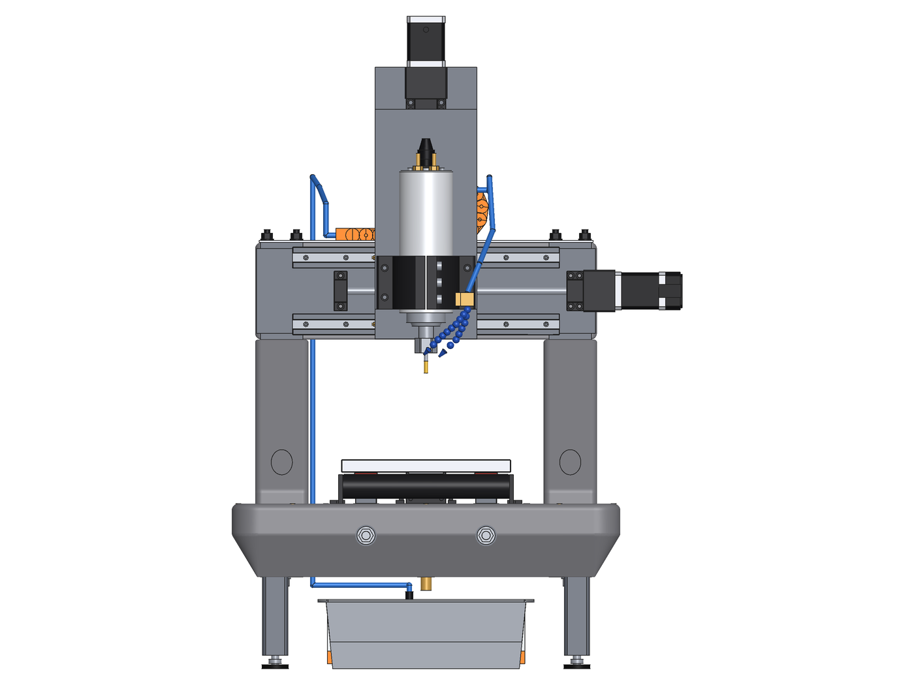
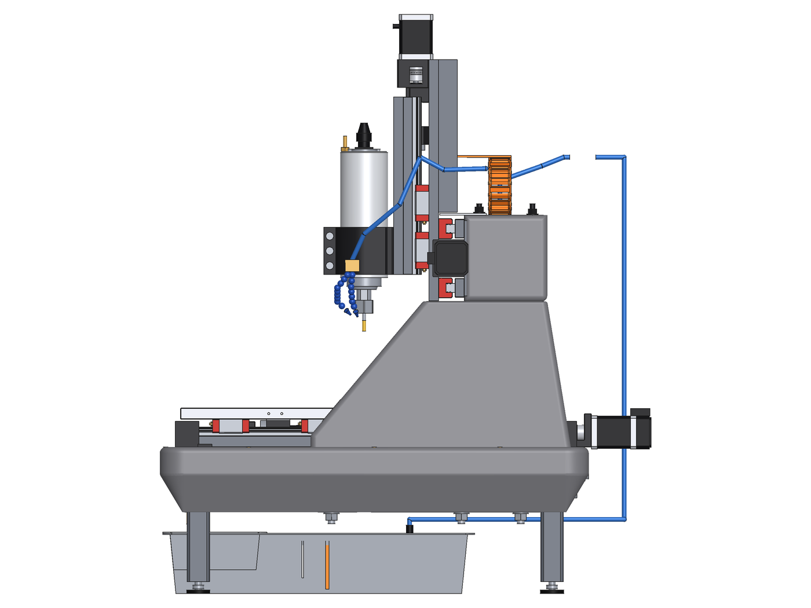
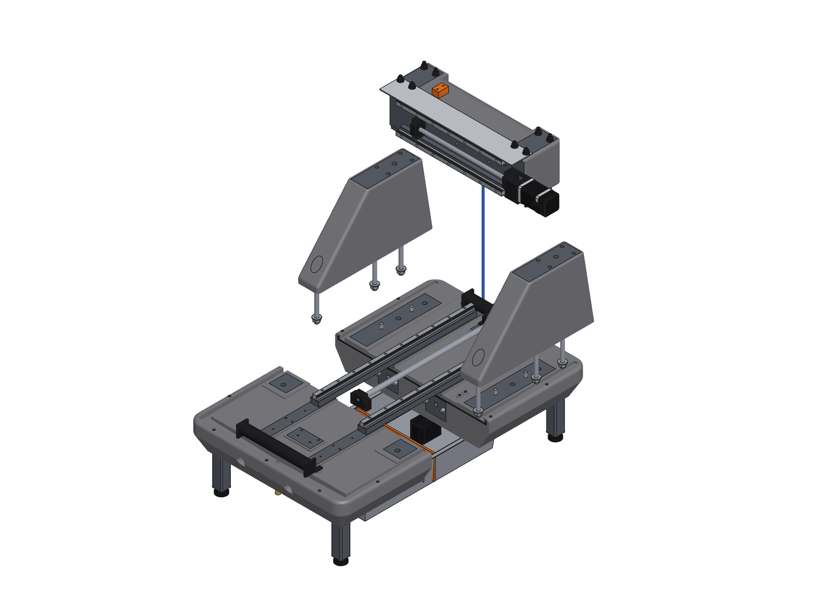
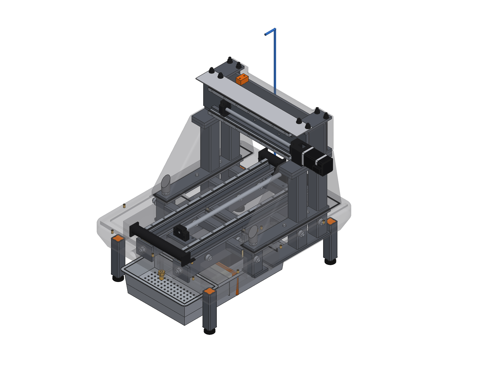
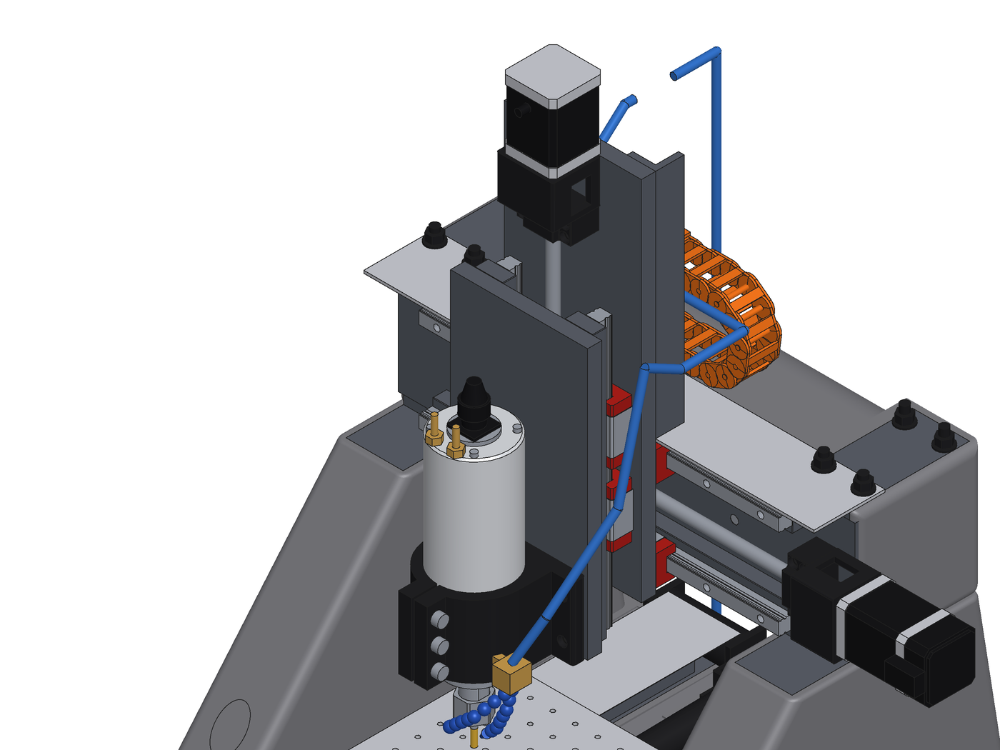
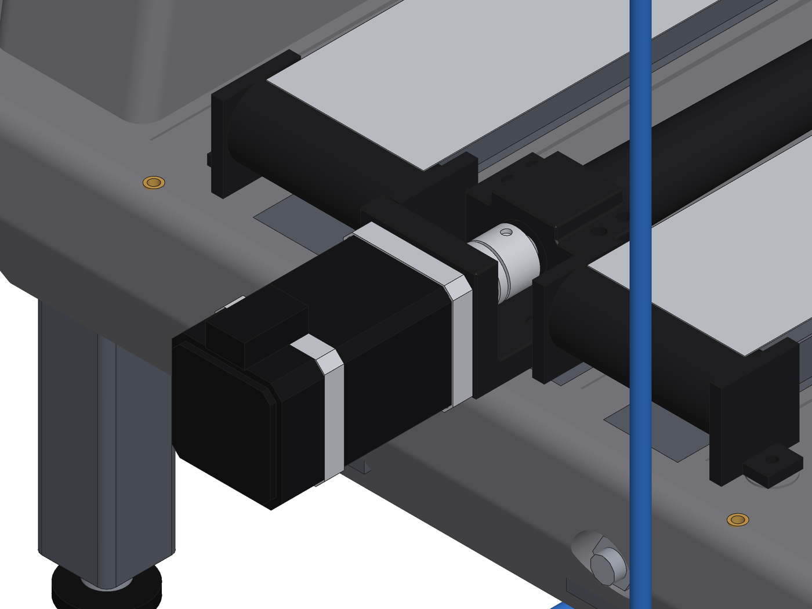
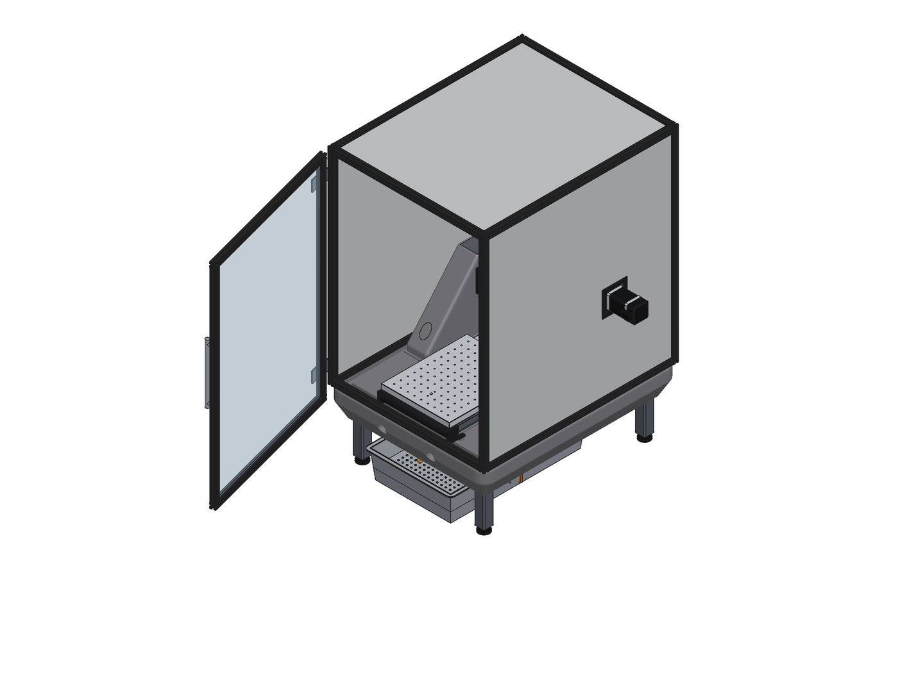
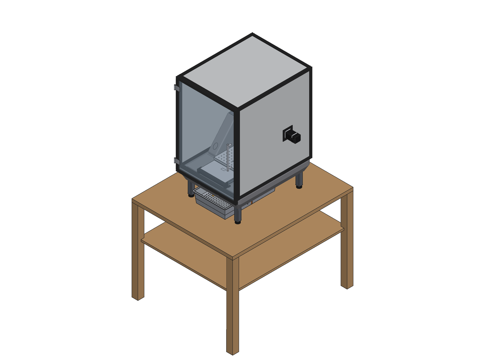

# DIY CNC: epoxy-granite desktop mill

A fixed-gantry desktop mill for cutting steel, sized like the Shariff DMC2 Mini:
180 x 300 x 140 mm travel, five bolt-together castings (steel skeletons of stock flat bar and tube, cast into epoxy granite), HGR15 rails,
ballscrews on all axes, a 2.2 kW water-cooled spindle, flood coolant and a full enclosure.
Everything is modeled from one Python script on [cad-rust-app](https://github.com/JonasMerrell/cad-rust-app)'s OpenCascade kernel.


The frame in the stiffness model: 1 kN at the tool in X, Y and Z, tool at the middle of X and the table
centered (about 98 / 153 / 131 N/um), and its four lowest vibration modes (148-370 Hz). The motion is exaggerated thousands of times.
With the moving parts in series (plates, rail blocks, ballscrews) the machine is about 3.8 / 3.8 / 6.8 N/um at the tool:
the frame has stiffness to spare, and the parts that bolt on are where later upgrades go (design notes).


## Views

| | |
|---|---|
|  Front |  Right side |
|  The five castings, pulled apart |  The steel skeletons inside |
|  The steel X carriage and Z plate, spindle |  The Y drive under the table |
|  The enclosure, door open |  Flood coolant and the sump |

The build guide has a picture for each step (`renders/build/`) and the mold guides theirs (`renders/mold/`).

## Documents

The documents are in `docs/`, one folder per stage of the build, in the order you use them (index:
[docs/README.md](docs/README.md)).

| Folder | What's in it |
|---|---|
| [1-sourcing](docs/1-sourcing) | [Sourcing list](docs/1-sourcing/sourcing.pdf): parts to buy, with listings and prices (also as [CSV](docs/1-sourcing/sourcing.csv)) |
| [2-printing](docs/2-printing) | [Print guide](docs/2-printing/print-guide.pdf): every 3D-printed part, settings and sliced filament use |
| [3-molds](docs/3-molds) | One guide per mold: [base](docs/3-molds/base-mold.pdf), [uprights](docs/3-molds/upright-molds.pdf), [beam](docs/3-molds/beam-mold.pdf); the [sheet layout](docs/src/boards/sheet-1.svg) for the boards; full-size [drilling templates](docs/3-molds/templates) to print and tape onto the boards |
| [4-build](docs/4-build) | The build guide in five stages for the bench (steel, casting, frame, axes and electronics, enclosure) |
| [5-design](docs/5-design) | [Design notes](docs/5-design/design-notes.pdf) (the frame, joints, stiffness study, cost) and the [report](docs/5-design/report.txt) (dimensions, masses, BOM, collision check) |

The Markdown sources are in `docs/src/`.

## Repository layout

| Folder | Contents |
|---|---|
| `model/` | `build_cnc.py` (the whole machine; every dimension is in `P` at the top), `parts.py` (components from catalog drawings), `molds.py` (printed mold pieces, their bolts, pins and pegs, and STL export), `moldbox.py` (the mold boards, brackets and hole maps), `mold_figures.py` (the mold guide's illustrations), `slice_prints.py` (slices `print/` in Bambu Studio for real filament figures), and the generated `DIYCNC.step` (rebuilt locally, not kept in the repo) |
| `print/` | STL files for every printed part, one folder per casting plus `machine/`, and `manifest.csv` |
| `renders/` | Images of the machine and its parts; `renders/build/` has the build-step pictures |
| `docs/` | The PDFs above, the report and the sourcing CSV; sources and generators in `docs/src/` |
| `analysis/` | Voxel finite-element model of the frame and the base topology optimization |

## Rebuilding

Everything runs in the `diycnc` conda env, with cad-rust-app's Python bindings built into it
(`environment.yml` says how). The model needs no FreeCAD and no window.

```sh
conda activate diycnc

# collision check, docs/5-design/report.txt, the print/ STLs and the Markdown in docs/src/ (about a minute)
python model/build_cnc.py

# everything above plus renders/, model/DIYCNC.step (named, colored parts in an assembly per container) and
# model/DIYCNC.json, the cad-rust-app document (neither kept in the repo). CNC_STEP=1 or CNC_DOC=1 writes
# just the STEP or the document
CNC_SNAPSHOTS=1 python model/build_cnc.py

# model/DIYCNC.html, the machine as an interactive page for a web browser (not kept in the repo)
python model/web_export.py

# the mold guide's illustrations (renders/mold/), and real filament figures from Bambu Studio
python model/mold_figures.py
python3 model/slice_prints.py

# the sourcing list, then the PDFs (needs Python with the markdown package and Google Chrome); it also makes
# molds-complete.pdf and build-guide.pdf, the combined guides, which are not kept in the repo
python3 docs/src/make_sourcing.py
python3 docs/src/make_pdfs.py
```

Open `model/DIYCNC.html` in a browser to see how the machine works. You can jog X, Y and Z within their
travel with the sliders, by dragging the table, carriage or spindle, or with the arrow keys, and the ball screws
turn as you do. The way covers, cable chain and coolant loop follow the axes, and the tool tip reads out its
position on the work in machine coordinates and traces its path. A demo program faces, pockets and drills a
block on the table. You can also ghost the castings to see the steel inside, cut a section, explode the frame
and click any part for its size and mass. The page loads three.js from a CDN, so it needs an internet
connection.

Open `model/DIYCNC.json` in cad-rust-app and drag the table, X carriage, Z axis, door or coolant sump in the
DIYCNC assembly to jog them: they ride on slider and revolute mates limited to their travel. Its exploded view
pulls the castings apart. Each container is a Part Studio and an assembly of its parts. The renders move the
same containers in `container_matrix` (`build_cnc.py`); the shot list in `snapshots` sets them per image.

The stiffness and vibration studies use numpy, scipy, matplotlib, scikit-sparse 0.5 or later, and pyvista for
the animations (`analysis/animate.py`). The damping studies (`analysis/damping.py`, `steel_opt.py`,
`topopt_damped.py`, `ring_check.py`) judge the frame by its resonant peaks at the tool, not only its static
stiffness: the steel sized from stock first, then the castings placed for damping, then each steel member checked
for ringing with cad-rust-app's tetrahedra. `analysis/chain.py` carries the stiffness on through the plates, rail blocks and
ballscrews to the tool (run `python analysis/chain_geom.py` first for their geometry). See the design notes.
