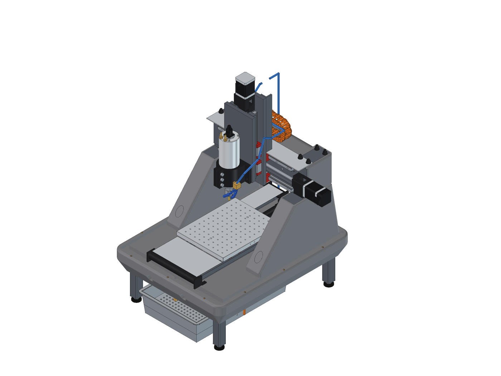

# DIY CNC: epoxy-granite desktop mill

A fixed-gantry desktop mill for cutting steel, sized like the Shariff DMC2 Mini:
180 x 300 x 140 mm travel, five bolt-together castings (steel skeletons of stock flat bar and tube, cast into epoxy granite), HGR15 rails,
ballscrews on all axes, a 2.2 kW water-cooled spindle, flood coolant and a full enclosure.
Everything is modeled in FreeCAD from one Python script.



The frame in the stiffness model: 1 kN at the tool in X, Y and Z, tool at the middle of X and the table
centered (about 108 / 164 / 148 N/um), and its four lowest vibration modes (145-376 Hz). The motion is exaggerated thousands of times.
With the moving parts in series (plates, rail blocks, ballscrews) the machine is about 3.8 / 3.8 / 6.9 N/um at the tool:
the frame has stiffness to spare, and the parts that bolt on are where later upgrades go (design notes).


## Documents

The documents are in `docs/`, one folder per stage of the build, in the order you use them (index:
[docs/README.md](docs/README.md)).

| Folder | What's in it |
|---|---|
| [1-sourcing](docs/1-sourcing) | [Sourcing list](docs/1-sourcing/sourcing.pdf): parts to buy, with listings and prices (also as [CSV](docs/1-sourcing/sourcing.csv)) |
| [2-printing](docs/2-printing) | [Print guide](docs/2-printing/print-guide.pdf): every 3D-printed part, settings and sliced filament use |
| [3-molds](docs/3-molds) | One guide per mold: [base](docs/3-molds/base-mold.pdf), [uprights](docs/3-molds/upright-molds.pdf), [beam](docs/3-molds/beam-mold.pdf); the [sheet layout](docs/src/boards/sheet-1.svg) for the boards; full-size [drilling templates](docs/3-molds/templates) to print and tape onto the boards |
| [4-build](docs/4-build) | The build guide in five stages for the bench (steel, casting, frame, axes and electronics, enclosure) |
| [5-design](docs/5-design) | [Design notes](docs/5-design/design-notes.pdf) (the frame, joints, stiffness study, cost) and the [report](docs/5-design/report.txt) (dimensions, masses, BOM, collision check) |

The Markdown sources are in `docs/src/`.

## Repository layout

| Folder | Contents |
|---|---|
| `model/` | `build_cnc.py` (the whole machine; every dimension is in `P` at the top), `parts.py` (components from catalog drawings), `molds.py` (printed mold pieces, their bolts, pins and pegs, and STL export), `moldbox.py` (the mold boards, brackets and hole maps), `mold_figures.py` (the mold guide's illustrations; run it in the FreeCAD GUI), `slice_prints.py` (slices `print/` in Bambu Studio for real filament figures), and the generated `DIYCNC.FCStd` and `DIYCNC.step` (rebuilt locally, not kept in the repo) |
| `print/` | STL files for every printed part, one folder per casting plus `machine/`, and `manifest.csv` |
| `renders/` | Images of the machine and its parts; `renders/build/` has the build-step pictures |
| `docs/` | The PDFs above, the report and the sourcing CSV; sources and generators in `docs/src/` |
| `analysis/` | Voxel finite-element model of the frame and the base topology optimization |

## Rebuilding

FreeCAD 1.1 is the only requirement for the model.

```sh
# collision check, docs/5-design/report.txt, the print/ STLs and the Markdown in docs/src/
/Applications/FreeCAD.app/Contents/Resources/bin/freecadcmd model/build_cnc.py

# everything above plus renders/ and model/DIYCNC.FCStd and DIYCNC.step (not kept in the repo; opens and closes a FreeCAD window)
CNC_SNAPSHOTS=1 /Applications/FreeCAD.app/Contents/MacOS/FreeCAD "$PWD/model/build_cnc.py"

# the mold guide's illustrations (renders/mold/), and real filament figures from Bambu Studio
/Applications/FreeCAD.app/Contents/MacOS/FreeCAD "$PWD/model/mold_figures.py"
python3 model/slice_prints.py

# the sourcing list, then the PDFs (needs Python with the markdown package and Google Chrome); it also makes
# molds-complete.pdf and build-guide.pdf, the combined guides, which are not kept in the repo
python3 docs/src/make_sourcing.py
python3 docs/src/make_pdfs.py
```

In the FreeCAD file, edit `posX`, `posY`, `posZ` and `doorAngle` in the `Params` sheet to jog the
axes and open the door, `explode` to pull the frame apart and `sumpOut` to slide the coolant sump
out. The printed mold pieces are in the hidden `Molds` group.

The stiffness and vibration studies run in the `diycnc` conda env (`conda env create -f environment.yml`,
then `conda activate diycnc`): numpy, scipy, matplotlib, scikit-sparse 0.5 or later, and pyvista for the animations
(`analysis/animate.py`). `analysis/chain.py` carries the stiffness on through the plates, rail blocks and
ballscrews to the tool (run `freecadcmd analysis/chain_geom.py` first for their geometry). See the design notes.
