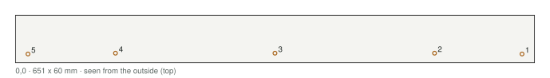
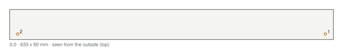

# Base mold

How to make the base mold. Drilling templates: `templates/base-templates.pdf`. The complete guide (all the molds and the
sheet layout for the boards) is `molds-complete.pdf`.

**In short:** melamine boards bolt together with printed brackets. Every printed piece bolts or pins to
its board from outside. The walls stand 25 mm above the pour line, so no bolt goes through a face the
mix touches. Nothing is glued, and it all comes apart for the next casting.

**Order of work:** print &rarr; cut the boards &rarr; mark them with the templates and drill &rarr; cut the foam &rarr; wax &rarr; assemble &rarr; pour &rarr; take apart.

## 1. How it works

- **Walls** stand on the floor against bolted-down **cleats**; **corner brackets** square the tops. All the
  bolts go through the top 25 mm, above the pour line.

- **Printed pieces** have a nut built in: it goes into a pocket on the board side and slides under the
  hole; an M4 bolt comes through the board from outside.

- **Thin pieces** (gasket-groove beads, motor relief) have 3 mm pins that push into 1/8 in holes.

- **Long pieces** are printed in parts that peg together; each part bolts down on its own.

- **Cores** are taped foam blocks with a printed post that bolts to a bridge across the mold.

- **Fits** are 0.15 mm a side, and drawn for 19.05 mm board (Home Depot's 3/4 in melamine is a true
  0.750 in). Measure yours; if it differs, set `mold_board` in `model/build_cnc.py` and re-run it.

## 2. What you need

| Material | Amount | Notes |
|---|---|---|
| Melamine board, 3/4 in | about 1.4 m2 | all the molds come out of 1 sheet, 4 x 8 ft |
| 1x2 lumber (furring strip is fine) | 2 x 8 ft 1x2 (2.7 m) | the cleats: they lie on the floor outside the walls |
| XPS foam board, 2 in | 1 sheet, 2 x 8 ft | the cores |
| PETG | 1.42 kg | sliced; everything printed for the machine fits in two 1 kg rolls |
| Packing tape, double-sided carpet tape | 1 roll each | wrapping and holding the foam |
| Paste wax and PVA | 1 each | release |
| 3/8 in quarter-round PVC molding | a few meters | the rounded outside edges |

| Hardware | Qty |
|---|---|
| M3 nut | 20 |
| M3 washer | 20 |
| M3 x 25 bolt | 20 |
| M4 nut | 117 |
| M4 washer | 113 |
| M4 x 20 bolt (leg pinch screw) | 4 |
| M4 x 30 bolt | 69 |
| M4 x 35 bolt | 28 |
| M4 x 45 bolt | 16 |
| M5 x 20 screw, greased (holds an insert) | 15 |
| M5 x 30 screw, greased (holds a rail bar or the BK pad) | 12 |
| M6 x 30 screw, greased (holds a support pad) | 6 |

Add about 10 % spare small bolts, nuts and washers. **Tools:** drill and brad-point bits (sizes in section 5), a 2-1/2 in hole saw, a square, clamps, a 7 mm nut driver, a 3 mm hex key, an awl, a fine saw or hot wire for the foam.

## 3. Print

75 prints, 1.42 kg, about 91 hours (sliced; settings in the print guide). Print one corner bracket and one saddle first
and check them on a board offcut. Press or slide the nuts in before the pieces go on the boards.

| File | Qty | g | Time each |
|---|---|---|---|
| `base-box/kit-corner-bracket.stl` | 4 | 33 | 39m 23s |
| `base-box/kit-partition-bracket.stl` | 2 | 14 | 35m 28s |
| `base-box/kit-saddle.stl` | 6 | 58 | 46m 3s |
| `base-box/kit-leg-holder.stl` | 4 | 166 | 2h 30m 55s |
| `base-rear/former-gutter-L-part1of3.stl` | 1 | 8 | 35m 5s |
| `base-rear/former-gutter-L-part2of3.stl` | 1 | 8 | 33m 40s |
| `base-rear/former-gutter-L-part3of3.stl` | 1 | 7 | 31m 15s |
| `base-rear/former-gutter-R-part1of3.stl` | 1 | 8 | 35m 6s |
| `base-rear/former-gutter-R-part2of3.stl` | 1 | 8 | 33m 40s |
| `base-rear/former-gutter-R-part3of3.stl` | 1 | 7 | 31m 15s |
| `base-rear/former-motor-relief.stl` | 1 | 12 | 40m 58s |
| `base-rear/filler-corner-L.stl` | 1 | 29 | 2h 10m 20s |
| `base-rear/filler-bevel-L-part1of2.stl` | 1 | 50 | 2h 39m 9s |
| `base-rear/filler-bevel-L-part2of2.stl` | 1 | 50 | 2h 39m 42s |
| `base-rear/filler-corner-R.stl` | 1 | 29 | 2h 11m 33s |
| `base-rear/filler-bevel-R-part1of2.stl` | 1 | 50 | 2h 34m 47s |
| `base-rear/filler-bevel-R-part2of2.stl` | 1 | 50 | 2h 35m 56s |
| `base-rear/filler-bevel-end-part1of3.stl` | 1 | 51 | 2h 41m 27s |
| `base-rear/filler-bevel-end-part2of3.stl` | 1 | 51 | 2h 41m 49s |
| `base-rear/filler-bevel-end-part3of3.stl` | 1 | 51 | 2h 41m 53s |
| `base-front/former-gutter-L-part1of2.stl` | 1 | 11 | 49m 23s |
| `base-front/former-gutter-L-part2of2.stl` | 1 | 10 | 43m 43s |
| `base-front/former-gutter-R-part1of2.stl` | 1 | 11 | 49m 24s |
| `base-front/former-gutter-R-part2of2.stl` | 1 | 10 | 43m 43s |
| `base-front/former-trough-part1of5.stl` | 1 | 20 | 1h 14m 18s |
| `base-front/former-trough-part2of5.stl` | 1 | 22 | 1h 23m 56s |
| `base-front/former-trough-part3of5.stl` | 1 | 25 | 1h 34m 0s |
| `base-front/former-trough-part4of5.stl` | 1 | 23 | 1h 24m 3s |
| `base-front/former-trough-part5of5.stl` | 1 | 21 | 1h 17m 36s |
| `base-front/filler-corner-L.stl` | 1 | 29 | 2h 10m 58s |
| `base-front/filler-bevel-L-part1of2.stl` | 1 | 46 | 2h 25m 12s |
| `base-front/filler-bevel-L-part2of2.stl` | 1 | 46 | 2h 25m 28s |
| `base-front/filler-corner-R.stl` | 1 | 29 | 2h 8m 16s |
| `base-front/filler-bevel-R-part1of2.stl` | 1 | 46 | 2h 21m 6s |
| `base-front/filler-bevel-R-part2of2.stl` | 1 | 46 | 2h 21m 44s |
| `base-front/filler-bevel-end-part1of3.stl` | 1 | 51 | 2h 37m 19s |
| `base-front/filler-bevel-end-part2of3.stl` | 1 | 51 | 2h 38m 46s |
| `base-front/filler-bevel-end-part3of3.stl` | 1 | 51 | 2h 38m 0s |
| `base-rear/former-split-gasket-groove-part1of4.stl` | 1 | 2 | 9m 50s |
| `base-rear/former-split-gasket-groove-part2of4.stl` | 1 | 1 | 8m 58s |
| `base-rear/former-split-gasket-groove-part3of4.stl` | 1 | 1 | 8m 58s |
| `base-rear/former-split-gasket-groove-part4of4.stl` | 1 | 2 | 9m 53s |
| `base-front/core-center-a-post.stl` | 1 | 5 | 44m 56s |
| `base-front/core-center-b-post.stl` | 1 | 5 | 44m 56s |
| `base-rear/core-center-post.stl` | 1 | 5 | 44m 56s |
| `base-front/core-outboard-L-post.stl` | 1 | 5 | 44m 53s |
| `base-rear/core-foot-b-L-post.stl` | 1 | 5 | 44m 53s |
| `base-rear/core-knee-L-post.stl` | 1 | 5 | 44m 53s |
| `base-front/core-outboard-R-post.stl` | 1 | 5 | 44m 53s |
| `base-rear/core-foot-b-R-post.stl` | 1 | 5 | 44m 53s |
| `base-rear/core-knee-R-post.stl` | 1 | 5 | 44m 53s |
| `base-front/plug-draw-pocket-L.stl` | 1 | 12 | 46m 16s |
| `base-front/plug-draw-pocket-R.stl` | 1 | 12 | 46m 16s |
| `base-rear/plug-draw-pocket-L.stl` | 1 | 5 | 21m 23s |
| `base-rear/plug-draw-pocket-R.stl` | 1 | 5 | 21m 23s |
| `tools/kit-pour-gauge.stl` | 2 | 9 | 24m 33s |
| `tools/kit-screed-shoe.stl` | 2 | 20 | 44m 42s |
| `base-front/cast-in-leg-front-l-plug.stl` | 2 | 8 | 24m 14s |
| `base-rear/cast-in-leg-rear-l-plug.stl` | 2 | 8 | 24m 14s |

## 4. Cut the boards

Have the store rip the strips; crosscut at home. Write each board's name on its outside face, and mark
the cast face (the melamine face the mix touches). The cleats are cut from 1x2 lumber, not the sheet;
the bridges and struts come out of the sheet's offcuts.

| Board | Qty | Size (mm) | Notes |
|---|---|---|---|
| Base floor | 1 | 718 x 843 | both halves are cast on it |
| Base front wall | 1 | 638 x 135 |  |
| Base rear wall | 1 | 638 x 135 |  |
| Base side wall, left | 1 | 724 x 135 |  |
| Base side wall, right | 1 | 724 x 135 |  |
| Base partition | 1 | 600 x 135 | rear half only; comes out before the front half |
| Base partition strut | 2 | 326 x 60 | offcut, stands on edge; holds the partition foot (rear half only) |
| Base cleat, front | 1 | 638 x 38 | 1x2 lumber; flat on the floor |
| Base cleat, rear | 1 | 638 x 38 | 1x2 lumber; flat on the floor |
| Base cleat, left | 1 | 724 x 38 | 1x2 lumber; flat on the floor |
| Base cleat, right | 1 | 724 x 38 | 1x2 lumber; flat on the floor |
| Base bridge y=-230 | 1 | 651 x 60 |  |
| Base bridge y=-130 | 1 | 651 x 60 |  |
| Base bridge y=-60 | 1 | 651 x 60 |  |
| Base bridge y=100 | 1 | 651 x 60 |  |
| Base bridge y=170 | 1 | 651 x 60 |  |
| Base bridge y=280 | 1 | 651 x 60 |  |
| Base leg bridge y=-280 | 1 | 420 x 60 |  |
| Base leg bridge y=318 | 1 | 420 x 60 |  |

## 5. Mark and drill

1. Print the drilling templates (`templates/base-templates.pdf`) at **actual size** and check the 100 mm square.
2. Tape each board's pages onto it: printed edges on the board's edges, grid lines lined up.
3. Awl through every crosshair. Pencil the dashed **pour line** on the walls.
4. Drill from the marked face, at the size the color legend gives. Pilot the big ones; the 63.5 mm
   holes are a 2-1/2 in hole saw.

The appendix has every board as a drawing and a table, if you would rather measure.

| Hole | Drill | For |
|---|---|---|
| 3.2 mm | 1/8 in | motor-relief, split-gasket-groove |
| 3.4 mm | 9/64 in | corner-L, corner-R, gutter-L, gutter-R |
| 4.5 mm | 11/64 in | bevel-L, bevel-R, bevel-end, cleat, core post, corner bracket, corner-L, corner-R, draw-pocket-L, draw-pocket-R, gutter-L, gutter-R, leg holder, saddle, trough |
| 5.5 mm | 7/32 in | M5 insert screw, M5 screw into the steel |
| 6.5 mm | 17/64 in | M6 screw into a pad |
| 9.6 mm | 25/64 in | 3/8 dowel, 3/8 dowel pin |

## 6. Cut the foam

Fine saw, hot wire or a long knife. Stack and glue two layers of 2 in foam for the 90 mm cores. Wrap
each piece smooth in packing tape. Cut a snug 12 mm square hole 30 mm deep for each core's post and
glue the post in.

| Casting | Piece | Qty | Size and how |
|---|---|---|---|
| base-front | center-a | 1 | XPS block 100 x 73 x 90 mm, outline as the pocket (chamfered corners); taped, with its printed post glued in. |
| base-front | center-b | 1 | XPS block 100 x 72 x 90 mm, outline as the pocket (chamfered corners); taped, with its printed post glued in. |
| base-rear | center | 1 | XPS block 88 x 190 x 90 mm, outline as the pocket (chamfered corners); taped, with its printed post glued in. |
| base-front | outboard-L | 1 | XPS block 102 x 148 x 90 mm, outline as the pocket (chamfered corners); taped, with its printed post glued in. |
| base-rear | foot-b-L | 1 | XPS block 39 x 99 x 90 mm, outline as the pocket (chamfered corners); taped, with its printed post glued in. |
| base-rear | knee-L | 1 | XPS block 50 x 140 x 40 mm, outline as the pocket (chamfered corners); taped, with its printed post glued in. |
| base-front | outboard-R | 1 | XPS block 102 x 148 x 90 mm, outline as the pocket (chamfered corners); taped, with its printed post glued in. |
| base-rear | foot-b-R | 1 | XPS block 39 x 99 x 90 mm, outline as the pocket (chamfered corners); taped, with its printed post glued in. |
| base-rear | knee-R | 1 | XPS block 50 x 140 x 40 mm, outline as the pocket (chamfered corners); taped, with its printed post glued in. |
## 7. Wax

- 3-5 coats of paste wax on every face the mix touches, boards and removable printed pieces, then PVA.
  Don't wax pieces that stay in (core posts, cast-in parts): scuff and degrease them.
- Glue quarter-round into the floor-to-wall corners that make outside edges; silicone fillets elsewhere.
- Grease every screw, bolt and rod that comes out of the casting.

## 8. Assemble

### Base, rear half (first)

Cast upside down, top face on the floor; shown the right way up. New parts in color. Bolt each half's steel grid together first (the build guide, section 1), then it goes in as one piece.

1. Floor on three battens. Bolt the cleats down.

2. Walls against the cleats; corner brackets at the top. Diagonals equal within 2 mm, then tighten.

3. Partition between the side walls: two brackets, two struts to the front wall. Beads on its pins.

4. Gutter formers, motor relief, corner fillers and the draw-rod pocket plugs on. Bevel strips on the side and rear walls, their 1-1/2 in face flush with the pour line.

5. The steel grid in, bolted up and upside down: its rail bars and the BK pad screwed to the floor (greased M5 and M6), its seats over the dowels, the split end plates against the partition with their dowel pins through it. Tape over the holes in the pedestals' bottom bars. Inserts; leg holders, legs set to height, pinch screws tight.

6. Pour the 20 mm skin. Foam cores on it between the steel, bridges into the saddles, each post bolted to its bridge. Fill to the pour line, packing the mix up under the bevel strips.

### Base, front half (against the rear half)

1. After the cure: bridges, partition and struts off. Pull the beads, tape the groove, and wax the rear half's split face, end plates and dowel pins.

2. Trough and gutter formers, corner fillers, bevel strips and pocket plugs on; the front grid in, its rail bars and BF pad screwed down and its split end plates onto the dowel pins; inserts and legs.

3. Skin, cores, bridges, fill (packed under the bevel strips). After the cure, take it apart and split the halves with wedges.

## 9. Pour

- Fill to the **pour line**, 25 mm below the wall tops (pencilled from the templates, or with the
  printed pour-line gauge clipped over a wall).
- Vibrate each layer until it stops bubbling; check the brackets halfway through.
- Strike the top off with a straight board in the two printed **screed shoes**: they hang it from the wall
  tops with its bottom edge on the pour line.

## 10. Take apart

1. After the full cure: bridges and saddles off, then corner brackets, then cleats; pull the walls off.
2. Screws, bolts and rods out from outside; lift the casting off the floor.
3. Unbolt and pull the formers and fillers.
4. Scrape and re-wax the boards; keep each mold's kit in a box. The kit is reused.

## 11. If something doesn't fit

| Problem | Fix |
|---|---|
| Nut won't slide under the hole | Clean the pocket with a nut on a bolt; warm the nut |
| Bracket or saddle loose on the board | Board thinner than set: tape shim, or set `mold_board` and reprint |
| Pin won't go in | Run the 1/8 in bit through again; trim the pin tip |
| Foam core moves | Tighten its post bolt; carpet tape under it |
| Printed part won't go on or into a steel tube | File the weld seam; sand the part. Several tight: caliper the tube, put its sizes in `frame_tube` / `post_tube`, re-run and reprint |
| Printed part loose on a tube | A wrap of tape round the part |
| Leak at a corner | Silicone fillet inside before waxing; check the brackets and diagonals |
| Former stuck after curing | Bolts out first, then a dowel and a light tap |

## Appendix: hole maps

Every board as seen from the face you mark: x from the left edge, y from the bottom edge (for a wall, the
edge on the floor). The templates carry the same holes at full size.

#### Base floor

| # | x | y | Hole | For |
|---|---|---|---|---|
| 1 | 80 | 21 | 4.5 | cleat |
| 2 | 266 | 21 | 4.5 | cleat |
| 3 | 452 | 21 | 4.5 | cleat |
| 4 | 638 | 21 | 4.5 | cleat |
| 5 | 71 | 64 | 3.4 | corner-R |
| 6 | 647 | 64 | 3.4 | corner-L |
| 7 | 159 | 69 | 5.5 | M5 insert screw |
| 8 | 359 | 69 | 5.5 | M5 insert screw |
| 9 | 559 | 69 | 5.5 | M5 insert screw |
| 10 | 107 | 89 | 4.5 | trough |
| 11 | 275 | 89 | 4.5 | trough |
| 12 | 387 | 89 | 4.5 | trough |
| 13 | 499 | 89 | 4.5 | trough |
| 14 | 611 | 89 | 4.5 | trough |
| 15 | 21 | 99 | 4.5 | cleat |
| 16 | 697 | 99 | 4.5 | cleat |
| 17 | 163 | 104 | 4.5 | trough |
| 18 | 219 | 104 | 4.5 | trough |
| 19 | 331 | 104 | 4.5 | trough |
| 20 | 443 | 104 | 4.5 | trough |
| 21 | 555 | 104 | 4.5 | trough |
| 22 | 231 | 135 | 5.5 | M5 insert screw |
| 23 | 487 | 135 | 5.5 | M5 insert screw |
| 24 | 87 | 150 | 4.5 | gutter-R |
| 25 | 632 | 150 | 4.5 | gutter-L |
| 26 | 269 | 184 | 5.5 | M5 screw into the steel |
| 27 | 449 | 184 | 5.5 | M5 screw into the steel |
| 28 | 69 | 209 | 5.5 | M5 insert screw |
| 29 | 336 | 210 | 6.5 | M6 screw into a pad |
| 30 | 382 | 210 | 6.5 | M6 screw into a pad |
| 31 | 649 | 209 | 5.5 | M5 insert screw |
| 32 | 87 | 223 | 4.5 | gutter-R |
| 33 | 632 | 223 | 4.5 | gutter-L |
| 34 | 87 | 295 | 3.4 | gutter-R |
| 35 | 632 | 295 | 3.4 | gutter-L |
| 36 | 269 | 304 | 5.5 | M5 screw into the steel |
| 37 | 449 | 304 | 5.5 | M5 screw into the steel |
| 38 | 21 | 314 | 4.5 | cleat |
| 39 | 697 | 314 | 4.5 | cleat |
| 40 | 87 | 368 | 3.4 | gutter-R |
| 41 | 632 | 368 | 3.4 | gutter-L |
| 42 | 69 | 421 | 5.5 | M5 insert screw |
| 43 | 649 | 421 | 5.5 | M5 insert screw |
| 44 | 269 | 424 | 5.5 | M5 screw into the steel |
| 45 | 449 | 424 | 5.5 | M5 screw into the steel |
| 46 | 87 | 434 | 3.4 | gutter-R |
| 47 | 632 | 434 | 3.4 | gutter-L |
| 48 | 87 | 494 | 3.4 | gutter-R |
| 49 | 632 | 494 | 3.4 | gutter-L |
| 50 | 134 | 504 | 9.6 | 3/8 dowel |
| 51 | 584 | 504 | 9.6 | 3/8 dowel |
| 52 | 21 | 529 | 4.5 | cleat |
| 53 | 697 | 529 | 4.5 | cleat |
| 54 | 269 | 544 | 5.5 | M5 screw into the steel |
| 55 | 449 | 544 | 5.5 | M5 screw into the steel |
| 56 | 87 | 554 | 3.4 | gutter-R |
| 57 | 632 | 554 | 3.4 | gutter-L |
| 58 | 87 | 614 | 3.4 | gutter-R |
| 59 | 632 | 614 | 3.4 | gutter-L |
| 60 | 134 | 619 | 9.6 | 3/8 dowel |
| 61 | 584 | 619 | 9.6 | 3/8 dowel |
| 62 | 69 | 634 | 5.5 | M5 insert screw |
| 63 | 649 | 634 | 5.5 | M5 insert screw |
| 64 | 269 | 664 | 5.5 | M5 screw into the steel |
| 65 | 449 | 664 | 5.5 | M5 screw into the steel |
| 66 | 87 | 674 | 3.4 | gutter-R |
| 67 | 632 | 674 | 3.4 | gutter-L |
| 68 | 336 | 705 | 6.5 | M6 screw into a pad |
| 69 | 382 | 705 | 6.5 | M6 screw into a pad |
| 70 | 320 | 712 | 5.5 | M5 screw into the steel |
| 71 | 398 | 712 | 5.5 | M5 screw into the steel |
| 72 | 336 | 718 | 6.5 | M6 screw into a pad |
| 73 | 382 | 718 | 6.5 | M6 screw into a pad |
| 74 | 87 | 734 | 3.4 | gutter-R |
| 75 | 343 | 737 | 3.2 | motor-relief |
| 76 | 632 | 734 | 3.4 | gutter-L |
| 77 | 21 | 744 | 4.5 | cleat |
| 78 | 222 | 743 | 5.5 | M5 insert screw |
| 79 | 496 | 743 | 5.5 | M5 insert screw |
| 80 | 697 | 744 | 4.5 | cleat |
| 81 | 64 | 772 | 3.4 | corner-R |
| 82 | 375 | 770 | 3.2 | motor-relief |
| 83 | 654 | 772 | 3.4 | corner-L |
| 84 | 209 | 774 | 5.5 | M5 insert screw |
| 85 | 509 | 774 | 5.5 | M5 insert screw |
| 86 | 80 | 822 | 4.5 | cleat |
| 87 | 266 | 822 | 4.5 | cleat |
| 88 | 452 | 822 | 4.5 | cleat |
| 89 | 638 | 822 | 4.5 | cleat |

#### Base front wall

| # | x | y | Hole | For |
|---|---|---|---|---|
| 1 | 229 | 39 | 4.5 | draw-pocket-L |
| 2 | 409 | 39 | 4.5 | draw-pocket-R |
| 3 | 34 | 57 | 4.5 | corner-L |
| 4 | 604 | 57 | 4.5 | corner-R |
| 5 | 149 | 78 | 4.5 | bevel-end |
| 6 | 319 | 78 | 4.5 | bevel-end |
| 7 | 489 | 78 | 4.5 | bevel-end |
| 8 | 33 | 124 | 4.5 | corner bracket |
| 9 | 605 | 124 | 4.5 | corner bracket |
| 10 | 84 | 129 | 4.5 | leg holder |
| 11 | 554 | 129 | 4.5 | leg holder |

#### Base rear wall

| # | x | y | Hole | For |
|---|---|---|---|---|
| 1 | 229 | 39 | 4.5 | draw-pocket-R |
| 2 | 409 | 39 | 4.5 | draw-pocket-L |
| 3 | 34 | 57 | 4.5 | corner-R |
| 4 | 604 | 57 | 4.5 | corner-L |
| 5 | 149 | 78 | 4.5 | bevel-end |
| 6 | 319 | 78 | 4.5 | bevel-end |
| 7 | 489 | 78 | 4.5 | bevel-end |
| 8 | 33 | 124 | 4.5 | corner bracket |
| 9 | 605 | 124 | 4.5 | corner bracket |
| 10 | 84 | 129 | 4.5 | leg holder |
| 11 | 554 | 129 | 4.5 | leg holder |

#### Base side wall, left

| # | x | y | Hole | For |
|---|---|---|---|---|
| 1 | 15 | 57 | 4.5 | corner-L |
| 2 | 709 | 57 | 4.5 | corner-L |
| 3 | 129 | 78 | 4.5 | bevel-L |
| 4 | 296 | 78 | 4.5 | bevel-L |
| 5 | 454 | 78 | 4.5 | bevel-L |
| 6 | 604 | 78 | 4.5 | bevel-L |
| 7 | 14 | 124 | 4.5 | corner bracket |
| 8 | 100 | 123 | 4.5 | saddle |
| 9 | 210 | 123 | 4.5 | saddle |
| 10 | 280 | 123 | 4.5 | saddle |
| 11 | 419 | 124 | 4.5 | corner bracket |
| 12 | 440 | 123 | 4.5 | saddle |
| 13 | 510 | 123 | 4.5 | saddle |
| 14 | 610 | 123 | 4.5 | saddle |
| 15 | 711 | 124 | 4.5 | corner bracket |
| 16 | 62 | 129 | 4.5 | leg holder |
| 17 | 660 | 129 | 4.5 | leg holder |

#### Base side wall, right

| # | x | y | Hole | For |
|---|---|---|---|---|
| 1 | 15 | 57 | 4.5 | corner-R |
| 2 | 709 | 57 | 4.5 | corner-R |
| 3 | 120 | 78 | 4.5 | bevel-R |
| 4 | 270 | 78 | 4.5 | bevel-R |
| 5 | 429 | 78 | 4.5 | bevel-R |
| 6 | 596 | 78 | 4.5 | bevel-R |
| 7 | 14 | 124 | 4.5 | corner bracket |
| 8 | 115 | 123 | 4.5 | saddle |
| 9 | 215 | 123 | 4.5 | saddle |
| 10 | 285 | 123 | 4.5 | saddle |
| 11 | 306 | 124 | 4.5 | corner bracket |
| 12 | 445 | 123 | 4.5 | saddle |
| 13 | 515 | 123 | 4.5 | saddle |
| 14 | 625 | 123 | 4.5 | saddle |
| 15 | 711 | 124 | 4.5 | corner bracket |
| 16 | 65 | 129 | 4.5 | leg holder |
| 17 | 662 | 129 | 4.5 | leg holder |

#### Base partition

| # | x | y | Hole | For |
|---|---|---|---|---|
| 1 | 46 | 18 | 3.2 | split-gasket-groove |
| 2 | 119 | 18 | 3.2 | split-gasket-groove |
| 3 | 191 | 18 | 3.2 | split-gasket-groove |
| 4 | 264 | 18 | 3.2 | split-gasket-groove |
| 5 | 336 | 18 | 3.2 | split-gasket-groove |
| 6 | 409 | 18 | 3.2 | split-gasket-groove |
| 7 | 481 | 18 | 3.2 | split-gasket-groove |
| 8 | 554 | 18 | 3.2 | split-gasket-groove |
| 9 | 178 | 48 | 9.6 | 3/8 dowel pin (split) |
| 10 | 242 | 48 | 9.6 | 3/8 dowel pin (split) |
| 11 | 358 | 48 | 9.6 | 3/8 dowel pin (split) |
| 12 | 422 | 48 | 9.6 | 3/8 dowel pin (split) |
| 13 | 20 | 124 | 4.5 | corner bracket |
| 14 | 580 | 124 | 4.5 | corner bracket |

#### Base cleat, front

| # | x | y | Hole | For |
|---|---|---|---|---|
| 1 | 598 | 19 | 4.5 | cleat |
| 2 | 412 | 19 | 4.5 | cleat |
| 3 | 226 | 19 | 4.5 | cleat |
| 4 | 40 | 19 | 4.5 | cleat |

#### Base cleat, rear

| # | x | y | Hole | For |
|---|---|---|---|---|
| 1 | 598 | 19 | 4.5 | cleat |
| 2 | 412 | 19 | 4.5 | cleat |
| 3 | 226 | 19 | 4.5 | cleat |
| 4 | 40 | 19 | 4.5 | cleat |

#### Base cleat, left

| # | x | y | Hole | For |
|---|---|---|---|---|
| 1 | 684 | 19 | 4.5 | cleat |
| 2 | 470 | 19 | 4.5 | cleat |
| 3 | 255 | 19 | 4.5 | cleat |
| 4 | 40 | 19 | 4.5 | cleat |

#### Base cleat, right

| # | x | y | Hole | For |
|---|---|---|---|---|
| 1 | 684 | 19 | 4.5 | cleat |
| 2 | 470 | 19 | 4.5 | cleat |
| 3 | 255 | 19 | 4.5 | cleat |
| 4 | 40 | 19 | 4.5 | cleat |

#### Base bridge y=-230

| # | x | y | Hole | For |
|---|---|---|---|---|
| 1 | 635 | 11 | 4.5 | saddle |
| 2 | 325 | 12 | 4.5 | core post |
| 3 | 16 | 11 | 4.5 | saddle |

#### Base bridge y=-130

| # | x | y | Hole | For |
|---|---|---|---|---|
| 1 | 635 | 11 | 4.5 | saddle |
| 2 | 516 | 12 | 4.5 | core post |
| 3 | 325 | 12 | 4.5 | core post |
| 4 | 134 | 12 | 4.5 | core post |
| 5 | 16 | 11 | 4.5 | saddle |

#### Base bridge y=-60

| # | x | y | Hole | For |
|---|---|---|---|---|
| 1 | 635 | 11 | 4.5 | saddle |
| 2 | 16 | 11 | 4.5 | saddle |

#### Base bridge y=100

| # | x | y | Hole | For |
|---|---|---|---|---|
| 1 | 635 | 11 | 4.5 | saddle |
| 2 | 481 | 12 | 4.5 | core post |
| 3 | 170 | 12 | 4.5 | core post |
| 4 | 16 | 11 | 4.5 | saddle |

#### Base bridge y=170

| # | x | y | Hole | For |
|---|---|---|---|---|
| 1 | 635 | 11 | 4.5 | saddle |
| 2 | 480 | 12 | 4.5 | core post |
| 3 | 325 | 12 | 4.5 | core post |
| 4 | 170 | 12 | 4.5 | core post |
| 5 | 16 | 11 | 4.5 | saddle |

#### Base bridge y=280

| # | x | y | Hole | For |
|---|---|---|---|---|
| 1 | 635 | 11 | 4.5 | saddle |
| 2 | 16 | 11 | 4.5 | saddle |

#### Base leg bridge y=-280

| # | x | y | Hole | For |
|---|---|---|---|---|
| 1 | 414 | 11 | 4.5 | leg holder |
| 2 | 6 | 11 | 4.5 | leg holder |

#### Base leg bridge y=318

| # | x | y | Hole | For |
|---|---|---|---|---|
| 1 | 414 | 11 | 4.5 | leg holder |
| 2 | 6 | 11 | 4.5 | leg holder |
