# Beam mold

How to make the beam mold. Drilling templates: `templates/beam-templates.pdf`. The complete guide (all the molds and the
sheet layout for the boards) is `molds-complete.pdf`.

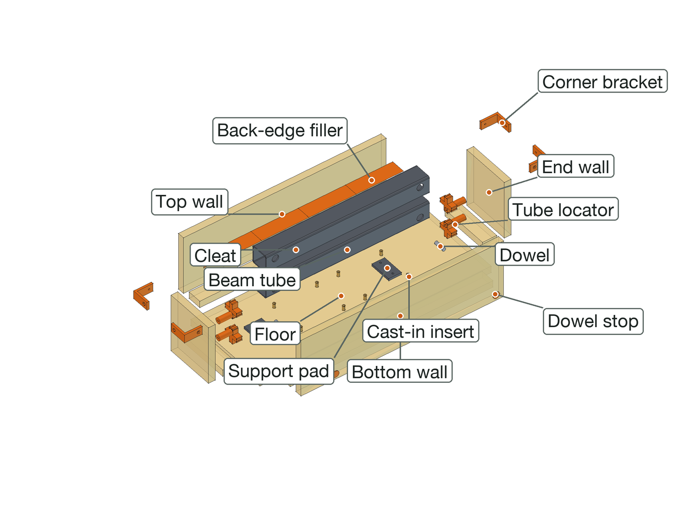

**In short:** melamine boards bolt together with printed brackets. Every printed piece bolts or pins to
its board from outside. The walls stand 25 mm above the pour line, so no bolt goes through a face the
mix touches. Nothing is glued, and it all comes apart for the next casting.

**Order of work:** print &rarr; cut the boards &rarr; mark them with the templates and drill &rarr; wax &rarr; assemble &rarr; pour &rarr; take apart.

## 1. How it works

- **Walls** stand on the floor against bolted-down **cleats**; **corner brackets** square the tops. All the
  bolts go through the top 25 mm, above the pour line.

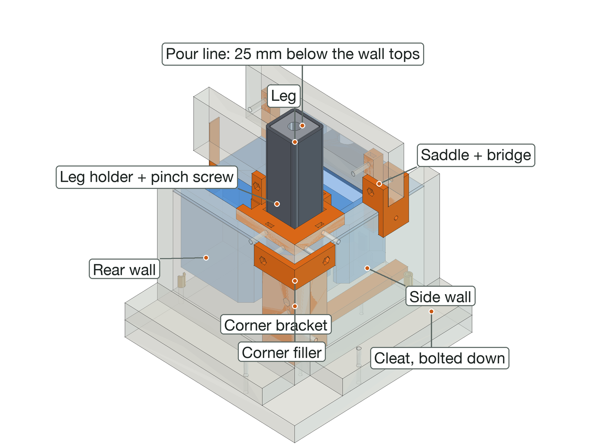

- **Printed pieces** have a nut built in: it goes into a pocket on the board side and slides under the
  hole; an M4 bolt comes through the board from outside.

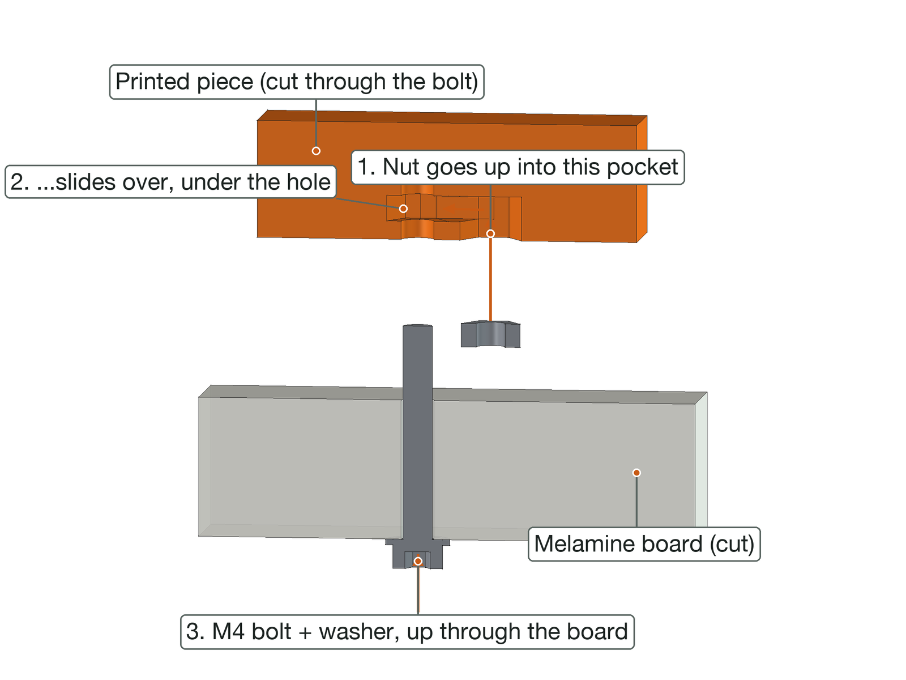

- **Thin pieces** (gasket-groove beads, motor relief) have 3 mm pins that push into 1/8 in holes.

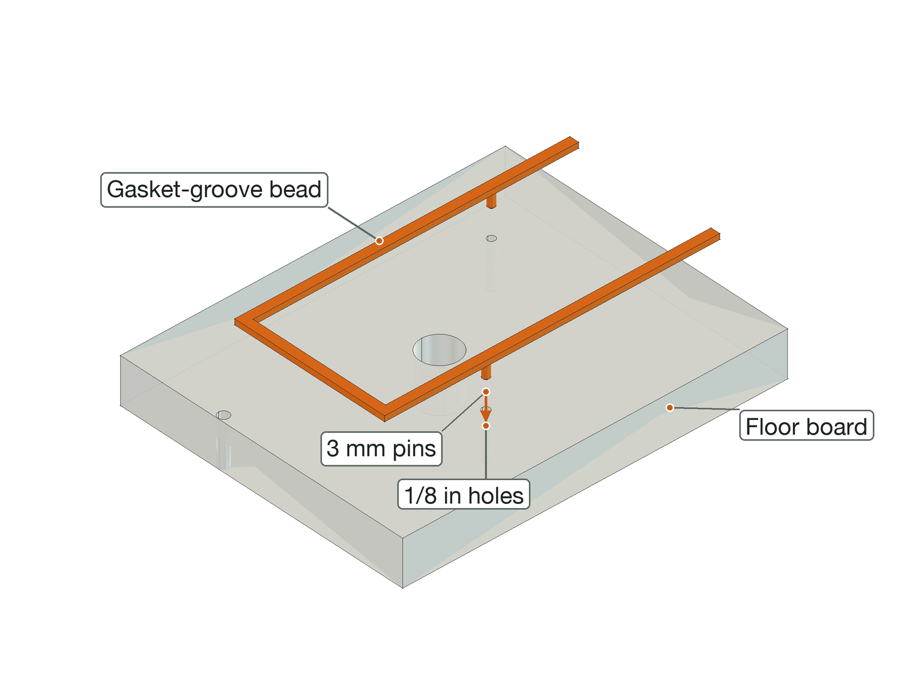

- **Long pieces** are printed in parts that peg together; each part bolts down on its own.

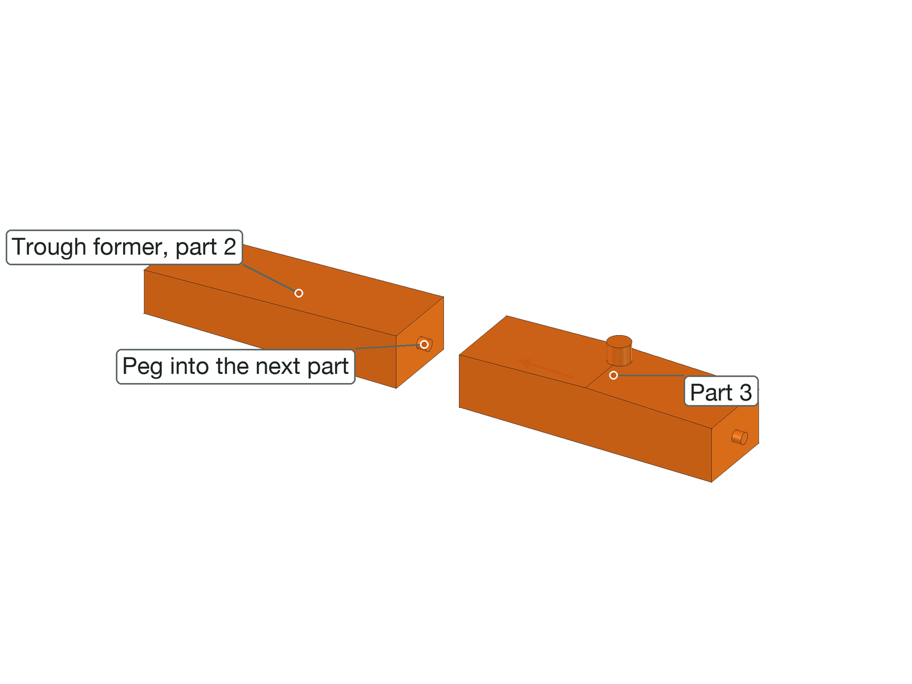

- **Fits** are 0.15 mm a side, and drawn for 19.05 mm board (Home Depot's 3/4 in melamine is a true
  0.750 in). Measure yours; if it differs, set `mold_board` in `model/build_cnc.py` and re-run it.

## 2. What you need

| Material | Amount | Notes |
|---|---|---|
| Melamine board, 3/4 in | about 0.5 m2 | all the molds come out of two 4 x 8 ft sheets |
| PETG | 0.18 kg | sliced; everything printed for the machine fits in two 1 kg rolls |
| Paste wax and PVA | 1 each | release |
| 3/8 in quarter-round PVC molding | a few meters | the rounded outside edges |

| Hardware | Qty |
|---|---|
| M4 nut | 26 |
| M4 washer | 26 |
| M4 x 30 bolt | 12 |
| M4 x 45 bolt | 10 |
| M4 x 70 bolt | 4 |
| M5 x 20 screw, greased (holds an insert) | 8 |
| M6 x 20 screw, greased (holds a pad) | 6 |
| 1/2 in plain steel rod, greased (forms a beam bolt hole), 198 mm | 8 |

Add about 10 % spare small bolts, nuts and washers. **Tools:** drill and brad-point bits (sizes in section 5), a square, clamps, a 7 mm nut driver, a 3 mm hex key, an awl.

## 3. Print

18 prints, 0.18 kg, about 14 hours (sliced; settings in the print guide). Print one corner bracket and one saddle first
and check them on a board offcut. Press or slide the nuts in before the pieces go on the boards.

| File | Qty | g | Time each |
|---|---|---|---|
| `beam/kit-corner-bracket.stl` | 4 | 33 | 40m 3s |
| `beam/filler-back-edge-part1of4.stl` | 1 | 19 | 1h 14m 46s |
| `beam/filler-back-edge-part2of4.stl` | 1 | 19 | 1h 14m 46s |
| `beam/filler-back-edge-part3of4.stl` | 1 | 19 | 1h 14m 46s |
| `beam/filler-back-edge-part4of4.stl` | 1 | 19 | 1h 15m 1s |
| `beam/kit-tube-locator.stl` | 4 | 43 | 58m 26s |
| `beam/kit-dowel-stop.stl` | 2 | 1 | 4m 19s |
| `tools/kit-pour-gauge.stl` | 2 | 9 | 24m 33s |
| `tools/kit-screed-shoe.stl` | 2 | 20 | 44m 42s |

## 4. Cut the boards

Have the store rip the strips; crosscut at home. Write each board's name on its outside face, and mark
the cast face (the melamine face the mix touches).

| Board | Qty | Size (mm) | Notes |
|---|---|---|---|
| Beam floor | 1 | 648 x 258 |  |
| Beam top wall | 1 | 568 x 165 |  |
| Beam bottom wall | 1 | 568 x 165 |  |
| Beam end wall, left | 1 | 140 x 165 |  |
| Beam end wall, right | 1 | 140 x 165 |  |
| Beam cleat, top | 1 | 568 x 40 | offcut strip, flat on the floor |
| Beam cleat, bottom | 1 | 568 x 40 | offcut strip, flat on the floor |
| Beam cleat, left | 1 | 140 x 40 | offcut strip, flat on the floor |
| Beam cleat, right | 1 | 140 x 40 | offcut strip, flat on the floor |

## 5. Mark and drill

1. Print the drilling templates (`templates/beam-templates.pdf`) at **actual size** and check the 100 mm square.
2. Tape each board's pages onto it: printed edges on the board's edges, grid lines lined up.
3. Awl through every crosshair. Pencil the dashed **pour line** on the walls.
4. Drill from the marked face, at the size the color legend gives. Pilot the big ones; the 63.5 mm
   holes are a 2-1/2 in hole saw.

The appendix has every board as a drawing and a table, if you would rather measure.

| Hole | Drill | For |
|---|---|---|
| 4.5 mm | 11/64 in | back-edge, cleat, corner bracket, tube locator |
| 5.5 mm | 7/32 in | M5 insert screw |
| 6.5 mm | 17/64 in | M6 insert screw |
| 9.6 mm | 25/64 in | 3/8 dowel |
| 13.1 mm | 33/64 in | 1/2 core rod |

## 6. Wax

- 3-5 coats of paste wax on every face the mix touches, boards and removable printed pieces, then PVA.
  Don't wax pieces that stay in (core posts, cast-in parts): scuff and degrease them.
- Glue quarter-round into the floor-to-wall corners that make outside edges; silicone fillets elsewhere.
- Grease every screw, bolt and rod that comes out of the casting.

## 7. Assemble

### Beam

Cast front (rail) face down, back open.

1. Cleats bolted down; support pads and riser inserts screwed to the floor.

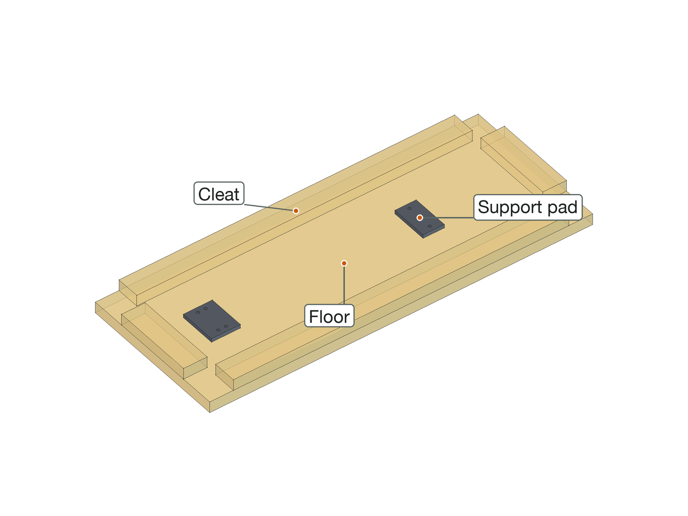

2. Walls against the cleats; four corner brackets.

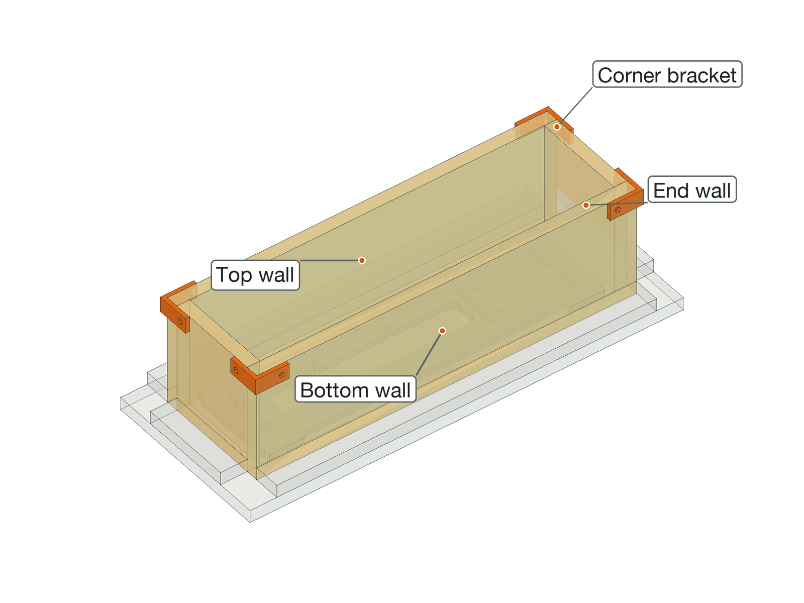

3. Tube locators bolted through the end walls. Butter the support pads with thickened epoxy (about 3 mm), then the tubes between the locators, holes over the rod holes; back-edge filler on the top wall; dowels on their stops; greased 1/2 in rods through both walls and the tubes. Fill to the line.

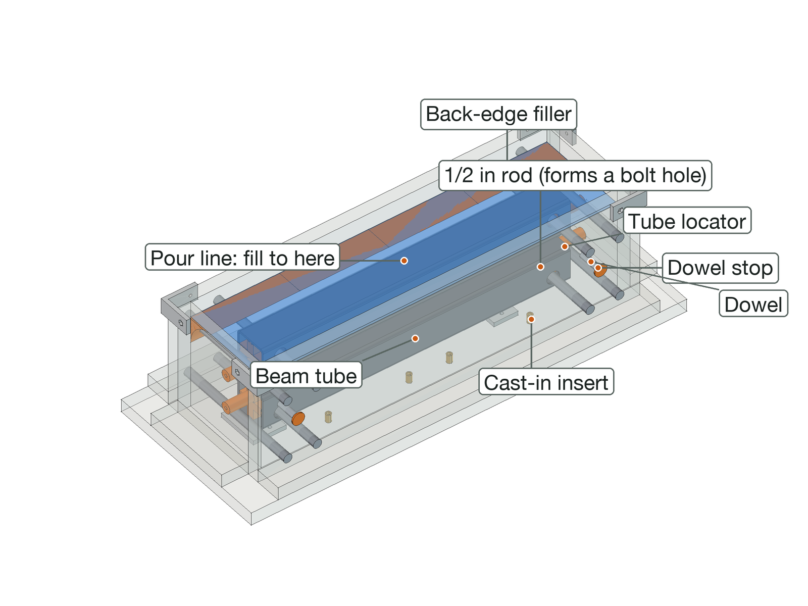

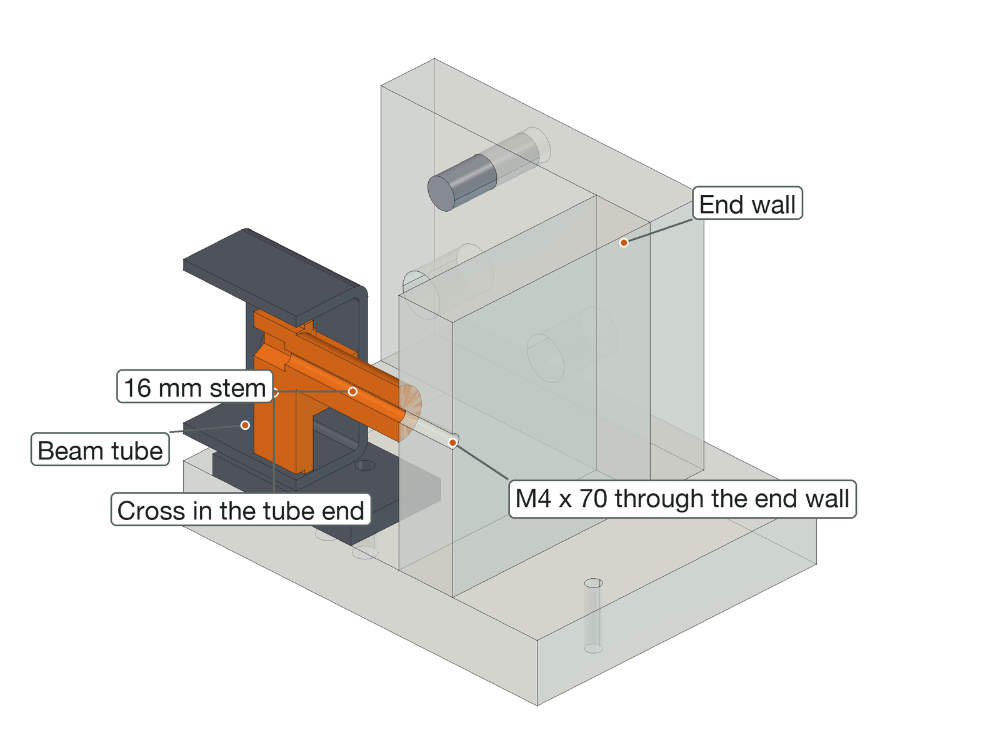

## 8. Pour

- Fill to the **pour line**, 25 mm below the wall tops (pencilled from the templates, or with the
  printed pour-line gauge clipped over a wall).
- Vibrate each layer until it stops bubbling; check the brackets halfway through.
- Strike the top off with a straight board in the two printed **screed shoes**: they hang it from the wall
  tops with its bottom edge on the pour line.

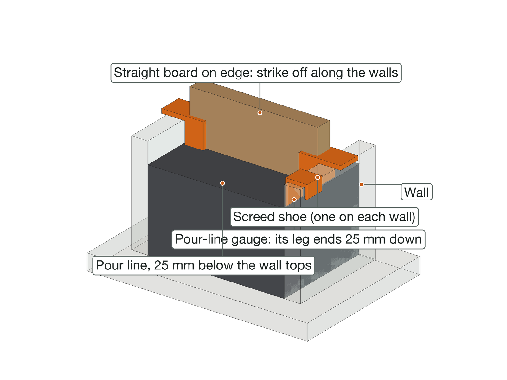

## 9. Take apart

1. After the full cure: bridges and saddles off, then corner brackets, then cleats; pull the walls off.
2. Screws, bolts and rods out from outside; lift the casting off the floor.
3. Unbolt and pull the formers and fillers.
4. Scrape and re-wax the boards; keep each mold's kit in a box. The kit is reused.

## 10. If something doesn't fit

| Problem | Fix |
|---|---|
| Nut won't slide under the hole | Clean the pocket with a nut on a bolt; warm the nut |
| Bracket or saddle loose on the board | Board thinner than set: tape shim, or set `mold_board` and reprint |
| Pin won't go in | Run the 1/8 in bit through again; trim the pin tip |
| Foam core moves | Tighten its post bolt; carpet tape under it |
| Printed part won't go on or into a steel tube | File the weld seam; sand the part. Several tight: caliper the tube, put its sizes in `frame_tube` / `post_tube`, re-run and reprint |
| Printed part loose on a tube | A wrap of tape round the part |
| Leak at a corner | Silicone fillet inside before waxing; check the brackets and diagonals |
| Former stuck after curing | Bolts out first, then a dowel and a light tap |

## Appendix: hole maps

Every board as seen from the face you mark: x from the left edge, y from the bottom edge (for a wall, the
edge on the floor). The templates carry the same holes at full size.

#### Beam floor

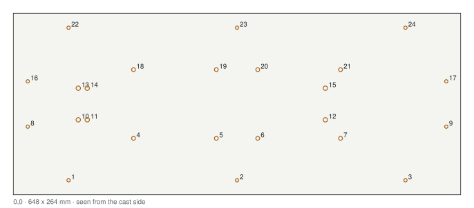

| # | x | y | Hole | For |
|---|---|---|---|---|
| 1 | 80 | 20 | 4.5 | cleat |
| 2 | 324 | 20 | 4.5 | cleat |
| 3 | 568 | 20 | 4.5 | cleat |
| 4 | 174 | 79 | 5.5 | M5 insert screw |
| 5 | 294 | 79 | 5.5 | M5 insert screw |
| 6 | 354 | 79 | 5.5 | M5 insert screw |
| 7 | 474 | 79 | 5.5 | M5 insert screw |
| 8 | 20 | 99 | 4.5 | cleat |
| 9 | 628 | 99 | 4.5 | cleat |
| 10 | 94 | 106 | 6.5 | M6 insert screw |
| 11 | 107 | 106 | 6.5 | M6 insert screw |
| 12 | 452 | 106 | 6.5 | M6 insert screw |
| 13 | 94 | 152 | 6.5 | M6 insert screw |
| 14 | 107 | 152 | 6.5 | M6 insert screw |
| 15 | 452 | 152 | 6.5 | M6 insert screw |
| 16 | 20 | 159 | 4.5 | cleat |
| 17 | 628 | 159 | 4.5 | cleat |
| 18 | 174 | 179 | 5.5 | M5 insert screw |
| 19 | 294 | 179 | 5.5 | M5 insert screw |
| 20 | 354 | 179 | 5.5 | M5 insert screw |
| 21 | 474 | 179 | 5.5 | M5 insert screw |
| 22 | 80 | 238 | 4.5 | cleat |
| 23 | 324 | 238 | 4.5 | cleat |
| 24 | 568 | 238 | 4.5 | cleat |

#### Beam top wall

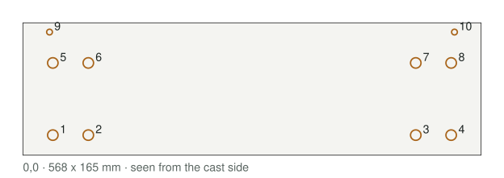

| # | x | y | Hole | For |
|---|---|---|---|---|
| 1 | 37 | 25 | 13.1 | 1/2 core rod |
| 2 | 81 | 25 | 13.1 | 1/2 core rod |
| 3 | 487 | 25 | 13.1 | 1/2 core rod |
| 4 | 531 | 25 | 13.1 | 1/2 core rod |
| 5 | 37 | 115 | 13.1 | 1/2 core rod |
| 6 | 81 | 115 | 13.1 | 1/2 core rod |
| 7 | 487 | 115 | 13.1 | 1/2 core rod |
| 8 | 531 | 115 | 13.1 | 1/2 core rod |
| 9 | 84 | 133 | 4.5 | back-edge |
| 10 | 219 | 133 | 4.5 | back-edge |
| 11 | 351 | 133 | 4.5 | back-edge |
| 12 | 484 | 133 | 4.5 | back-edge |
| 13 | 33 | 154 | 4.5 | corner bracket |
| 14 | 535 | 154 | 4.5 | corner bracket |

#### Beam bottom wall

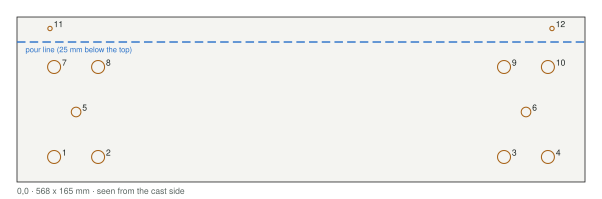

| # | x | y | Hole | For |
|---|---|---|---|---|
| 1 | 37 | 25 | 13.1 | 1/2 core rod |
| 2 | 81 | 25 | 13.1 | 1/2 core rod |
| 3 | 487 | 25 | 13.1 | 1/2 core rod |
| 4 | 531 | 25 | 13.1 | 1/2 core rod |
| 5 | 59 | 70 | 9.6 | 3/8 dowel |
| 6 | 509 | 70 | 9.6 | 3/8 dowel |
| 7 | 37 | 115 | 13.1 | 1/2 core rod |
| 8 | 81 | 115 | 13.1 | 1/2 core rod |
| 9 | 487 | 115 | 13.1 | 1/2 core rod |
| 10 | 531 | 115 | 13.1 | 1/2 core rod |
| 11 | 33 | 154 | 4.5 | corner bracket |
| 12 | 535 | 154 | 4.5 | corner bracket |

#### Beam end wall, left

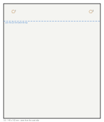

| # | x | y | Hole | For |
|---|---|---|---|---|
| 1 | 70 | 45 | 4.5 | tube locator |
| 2 | 70 | 96 | 4.5 | tube locator |
| 3 | 14 | 154 | 4.5 | corner bracket |
| 4 | 126 | 154 | 4.5 | corner bracket |

#### Beam end wall, right

| # | x | y | Hole | For |
|---|---|---|---|---|
| 1 | 70 | 45 | 4.5 | tube locator |
| 2 | 70 | 96 | 4.5 | tube locator |
| 3 | 14 | 154 | 4.5 | corner bracket |
| 4 | 126 | 154 | 4.5 | corner bracket |

#### Beam cleat, top

| # | x | y | Hole | For |
|---|---|---|---|---|
| 1 | 528 | 20 | 4.5 | cleat |
| 2 | 284 | 20 | 4.5 | cleat |
| 3 | 40 | 20 | 4.5 | cleat |

#### Beam cleat, bottom

| # | x | y | Hole | For |
|---|---|---|---|---|
| 1 | 528 | 20 | 4.5 | cleat |
| 2 | 284 | 20 | 4.5 | cleat |
| 3 | 40 | 20 | 4.5 | cleat |

#### Beam cleat, left

| # | x | y | Hole | For |
|---|---|---|---|---|
| 1 | 100 | 20 | 4.5 | cleat |
| 2 | 40 | 20 | 4.5 | cleat |

#### Beam cleat, right

| # | x | y | Hole | For |
|---|---|---|---|---|
| 1 | 100 | 20 | 4.5 | cleat |
| 2 | 40 | 20 | 4.5 | cleat |
