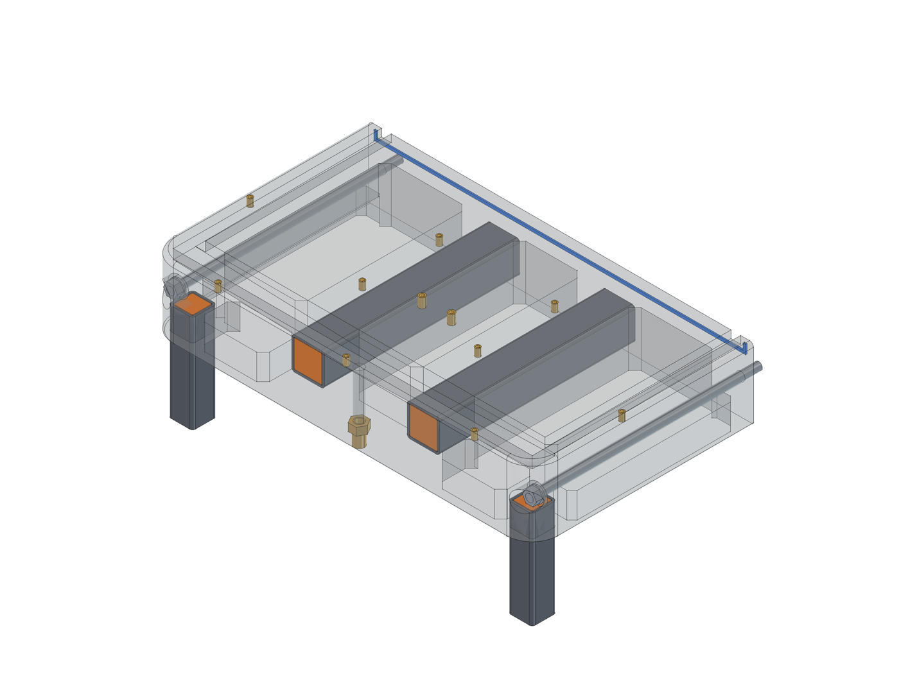
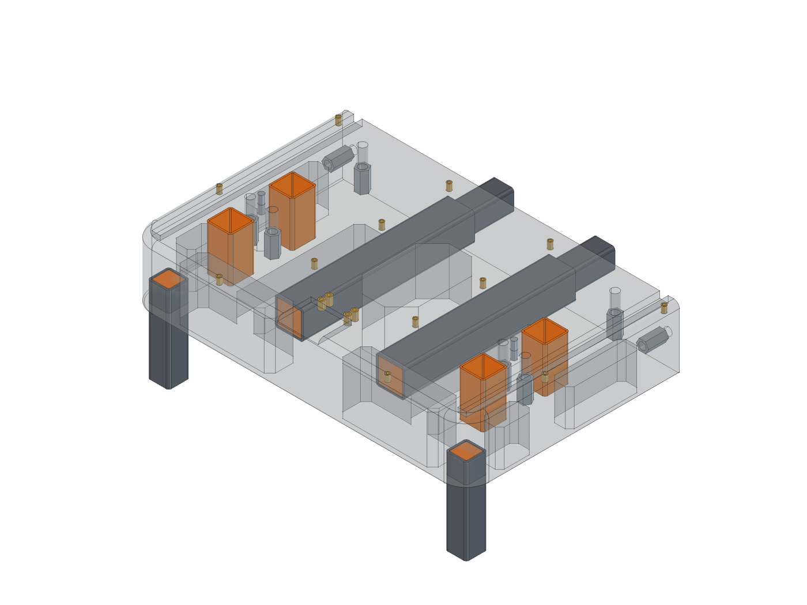
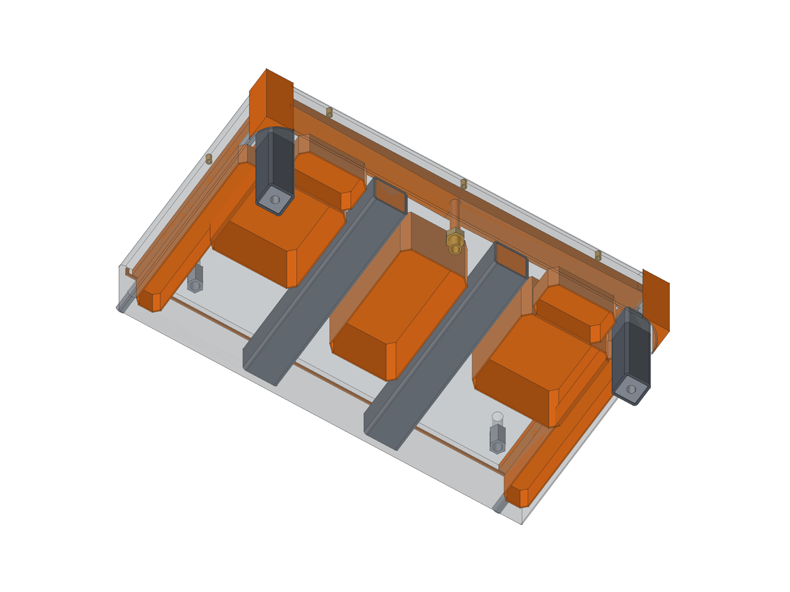
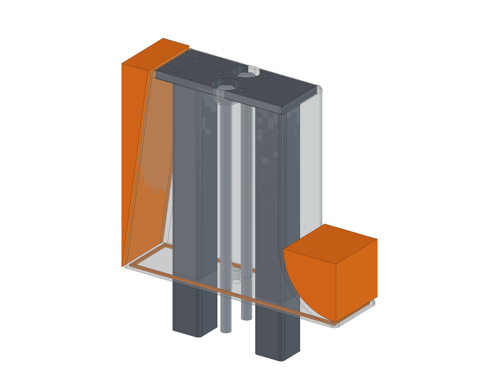
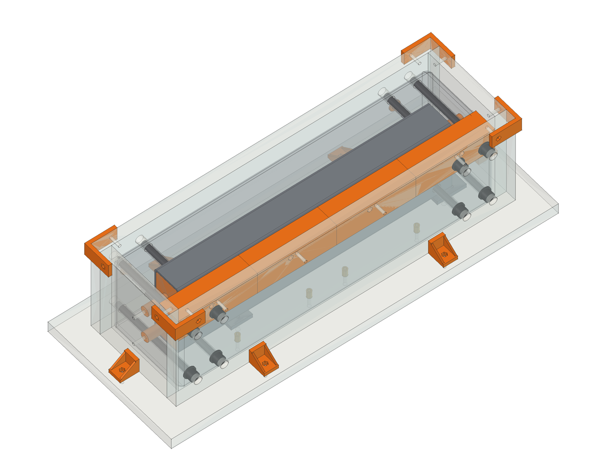

# Build guide

How to build the machine in this folder: five epoxy-granite (EG) castings with cast-in steel,
HGR15 rails on bedded steel risers, ballscrews on all three axes, a water-cooled spindle,
and a 2020/ACM enclosure with flood coolant. Dimensions come from the model
(`model/build_cnc.py`, summarised in `docs/report.txt`); parts and prices are in the sourcing
list, and every printed part is in the print guide. Read the whole thing once before buying.

Measure the parts you actually have before cutting or casting anything, especially the
rails, blocks, ballscrew kits and spindle clamp. Clone parts can differ from the catalogs by
a millimetre or two, and the castings lock in whatever you assume.

Torques below are starting points for these fastener sizes, not manufacturer specs.

---

## 0. Tools, space and safety

- **Space:** a level bench or floor area of about 1.2 x 1.5 m at 20-25 °C for a week. Epoxy
  cures slowly and badly below 18 °C.
- **Tools:** drill press, chop saw or hacksaw, angle grinder with flap disc, taps (M4, M5, M6),
  drill/mixer with a paddle (or a small cement mixer), kitchen scale + a 50 kg scale,
  vibration source (a table vibrator, a concrete poker, or a reciprocating sander with the pad
  removed pressed against the mould), straightedge (at least 600 mm, ideally ground),
  feeler gauges, dial indicator with a magnetic base, precision level, torque wrench.
- **Safety:** nitrile gloves and long sleeves for epoxy (skin sensitisation is permanent);
  an N95 dust mask when pouring the whiting; a P100 respirator when grinding or sanding cured
  EG (the quartz sand and gravel in it make silica dust; work wet if you can); eye protection
  when cutting steel. Mix in a ventilated space.
- **3D printing (PETG):** the mould cores, formers and fillers, plus the parts that get cast in
  (socket liners, spigot sleeves, tube plugs, drain liner) and the machine's printed parts. All
  of it is in `print/`, split to fit a Bambu A1 mini, and listed in the print guide: about 80
  prints and 3.5 kg of PETG (about 1.5 kg less if you cut the pocket cores from foam). Print
  the liners and sleeves first and test-fit them on your actual tube.

## 1. Buy and prepare the steel

Nothing you order needs cutting: buy the tube at these lengths, and order the risers, the top
plates and the aluminium plates cut to size. Only the M12 threaded rod is cut.

1. **Square tube** (plain steel, not galvanized; 0.120 or 1/8 in wall; remnants are fine):
   - 2 x 2 in: 4 x 12 in (base; they also take the split spigots), 2 x 18 in (beam).
   - 1-1/2 x 1-1/2 in: 4 x 12 in (upright posts), 6 x 6 in (2 base spigots + 4 legs).
2. **Check the telescoping fit.** A 1-1/2 in spigot must slide inside a 2 in base tube with the
   printed sleeve around it. File the inside weld seam of the 2 in base tubes where the sleeve
   goes. Adjust the sleeve wall in the slicer if it is too tight or loose.
3. **Drill the beam tubes:** each 18 in tube gets 14 mm holes straight through its top and
   bottom walls where the inner beam cap screws pass (4 holes per tube; mark from the model
   or the upright top plates, 203 mm either side of the centre, on the cap-screw line).
4. **Top plates** (3/8 in steel, 2 pieces 68 x 168 mm, ordered cut to size): drill and tap the four M10 beam-screw
   holes and the 10 mm dowel hole in each, and cut the tie-rod pockets (see
   the section picture below). Do this before casting.
5. **X support pads** (1/4 x 2-1/2 in flat bar, 2 pieces, about 49 and 36 mm long): drill and
   tap M6 at the BK10 and BF10 bolt positions (46 mm apart across the axis; along it, 13 mm
   apart for the BK10). These end up flush in the beam face and carry the X ballscrew bearings.
6. **Rail risers** (cold-rolled 1018, 1-1/4 in wide, ordered cut to the rail lengths): Y 3/4 in x
   600 mm (2), X 5/8 in x 400 mm (2), Z 5/8 in x 300 mm (2). The rails are used at full length.
   - Clamp each rail on its riser, centred, and use the rail's own holes as the drill
     template; drill and tap M4 (60 mm pitch). Mark which rail goes on which riser.
   - Y and X risers also get the hold-down holes, midway between rail holes and under the
     rail: 5.5 mm through with a 9.5 mm x 4.5 mm deep counterbore from the top. Positions from
     the riser centre: Y at 0, ±120 and ±240 mm, X at ±30 and ±150 mm.
   - Stone or lightly sand off burrs; keep the top faces flat.
7. **Clean all cast-in steel:** wire-brush or flap-disc to dull grey metal, then degrease with
   acetone just before casting. If it will sit more than a day or two, give it a thin coat
   of epoxy primer. Paint only the part of each leg that will hang below the base (after
   casting).
8. **Threaded rod and hardware:** cut the M12 rods (per upright 2 x 293, 1 x 213 and 1 x 102 mm; 2 x 358 mm
   for the base draw rods), deburr the ends. Have the inserts ready: 18 x M5 (12-16 mm long) and
   6 x M6 x 15 mm cast-in inserts, plus 11 x M5 for the enclosure.

The cast-in steel, inserts and printed liners for each base half (castings drawn see-through):

## 2. Moulds and cores

Use 18 mm melamine-faced board screwed together, with silicone fillets in the inside
corners. Wax every surface 3-5 times (Partall Paste #2), buff, then spray or wipe PVA release.
Everything that has to be flat or located precisely goes against the mould **floor**, so
each casting is poured with its most important face down.

| Casting | Face on the mould floor | Size (mm) | Mass |
|---|---|---|---|
| Base front | top face (coolant floor) | 600 x 345 x 110 | 34.5 kg |
| Base rear | top face | 600 x 380 x 110 | 42.4 kg |
| Upright (x2) | foot (the face that sits on the base) | 80 wide, foot 430 long, 246 tall, sloped front | 12.5 kg each |
| Beam | front face (rails) | 530 x 140 x 140 | 22 kg |

The printed pieces (in `print/`, see the print guide) do everything a flat board can't:

| Printed piece | Where it goes | After casting |
|---|---|---|
| Pocket cores (`core-*`) | in the base pockets, closed side down onto the wet skin | stay in |
| Formers (`former-*`) | on the mould floor or wall: gutters, coolant trough, motor relief, gasket grooves | pull out |
| Fillers (`filler-*`) | in the box corners: base corner radii, beam back edge | pull out, reuse |
| Plugs (`plug-*`) | upright tie-rod nut pockets | pull out |
| Liners (`liner-*`, `cast-in-*`) | drain, sockets, spigot sleeves, tube plugs | stay in |

**Pocket cores (base).** The pockets in the base underside face up in the mould, so the cores
sit on the cast top skin, 25 mm above the mould floor, with their open side up. The printed
shells stay in the casting. Cores float: fill them with dry sand and screw a bridge across the
mould top to hold every core down. Foam cores (XPS wrapped in packing tape and waxed) work too;
their sizes are in the print guide.

**Locating the cast-in parts** (all screws greased so they come out after curing):
- **Inserts** (M5 enclosure, M5 riser hold-downs, M6 Y BK/BF): screw each one to the mould floor
  from underneath with a greased screw, so its face is flush with the casting face.
- **Socket liners** (rear base half): open end down on the floor, held by a screw through a
  printed cap.
- **Base tubes, spigots and draw-rod hardware:** the split face is a mould wall. Bolt the
  2 in base tubes to it through printed end plugs. In the rear half, the spigots stick out
  through holes in that wall by half their length. Hold the rear half's coupling nuts on
  greased M12 bolts through the wall.
- **Legs** (base, 35 mm cast in): stick up out of the open back of the mould. Hold them square
  with a plywood jig screwed across the mould. Plug the top (inside) end first.
- **Drain nipple** (front half): screwed onto a greased fitting through the floor.
- **Uprights:** the mould is two melamine side plates cut to the upright's profile (430 mm
  foot, 246 mm tall, front sloping up to 190 mm long at the top), a back board, and a board
  along the sloped front. The posts pass through holes in the floor (the mould stands on
  blocks); a plywood jig underneath sets their spacing and squareness. The top plate is held
  flush with the open top by a bridge. Greased 14 mm rods (or dowels wrapped in packing tape)
  form the four tie-rod holes, two near the top and two through the sloped front, and the
  printed pocket plugs slide down them to form the nut pockets.
- **Beam:** the tubes are held by printed plugs bolted through the end walls, the two support
  pads are screwed to the floor, and greased 11.5 mm rods through the side walls form the
  cap-screw holes. Greased dowels form the dowel holes.
- **Gutters, trough and gasket grooves:** printed or MDF formers screwed to the mould floor
  or walls.

## 3. Mixing and casting

Use the graded mix (see the design notes): about 10 % epoxy, 10 % whiting (calcium
carbonate, 325 mesh, from a pottery supplier), 15 % fine sand, 20 % coarse sand, 20 % pea gravel 3-6 mm, 25 % gravel 6-10 mm, by
weight. Tune it with a jar test before buying in bulk, and cast two or three test bars
(50 x 50 x 200 mm). Cut one open: there should be no voids larger than a grain of sand.

| Casting | Mix (10 %) | Epoxy |
|---|---|---|
| Base front | 34.5 kg | 3.5 kg |
| Base rear | 42.4 kg | 4.2 kg |
| Uprights | 2 x 12.5 kg | 2 x 1.25 kg |
| Beam | 22 kg | 2.2 kg |

Add 5-10 % for waste.

1. **Dry and clean** all aggregate. Weigh everything out per batch before opening the epoxy.
   Keep batches to what you can place within about half the epoxy's pot life (10-15 kg each).
2. **Mix order:** epoxy resin + hardener (exact ratio, by weight), then the whiting until
   smooth, then the sands, then the gravel. Mix until every stone is wet and the colour is even.
3. **Place in layers** of 30-40 mm. Vibrate each layer until the surface goes glossy and stops
   releasing bubbles, then add the next. Work the mix around the steel, inserts and cores with a
   stick. Vibrate the full mould for 20-30 minutes at the end.
4. **Level the open face**, cover against dust, and leave it at 20-25 °C. Demould after the
   time your epoxy needs (usually 24-48 h), but don't load or machine anything for 7 days.
5. Pull all the greased screws and rods, the formers, fillers and plugs. Printed cores stay in;
   foam cores can be dug out or dissolved with a little acetone.
6. **Seal** the base top (the coolant floor) and the gutters with a thin epoxy gel coat. Paint
   the exposed leg ends.

Cast the two uprights together from one batch, and cast them before the beam, so you can
check the top-plate spacing against the beam mould.

## 4. Assemble the frame

1. **Feet:** set the rear base half on the bench on its legs. Bond an M12 nut into a printed
   plug in each leg end (or use the threaded inserts), screw in the leveling feet, and roughly
   level it.
2. **Join the base halves:** glue the O-ring cord into the front half's split groove (glue the
   cord ends). Slide the printed sleeves onto the spigots, push the front half on, and tighten
   the two M12 draw rods from the front pockets (snug, then about 40 N·m). Level the whole base
   with the feet.
3. **Uprights:** glue the foot O-ring into each upright's groove. Drop the posts into the lined
   sockets (the base dowel locates it); the foot runs forward across the base split. Thread the
   four tie rods into the coupling nuts, add washers and nuts in the pockets (two at the top,
   two in the sloped front), and tighten to about 40-50 N·m, working front to back.
4. **Beam:** set it on the top plates over the dowels and fit the eight M10 x 150 cap screws.
   Before final torque (about 40 N·m into the 3/8 in plates), check the beam face is square to
   the base top with a square and a dial indicator. Shim under one top plate if needed.

## 5. Bed the rail risers

The risers are bonded to the castings with a thin epoxy grout and held down by screws into the
cast-in inserts. Nothing is screwed into the cast-in tubes; the tubes stiffen the casting and
form the joints.

1. Abrade and degrease the casting under each riser and the riser's underside.
2. Set the riser on small shim stacks (feeler stock) at each hold-down. Fit the M5 low-head
   screws (M5 x 25 for Y, M5 x 20 for X) just snug.
3. **Y risers (base):** make each one straight along its length and both coplanar with each
   other, within 0.02 mm over the length if you can. Check with the straightedge and feelers,
   or a dial indicator on a bridge spanning both. Set them parallel, 180 mm apart on centre
   (rail spacing), using the rails as a gauge.
4. **X risers (beam face):** same, 100 mm apart. Make them parallel to the base top, checked
   with the indicator on the Y-axis table later, or now with a height gauge from the base top.
5. Dam the ends and sides with tape or plasticine, and flow low-viscosity epoxy thickened with
   a little whiting underneath from one side until it comes out the other.
6. After 48 h, torque the hold-downs to about 4 N·m (brass inserts) and recheck flatness.

## 6. Axes

**Y (table).**
1. Bolt the Y rails (full 600 mm, centred 20 mm behind the base split) to their risers
   (M4 x 16, about 4 N·m). Tighten the first rail against a
   straightedge, then set the second parallel with a dial indicator on a block of the first
   (within 0.01-0.02 mm over the travel).
2. Bolt the BK12 (fixed bearing, rear) and BF12 (front) to their M6 inserts (M6 x 40, about
   6-8 N·m) with the screw installed. Align the screw parallel to the rails in both directions
   with a dial indicator on the nut. Shim under a support if needed; the screw should spin
   freely by hand along the whole length.
3. Mount the DSG16H nut housing under the table (shim to height), bolt the table to the four
   blocks and the housing, and check for binding at both ends of travel. Fit the motor
   bracket, the 8 x 10 coupler and the closed-loop motor.

**X (beam).**
1. Rails onto the X risers as for Y (100 mm spacing).
2. BK10 and BF10 onto the beam pads: M6 x 35 with **two DIN 433 small washers under each head**
   (they fit the support's counterbore), so the screws stop short of the tube behind the pad.
   Align and check as for Y.
3. Bolt the X carriage plate to the four blocks and the nut housing; motor bracket, 8 x 8
   coupler, closed-loop motor.

**Z.**
1. Z risers onto the Z plate: tap the risers M5 and screw them on from the back of the plate
   (no inserts needed in aluminium). Rails on the risers, and the four Z blocks on the front
   of the X carriage.
2. BK10 / BF10 and the Z screw on the carriage, nut housing on the Z plate, open-loop motor
   on top.
3. Spindle clamp on the Z plate, spindle in the clamp. Tram it later (section 9).

Lubricate every block with the grease gun before moving anything far.

## 7. Electronics and spindle

- **Controller:** FluidNC board with external drivers. CL57T drivers for X and Y (closed loop),
  DM542T for Z, 48 V supply trimmed to about 46 V (the CL57T maxes out at 48 V), 24 V logic.
- **Steps:** with drivers at 1600 pulses/rev: Y (SFU1605, 5 mm lead) 320 steps/mm; X and Z
  (SFU1204, 4 mm lead) 400 steps/mm.
- **Spindle:** VFD for 120 V now (limits it to about 1.5 kW), the kit's 220 V VFD later on
  240 V. Use a dedicated 20 A circuit and shielded spindle cable, earthed at the VFD end. Set
  the VFD for the spindle's nameplate: 400 Hz, 220 V, 24,000 rpm.
- **Spindle cooling:** water pump in a 10-20 L bucket of distilled water with 10-20 % RV
  antifreeze, switched by a relay so it runs whenever the spindle runs. Never run the spindle
  dry.
- **Safety:** wire the E-stop to cut driver enable and the VFD run signal in hardware. Fit
  the homing switches, then the tool setter.

## 8. Enclosure and coolant (phase 2)

The machine runs without these: until then, brush or drip cutting fluid onto the cut, keep the
way covers and screw cover on, and let the gutters and drain carry the fluid to the pan under the
base. Cast the enclosure inserts into the base now so the frame bolts straight on later.

1. Bolt the 2020 frame to the base top with angle brackets into the cast-in M5 inserts
   (M5 x 35). Cut list in `docs/report.txt`.
2. ACM side, back and roof panels; polycarbonate door on hinges and gas struts, magnetic catch.
   Brush seals where the X and Y motors pass through the panels.
3. Way covers: the stainless strips on their spring rollers in front of and behind the table,
   the spiral cover on the Y screw, the drip shield over the X rails.
4. Coolant: slide the sump (steam-table pan with the chip basket, magnet, baffle, screen and
   24 V pump) in under the base below the drain nipple. Run the return hose to the bulkhead, up
   the cable chain, to the manifold and nozzles on the spindle clamp. Use water-soluble coolant.

## 9. Commissioning

1. **Run each axis by hand,** then with the motors at low speed, end to end. Listen for tight
   spots.
2. **Homing and soft limits** in FluidNC; check the travel (180 / 300 / 140 mm).
3. **Steps per mm:** move 100 mm and measure with the dial indicator or a caliper; correct.
4. **Squareness:** sweep an indicator in the spindle along a straightedge or the table edge.
   X to Y is set by the beam position (step 4 of the frame); Z to the table is set by
   shimming the spindle clamp (tram). Aim for under 0.02 mm over 100 mm.
5. **Face the table:** take a light fly-cut over the aluminium table so it is flat and parallel
   to X/Y.
6. **First cuts:** aluminium first, then steel at light depths of cut with flood coolant. Check
   the spindle temperature and the coolant flow, and re-torque the frame bolts and the riser
   hold-downs after the first few hours of running.
