# Build guide

How to build the machine in this folder: five epoxy-granite (EG) castings with cast-in steel,
HGR15 rails on bedded steel risers, ballscrews on all three axes, a water-cooled spindle,
and a 2020/ACM enclosure with flood coolant. Dimensions come from the model
(`model/build_cnc.py`, summarised in `docs/5-design/report.txt`); parts and prices are in the sourcing
list, and every printed part is in the print guide. Read the whole thing once before buying.

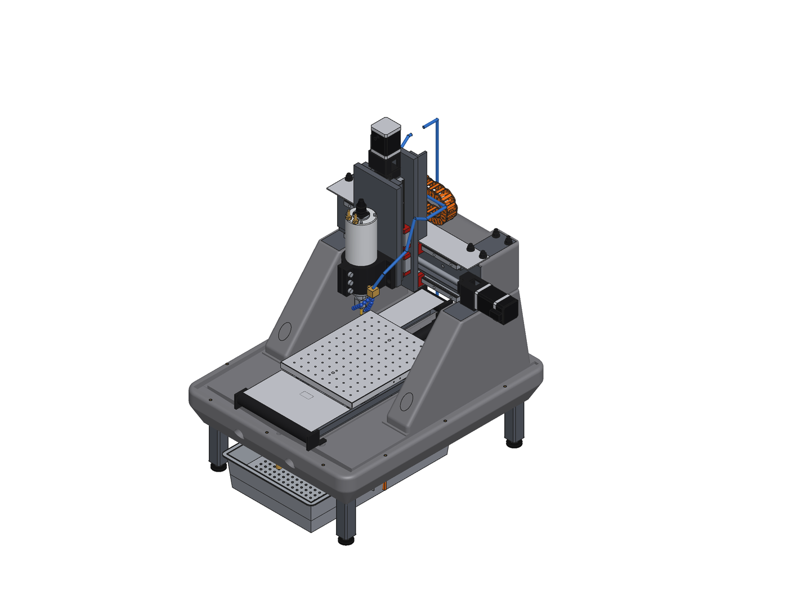

Measure the parts you actually have before cutting or casting anything, especially the
rails, blocks, ballscrew kits and spindle clamp. Clone parts can differ from the catalogs by
a millimeter or two, and the castings lock in whatever you assume.

Torques below are starting points for these fastener sizes, not manufacturer specs.

---

## 0. Tools, space and safety

- **Space:** a level bench or floor area of about 1.2 x 1.5 m at 20-25 °C for a week. Epoxy
  cures slowly and badly below 18 °C.
- **Tools:** drill press, chop saw or hacksaw, angle grinder with flap disc, taps (M4, M5, M6),
  drill/mixer with a paddle (or a small cement mixer), kitchen scale + a 50 kg scale,
  vibration source (a table vibrator, a concrete poker, or a reciprocating sander with the pad
  removed pressed against the mold), straightedge (at least 600 mm, ideally ground),
  feeler gauges, dial indicator with a magnetic base, precision level, torque wrench.
- **Safety:** nitrile gloves and long sleeves for epoxy (skin sensitisation is permanent);
  an N95 dust mask when pouring the whiting; a P100 respirator when grinding or sanding cured
  EG (the quartz sand and gravel in it make silica dust; work wet if you can); eye protection
  when cutting steel. Mix in a ventilated space.
- **3D printing (PETG):** the mold kit (brackets, saddles, holders, bushings), the core posts,
  formers and fillers, the parts that get cast in (column rings, tube plugs, drain liner) and
  the machine's printed parts. All of it is in `print/`, split to fit a Bambu A1 mini, and listed
  in the print guide: 1.1 kg of PETG (sliced), inside two 1 kg rolls, and about 90 hours of printing. The base pocket cores
  are cut from one sheet of 2 in XPS foam board instead. Print one bracket and one saddle first and check them on your board;
  print a column ring early and test-fit it in your actual tube.
- **Foam cutting:** a fine-tooth saw or a hot-wire cutter, a long knife, a sanding block, packing
  tape and double-sided carpet tape.

## 1. Buy and prepare the steel

The frame's backbone is steel: a skeleton in each casting, slotted together from laser-cut plates
and clamped with threaded rod, then cast into epoxy granite, which damps it and stiffens it
further. Every joint between the castings, and everything that bolts on (rails, ballscrew
supports), is steel to steel. Nothing is welded and nothing is threaded into the epoxy granite.

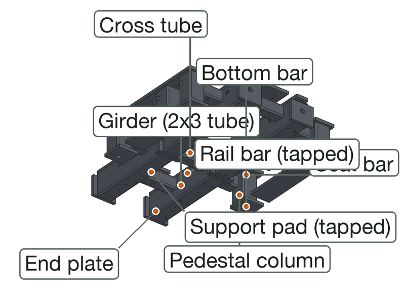

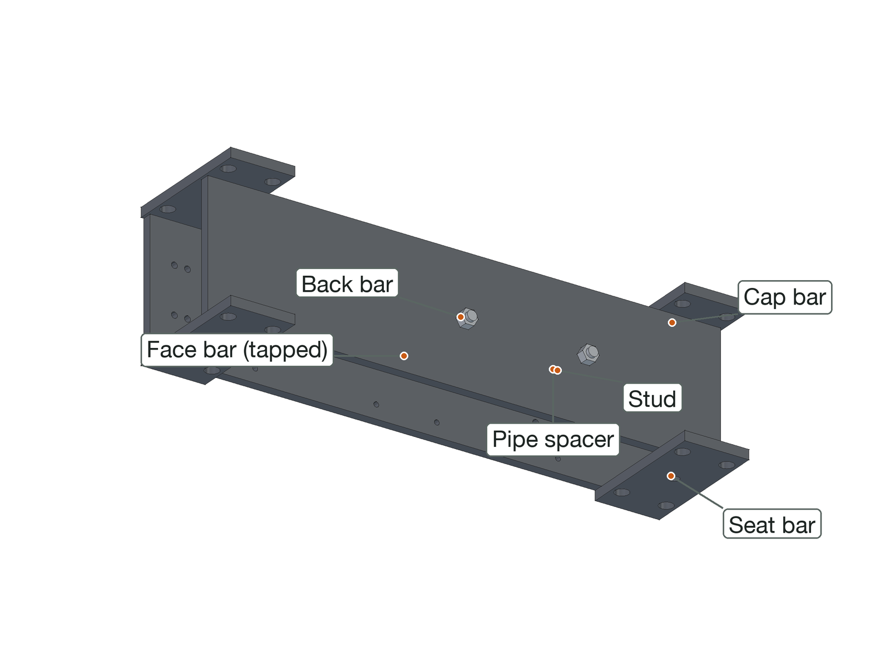

1. **Laser-cut plates.** Send the DXFs in `docs/1-sourcing/laser/` to Metal Supermarkets, a
   laser-cutting service, or a friend with a CNC plasma or router table. The README there lists
   every part, its thickness and how many. About 64 parts, roughly 48 kg of 1/4, 3/8 and 1/2 in
   mild steel. The tabs on one plate drop into slots in the next, so each skeleton only goes
   together one way.
   - Knock the dross off every edge and slot; the tabs should slide in by hand.
   - **Tap** the holes the README lists, at the drill size they're cut to: 3/8-16 in the upright top
     plates' lower layers, M5 in the base rail bars and the beam face plate, M6 in the base support
     pads and the beam face plate. Use a tap guide or the drill press to start them square.
2. **Square tube** (plain steel, not galvanized; 0.120 or 1/8 in wall; remnants are fine), bought at
   length: 2 x 2 in, 4 x 8 in (the upright columns); 1-1/2 x 1-1/2 in, 4 x 6 in (legs).
   - A saw cut within 1/8 in is fine: a column is clamped up against its top plate and its foot
     stands in an epoxy bed on the foot plate (4.8 mm nominal); a leg is pushed up against its leg
     plate and its leveling foot takes up the rest. Knock off burrs.
   - The printed rings that center a column on its rod have 0.5 mm a side and grooves for the weld
     seam, so they fit tube up to 0.5 mm off. If yours is further off, put its calipered sizes in
     `frame_tube` / `post_tube` in `model/build_cnc.py`, re-run it and print the rings again.
3. **Slot each skeleton together on the bench** (pictures above, and in the mold guide):
   - **Upright** (two): brace into the foot plate; columns on the foot plate, a printed ring in each
     end; top plate's lower layer over the brace tab, upper layer on it. It's clamped for good later,
     by the tie rods.
   - **Beam:** diaphragms into the face plate's slots, back plate over the diaphragms' tabs, the seat
     and cap plates onto the end tabs.
   - **Base** (one grid per half): girder webs into their bottom bars and end plates, pedestal webs
     into their bars, the cross plates dropped over the webs (half-depth slots, so they lock), then
     the rail bars, seats and pads on top and the leg plates through their cross plates. Glue the four
     3/8 x 1 in dowel pins into the rear half's split end plates, half their length out.
4. **Rail risers** (cold-rolled 1018, 1-1/4 in wide, ordered cut to the rail lengths): Y 3/4 in x
   600 mm (2), X 5/8 in x 400 mm (2), Z 5/8 in x 300 mm (2). The rails are used at full length.
   - Clamp each rail on its riser, centered, and use the rail's own holes as the drill
     template; drill and tap M4 (60 mm pitch). Mark which rail goes on which riser.
   - Y and X risers also get the hold-down holes, midway between rail holes and under the
     rail: 5.5 mm through with a 9.5 mm x 4.5 mm deep counterbore from the top. Positions from
     the riser center: Y at 0, ±120 and ±240 mm, X at ±30 and ±150 mm. They go into the tapped
     rail bars (base) and face plate (beam).
   - Stone or lightly sand off burrs; keep the top faces flat.
5. **Clean all the steel:** wire-brush or flap-disc to dull gray metal, then degrease with acetone
   just before casting. If it will sit more than a day or two, give it a thin coat of epoxy primer
   (not on the faces the mold screws or the rails bear on). Paint only the part of each leg that will
   hang below the base (after casting).
6. **Threaded rod and hardware:** cut the 1/2-13 rods: per upright 2 x 375 mm (in the columns) and
   1 x 153 mm (at the toe); 2 x 687 mm for the base draw rods. Deburr the ends. A rod a few mm off is
   fine: its top end is set flush and the error ends up in the 6 mm tail past the bottom nut. Have
   11 x M5 cast-in inserts ready for the enclosure (the only inserts left).

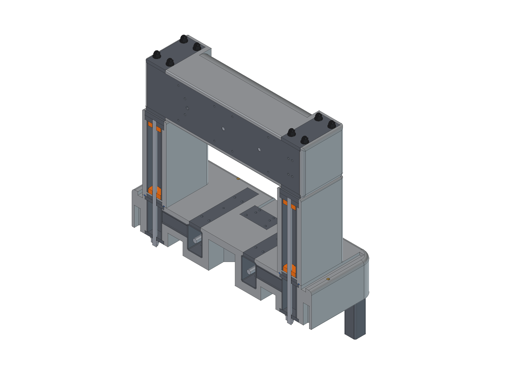

The cast-in steel for each base half (castings drawn see-through):

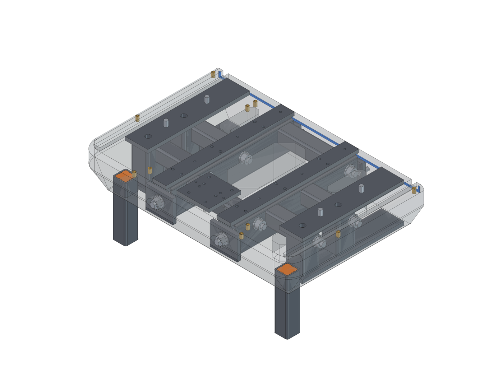

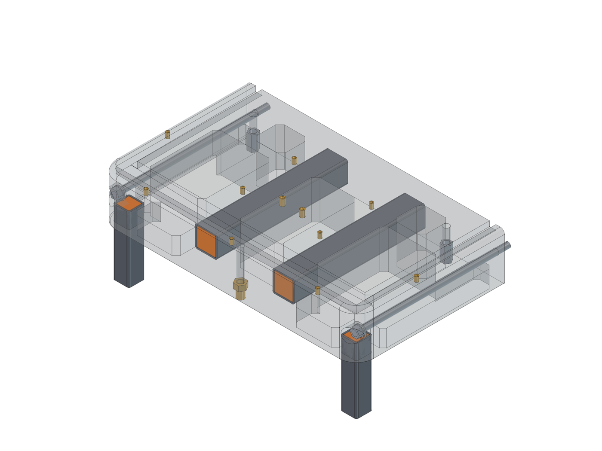

## 2. Molds and cores

The molds are a kit. Melamine boards are cut to a list and drilled from hole maps, and printed brackets
hold them together with M4 bolts. Every printed piece bolts or pins to its board from outside, into a
nut built into the piece. Nothing is glued, nothing goes through a cast face, and the molds come apart
and go back together the same way. The **mold guide** has the cut list, the hardware, a drawing and a
hole table for every board, and the steps (`docs/3-molds/`, one guide per mold); the print guide
lists the printed parts.

- **Walls stand 25 mm above the pour line.** The brackets, saddles and leg holders bolt through
  that band. Fill to the line, not to the top.
- **Everything that has to be flat or located goes against the floor**, so each casting is
  poured with its most important face down.
- **Edges:** the castings' outside edges are rounded 10 mm. Glue 3/8 in quarter-round molding
  (PVC or primed wood) into the inside corners of the boxes that form outside edges, and run
  small silicone fillets everywhere else.
- **Release:** wax every surface the mix touches 3-5 times (Partall Paste #2), buff, then
  spray or wipe PVA. That includes the printed pieces that come out; not the ones that stay in.

| Casting | Face on the mold floor | Size (mm) | Mass |
|---|---|---|---|
| Base front | top face (coolant floor) | 600 x 345 x 110 | 30.7 kg |
| Base rear | top face | 600 x 380 x 110 | 41.1 kg |
| Upright (x2) | foot (the face that sits on the base) | 80 wide, foot 400 long, 246 tall, sloped front | 12.5 kg each |
| Beam | front face (rails) | 530 x 140 x 140 | 23.8 kg |

**Casting order:**

1. **Base rear half**, against a partition at the split, on a floor board big enough for both halves.
2. **Base front half** on the same floor, with the partition out, cast against the rear half's waxed
   split face. The two top faces come out flush and the split faces match. The front grid's end plates
   go straight onto the rear half's dowel pins, and the draw rods run on through, so
   that joint fits by construction. The split's gasket groove is in the rear half; tape over it first.
3. **Uprights**, both from one batch, in two molds.
4. **Beam.**

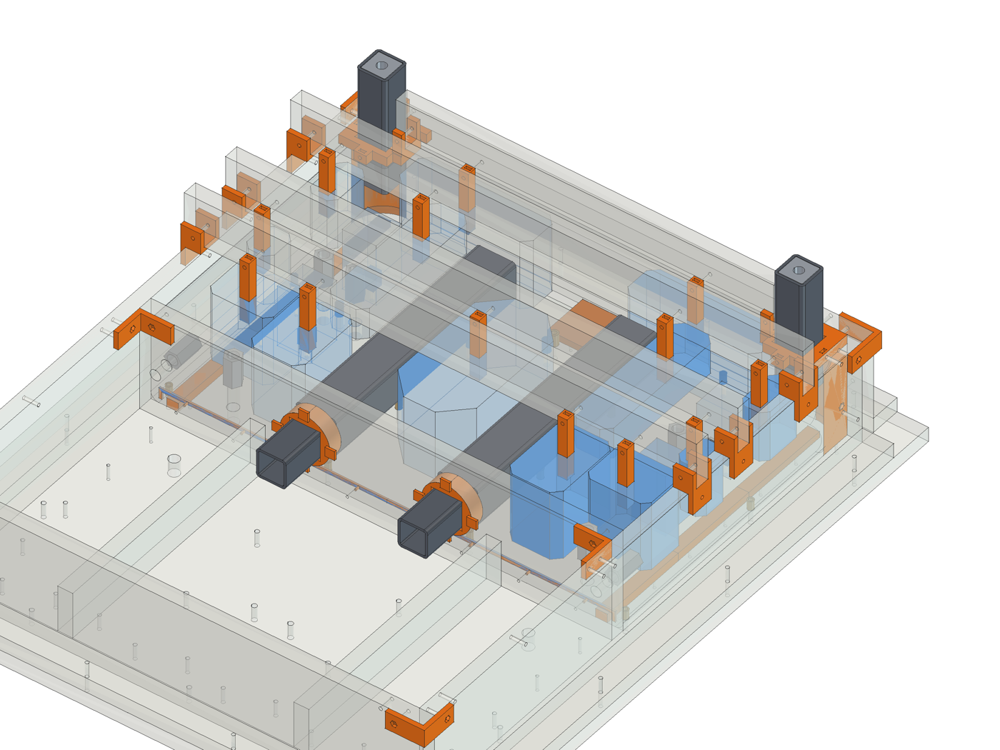

**Locating the steel** (the mold guide has the details; grease every screw and rod that comes out):
- **Each skeleton goes in as one piece**, already slotted together, and is held by the faces it
  bears on, so the plates that matter come out exactly where the templates put them.
- **Base:** the grid lies upside down on the floor (the base is cast top face down). Greased M5 and M6
  screws through the floor hold its rail bars and support pads; the dowels through the floor and the
  seat plates locate the pedestals. Greased 5/8 in rods up through the floor form the tie-rod holes,
  and two along the base, through the partition, the end plates and the printed pocket plugs, form
  the draw-rod holes. For the front half, the front grid's split end plates go onto the rear half's
  dowel pins. The 11 enclosure inserts screw to the floor.
- **Dowels** (rear half): two per upright, through the floor and the seat plates; they stand 15 mm
  proud and are grouted into oversize holes in the upright's foot at assembly (section 4).
- **Legs:** through printed holders in the corners, each pushed up against its leg plate and held by a
  pinch screw.
- **Cores:** taped XPS foam blocks on the wet 20 mm skin, between the grid plates; a printed post glued
  into each bolts to the side of a bridge. They can stay in.
- **Uprights:** the foot plate lies on the floor; greased 1/2 in rods up through the floor, the foot
  plate and the columns locate it and form the column rods' holes. Stand the columns on a bed of
  thickened epoxy, set the top plate and bridge on them while it goes off, then lift those away and
  fill. The top plate goes back on the rods and the brace's tab, hung from the bridge on two greased
  3/8 bolts. A printed plug forms the toe pocket down to the foot plate; greased 1/2-13 bolts form
  the two dowel holes.
- **Beam:** the face plate lies on the floor, held by greased M5 and M6 screws into its tapped holes;
  greased 1/2 in rods through the walls and the cap and seat plates form the cap-screw holes. Fill
  through the back plate's windows. The dowels sit in the bottom wall on printed stops.

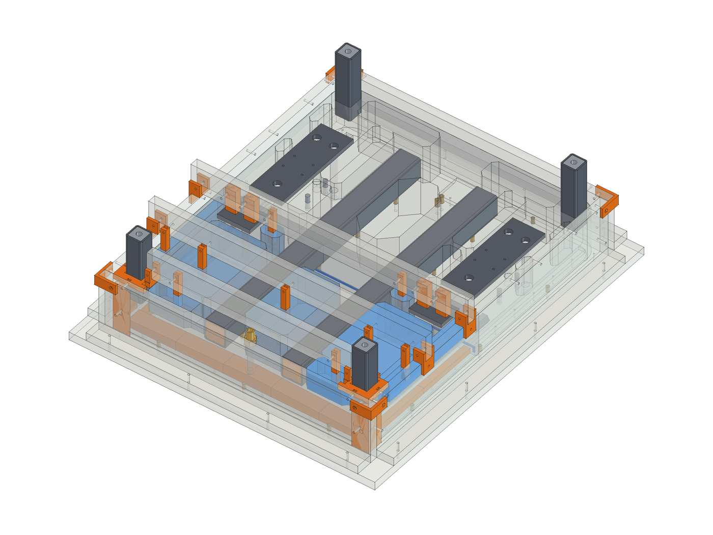

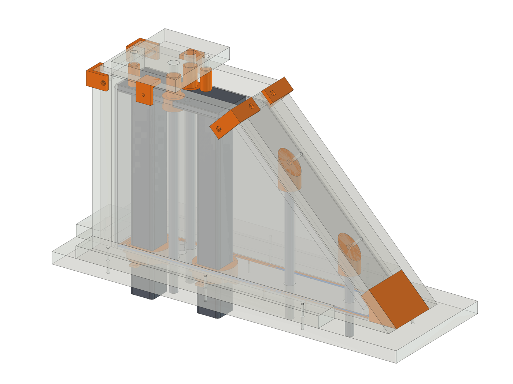

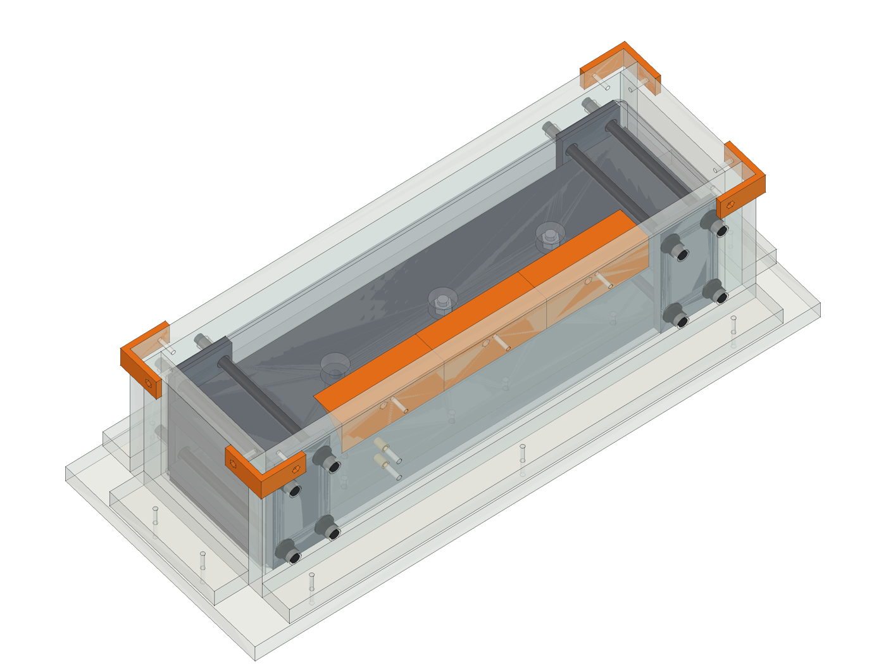

## 3. Mixing and casting

Use the graded mix, by weight. The aggregate follows a Fuller-type packing curve (each size
fills the gaps between the next size up), which is what lets the epoxy stay at 8.5 %:

| Part | Size | Source | % of mix | For the whole frame |
|---|---|---|---|---|
| Epoxy | | Raka 127 + 606 | 8.5 % | 9.6 kg |
| Whiting (calcium carbonate) | 325 mesh, under 0.05 mm | pottery supplier | 9 % | 10.5 kg |
| Fine sand | 0.1-0.6 mm | pool filter sand (#20 silica) | 15 % | 10 kg (base) + 10 kg of 70 grit |
| Coarse sand | 0.6-3 mm | concrete / all-purpose sand, sieved | 27.5 % | 19 kg (base) + 20 kg of #16 grit |
| Pea gravel | 3-6 mm | bagged pea gravel, sieved | 20 % | 23 kg |
| Gravel | 6-10 mm | 3/8 in crushed stone (#8) or bigger pea gravel | 20 % | 23 kg |

Two kitchen-type sieves (about 3 and 6 mm mesh, or hardware cloth) split the bagged sand and
gravel into these bands. Wash anything dusty or clay-coated, and dry everything completely
(spread it out in the sun, or an old oven tray): water stops the epoxy bonding. Crushed stone
locks together a little stiffer than rounded gravel; rounded flows and packs a little better;
either works.

**Beam and uprights: aluminum oxide instead of the sand.** Aluminum oxide grit is about five
times stiffer than sand or granite. Brown fused #16 (about 1.2 mm) replaces the coarse sand
and black 70 grit (about 0.2 mm, Harbor Freight) replaces the fine sand; together they make
these castings roughly 35 % stiffer, about 17 % on the whole frame. The grit is heavier, so
swap it by volume: **1.5 kg of #16 for every 1 kg of coarse sand, and 1.4 kg of 70 grit for
every 1 kg of fine sand**, everything else (epoxy included) the same. A 50 lb bag of #16 and
a 25 lb bag of 70 grit cover the beam, both uprights and a pair of test bars. The base keeps
the sand. Don't over-vibrate these: the heavy grit can settle. Use an old paddle; the grit
wears it.

8.5 % only works if the aggregate packs densely, so prove the mix before casting anything:

1. **Jar test.** Fill a 1 L jar with the dry aggregate blend (no whiting), shaking and
   tapping it down, then pour in water from a measuring cup until it reaches the top. The
   water is the void space. Nudge the coarse sand and fine sand up or down a few percent
   until it's as small as you can get it (below about 25 % of the jar is good).
2. **Test bars.** Print or build a 40 x 40 x 500 mm bar mold (waxed like the others) and cast
   two bars at 8.5 % and two at 9.5 %, about 2 kg each, vibrated the same way as the castings,
   plus two at 8.5 % with the alumina grits for the beam and uprights.
3. **Check them after 7 days.** Cut one bar of each pair open: there should be no voids larger
   than a grain of sand, and every stone should be wetted. Then tap-test the other: weigh it,
   rest it on two foam strips 112 mm in from each end, tap the middle with a small hammer and
   read the lowest strong peak on a phone spectrum app (phyphox, Spectroid). Its stiffness is
   about **E (GPa) = 4.8e-5 x mass (kg) x frequency (Hz)²**. The frame model assumes 30 GPa,
   about 570 Hz for a 1.9 kg bar; 25 GPa would cost about 13 % of the frame stiffness.
4. **Pick the mix.** Use 8.5 % if its bar is void-free and at least as stiff as the 9.5 % one;
   otherwise use 9.5 % and order the extra 1.5 qt epoxy kit. The alumina bar should come out
   about 35 % stiffer than the plain 8.5 % one (it's heavier, so use the formula, not the
   pitch); if it's well short, or it has voids, cast the beam and uprights with sand too.

| Casting | Mix | Epoxy (8.5 %) |
|---|---|---|
| Base front | 30.7 kg | 2.6 kg |
| Base rear | 41.1 kg | 3.5 kg |
| Uprights (alumina) | 2 x 12.5 kg | 2 x 1.0 kg |
| Beam (alumina) | 23.8 kg | 1.7 kg |

Add 5-10 % for waste: about 10.5 kg, plus about 1 kg for the test bars, which fits the 3 gal kit
(about 12.5 kg). Mix only what you can place; if you're running short, the 1.5 qt kit covers
the gel coat.

1. **Dry and clean** all aggregate. Weigh everything out per batch before opening the epoxy.
   Keep batches to what you can place within about half the epoxy's pot life (10-15 kg each).
2. **Mix order:** epoxy resin + hardener (exact ratio, by weight), then the whiting until
   smooth, then the sands, then the gravel. Mix until every stone is wet and the color is even.
3. **Place in layers** of 30-40 mm. Vibrate each layer until the surface goes glossy and stops
   releasing bubbles, then add the next. Work the mix around the steel, inserts and cores with a
   stick. Vibrate the full mold for 20-30 minutes at the end.
4. **Level the open face** at the pour line, 25 mm below the wall tops: strike it off with a straight
   board in the two printed screed shoes (mold guide, "Pour"). Cover against dust, and leave it at 20-25 °C. Demold after the
   time your epoxy needs (usually 24-48 h), but don't load or machine anything for 7 days.
5. Pull all the greased screws and rods, the formers, fillers and plugs. Printed cores stay in;
   foam cores can be dug out or dissolved with a little acetone. Unbolt the mold kit; it's reused.
6. **Seal** the base top (the coolant floor) and the gutters with a thin epoxy gel coat. Paint
   the exposed leg ends.

Cast the rear base half first and the front half against it (above). Cast the two uprights
together from one batch, before the beam, so you can check the top-plate spacing against the beam
mold.

## 4. Assemble the frame

1. **Feet:** set the rear base half on the bench on its legs. Bond a 1/2-13 nut into a printed
   plug in each leg end (or use the threaded inserts), screw in the leveling feet, and roughly
   level it.
2. **Join the base halves:** glue the O-ring cord into the rear half's split groove (glue the
   cord ends). Push the front half on, its split end plates over the rear half's dowel pins. Run the
   two 687 mm draw rods in from the front pockets, through both halves, a washer and nut on each end
   (the rod's end flush with the front nut), and tighten from the back pockets (snug, then about
   40 N·m). The halves now meet end plate to end plate. Level the whole base with the feet.
3. **Grout the dowels.** The two dowel holes in each upright's foot are 1/2 in, over the 3/8 in
   dowels, so the fit comes from epoxy, not from the two molds agreeing. Wax the base dowels
   (three coats, buffed). Mix a little of the leftover epoxy with whiting to a thick cream and
   half-fill each dowel hole. Glue the foot O-ring into each upright's groove, lower the upright
   on (dowels into their holes, foot on the base) and put the tie rods in (next step) snug, wipe
   off what squeezes out, and leave it 24 h. After that the upright lifts off and drops back on
   in the same place.
4. **Tie rods.** Each upright is held by three 1/2-13 rods. Two run inside its columns, from nuts held
   in the top plate, and one from the toe pocket, where its nut bears on the foot plate. All three go
   right through the base pedestal to its bottom bar. So the beam screws, the top plate, the columns,
   the foot plate, the pedestal and the rods are one steel chain, and every nut can be reached and
   retightened.
   - **Column rods:** drop a nut into each hex hole in the top plate. Push the 375 mm rod up from
     under the base, through the pedestal and the column, and screw it into that nut until its end
     is flush with the top of the plate (the hex hole stops the nut turning).
   - **Toe rod:** washer and nut in the toe pocket; push the 153 mm rod up from below and screw it
     into the nut until its end is flush with the nut's top.
   - **Underneath:** an SAE washer and a nut on each rod against the pedestal's bottom bar. Snug all
     three, then tighten to about 40-50 N·m, front to back. Push the printed cap into the toe pocket,
     flush with the face (a dab of silicone holds it).
   - Check them again after a week and after the first month; later, once a year.
5. **Beam:** the top plates' dowel holes are 14 mm, oversize the same way. Wax the beam's
   dowels, put grout in the holes, set the beam on and fit the eight 3/8-16 x 6-1/2 in bolts snug.
   Check the beam face is square to the base top with a square and a dial indicator (shim under
   one top plate if needed) and leave it 24 h before the final torque (about 40 N·m).

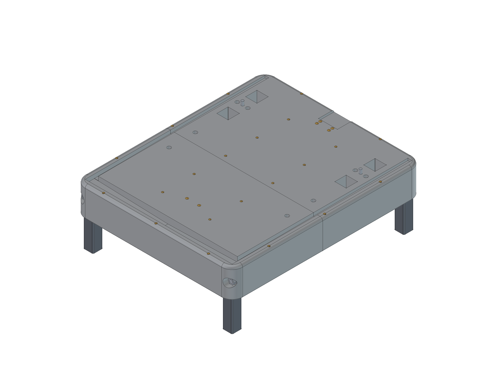

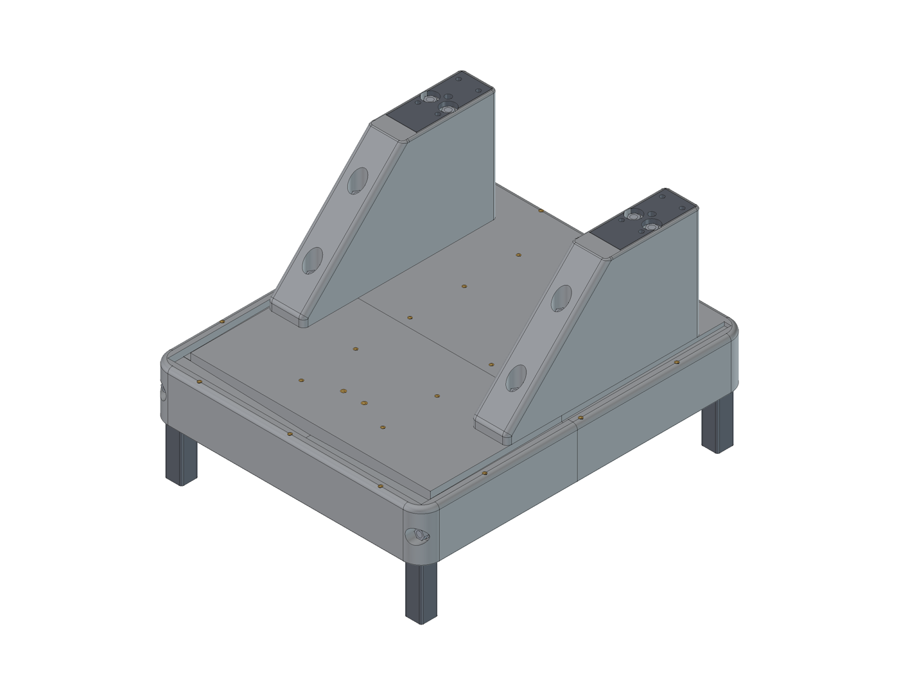

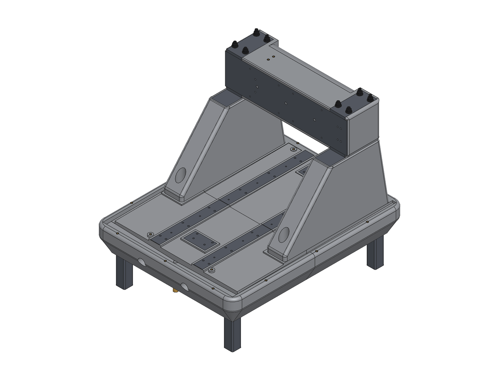

## 5. Bed the rail risers

The risers are bonded to the castings with a thin epoxy grout and held down by screws into the
steel: the base's rail bars and the beam's face plate, tapped M5.

1. Abrade and degrease the casting under each riser and the riser's underside.
2. Set the riser on small shim stacks (feeler stock) at each hold-down. Fit the M5 low-head
   screws (M5 x 25 for Y, M5 x 20 for X) just snug.
3. **Y risers (base):** make each one straight along its length and both coplanar with each
   other, within 0.02 mm over the length if you can. Check with the straightedge and feelers,
   or a dial indicator on a bridge spanning both. Set them parallel, 180 mm apart on center
   (rail spacing), using the rails as a gauge.
4. **X risers (beam face):** same, 100 mm apart. Make them parallel to the base top, checked
   with the indicator on the Y-axis table later, or now with a height gauge from the base top.
5. Dam the ends and sides with tape or plasticine, and flow low-viscosity epoxy thickened with
   a little whiting underneath from one side until it comes out the other.
6. After 48 h, torque the hold-downs to about 5 N·m (they're in steel) and recheck flatness.

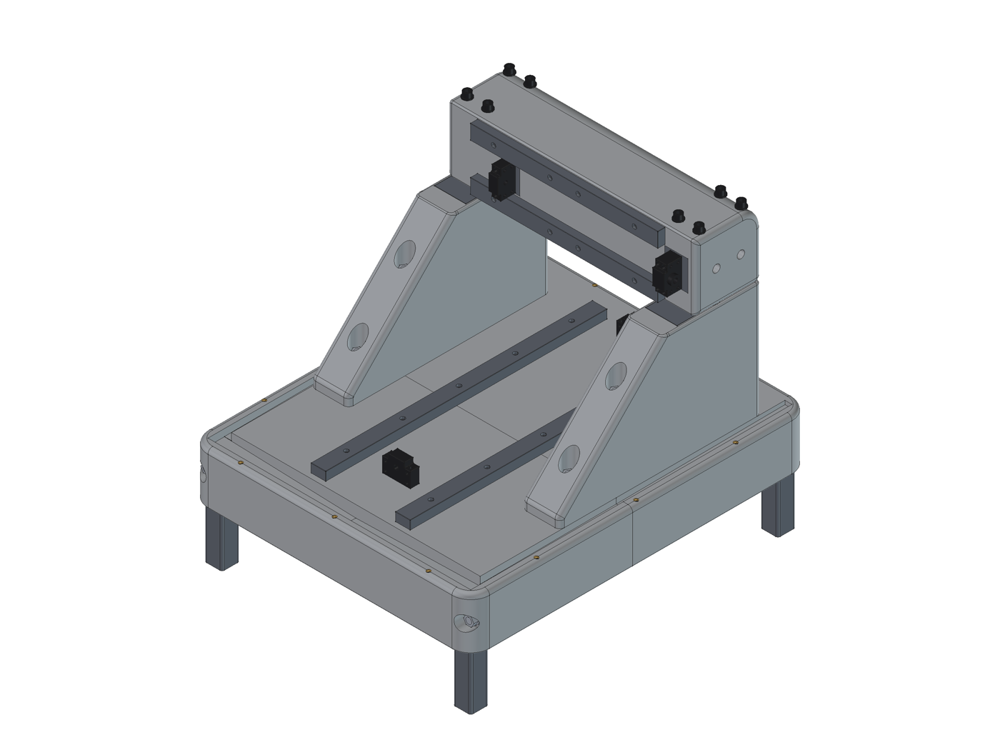

## 6. Axes

**Y (table).**
1. Bolt the Y rails (full 600 mm, centerd 20 mm behind the base split) to their risers
   (M4 x 16, about 4 N·m). Tighten the first rail against a
   straightedge, then set the second parallel with a dial indicator on a block of the first
   (within 0.01-0.02 mm over the travel).
2. Bolt the BK12 (fixed bearing, rear) and BF12 (front) to their tapped steel pads (M6 x 35, about
   6-8 N·m) with the screw installed. Align the screw parallel to the rails in both directions
   with a dial indicator on the nut. Shim under a support if needed; the screw should spin
   freely by hand along the whole length.
3. Mount the DSG16H nut housing under the table (shim to height), bolt the table to the four
   blocks and the housing, and check for binding at both ends of travel. Fit the motor
   bracket, the 8 x 10 coupler and the closed-loop motor.

**X (beam).**
1. Rails onto the X risers as for Y (100 mm spacing).
2. BK10 and BF10 onto the beam's face plate, tapped M6: M6 x 35 (the casting is relieved behind each
   hole, so the screws don't bottom).
   Align and check as for Y.
3. Bolt the X carriage plate to the four blocks and the nut housing; motor bracket, 8 x 8
   coupler, closed-loop motor.

**Z.**
1. Z risers onto the Z plate: tap the risers M5 and screw them on from the back of the plate
   (no inserts needed in aluminum). Rails on the risers, and the four Z blocks on the front
   of the X carriage.
2. BK10 / BF10 and the Z screw on the carriage, nut housing on the Z plate, open-loop motor
   on top.
3. Spindle clamp on the Z plate, spindle in the clamp. Tram it later (section 9).

Lubricate every block with the grease gun before moving anything far.

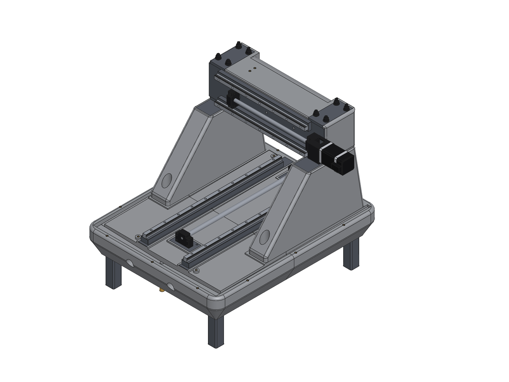

## 7. Electronics and spindle

- **Controller:** FluidNC board with external drivers. CL57T drivers for X and Y (closed loop),
  DM542T for Z, 48 V supply trimmed to about 46 V (the CL57T maxes out at 48 V), 24 V logic.
- **Steps:** with drivers at 1600 pulses/rev: Y (SFU1605, 5 mm lead) 320 steps/mm; X and Z
  (SFU1204, 4 mm lead) 400 steps/mm.
- **Spindle:** VFD for 120 V now (limits it to about 1.5 kW), the kit's 220 V VFD later on
  240 V. Use a dedicated 20 A circuit and shielded spindle cable, earthed at the VFD end. Set
  the VFD for the spindle's nameplate: 400 Hz, 220 V, 24,000 rpm.
- **Spindle cooling:** water pump in a 10-20 L bucket of distilled water with 10-20 % RV
  antifreeze, switched by a relay so it runs whenever the spindle runs. Never run the spindle
  dry.
- **Safety:** wire the E-stop to cut driver enable and the VFD run signal in hardware. Fit
  the homing switches, then the tool setter.

## 8. Enclosure and coolant (part 3 of the sourcing list)

The machine runs without these: until then, brush or drip cutting fluid onto the cut, keep the
way covers and screw cover on, and let the gutters and drain carry the fluid to the pan under the
base. Cast the enclosure inserts into the base now so the frame bolts straight on later.

1. Bolt the 2020 frame to the base top with angle brackets into the cast-in M5 inserts
   (M5 x 35). Cut list in `docs/5-design/report.txt`.
2. ACM side, back and roof panels; polycarbonate door on hinges and gas struts, magnetic catch.
   Brush seals where the X and Y motors pass through the panels.
3. Way covers: the stainless strips on their spring rollers in front of and behind the table,
   the spiral cover on the Y screw, the drip shield over the X rails.
4. Coolant: slide the sump (steam-table pan with the chip basket, magnet, baffle, screen and
   24 V pump) in under the base below the drain nipple. Run the return hose to the bulkhead, up
   the cable chain, to the manifold and nozzles on the spindle clamp. Use water-soluble coolant.

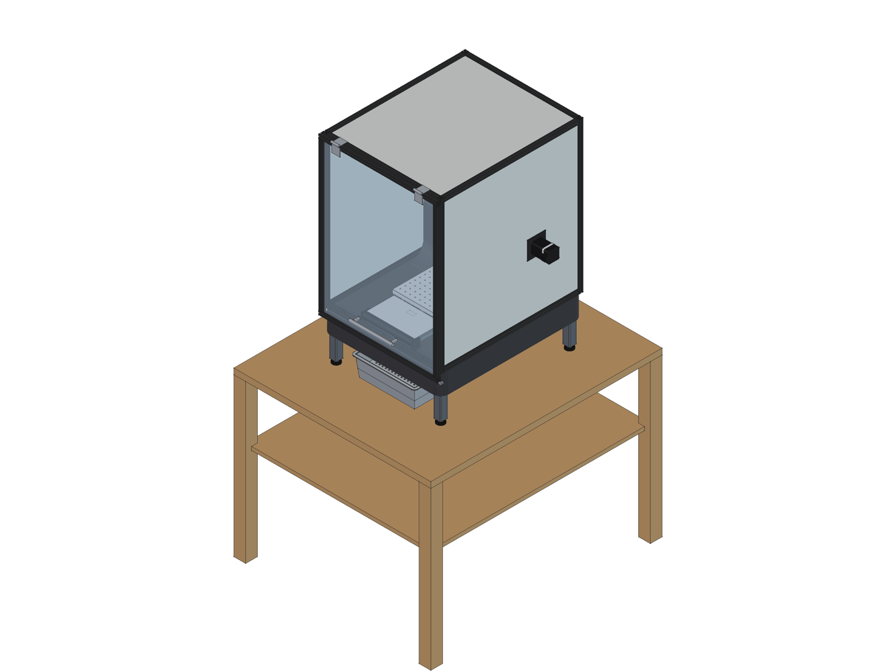

## 9. Commissioning

1. **Run each axis by hand,** then with the motors at low speed, end to end. Listen for tight
   spots.
2. **Homing and soft limits** in FluidNC; check the travel (180 / 300 / 140 mm).
3. **Steps per mm:** move 100 mm and measure with the dial indicator or a caliper; correct.
4. **Squareness:** sweep an indicator in the spindle along a straightedge or the table edge.
   X to Y is set by the beam position (step 4 of the frame); Z to the table is set by
   shimming the spindle clamp (tram). Aim for under 0.02 mm over 100 mm.
5. **Face the table:** take a light fly-cut over the aluminum table so it is flat and parallel
   to X/Y.
6. **First cuts:** aluminum first, then steel at light depths of cut with flood coolant. Check
   the spindle temperature and the coolant flow, and re-torque the frame bolts and the riser
   hold-downs after the first few hours of running.
