# Mold guide

How to make the molds for the five castings. Each mold also has its own shorter guide in this folder
(base, uprights, beam), and its own printable drilling templates in `templates/`.

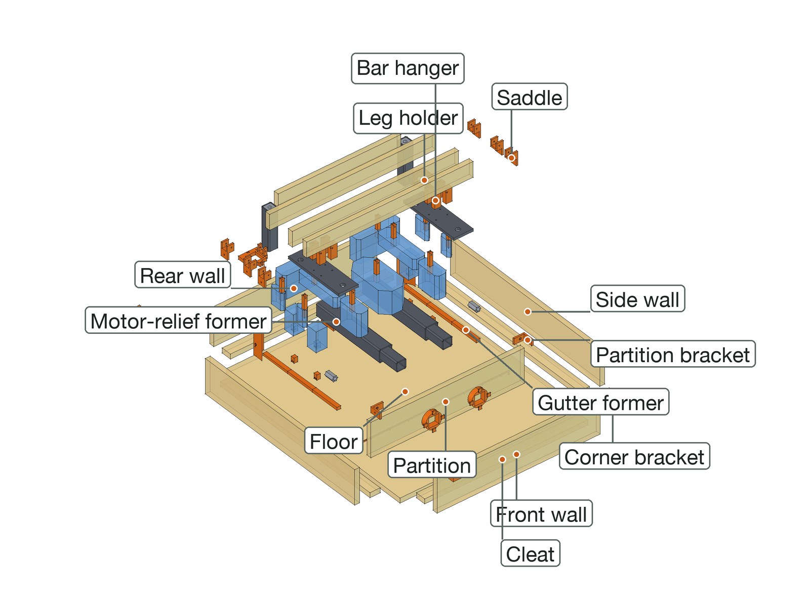

**In short:** melamine boards bolt together with printed brackets. Every printed piece bolts or pins to
its board from outside. The walls stand 25 mm above the pour line, so no bolt goes through a face the
mix touches. Nothing is glued, and it all comes apart for the next casting.

**Order of work:** print &rarr; cut the boards &rarr; mark them with the templates and drill &rarr; cut the foam &rarr; wax &rarr; assemble &rarr; pour &rarr; take apart.

## 1. How it works

- **Walls** stand on the floor against bolted-down **cleats**; **corner brackets** square the tops. All the
  bolts go through the top 25 mm, above the pour line.

- **Printed pieces** have a nut built in: it goes into a pocket on the board side and slides under the
  hole; an M4 bolt comes through the board from outside.

- **Thin pieces** (gasket-groove beads, motor relief) have 3 mm pins that push into 1/8 in holes.

- **Long pieces** are printed in parts that peg together; each part bolts down on its own.

- **Cores** are taped foam blocks with a printed post that bolts to a bridge across the mold.

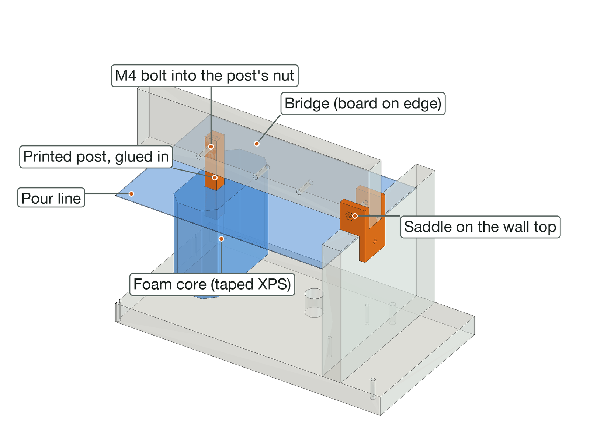

- **Fits** are 0.15 mm a side, and drawn for 19.05 mm board (Home Depot's 3/4 in melamine is a true
  0.750 in). Measure yours; if it differs, set `mold_board` in `model/build_cnc.py` and re-run it.

## 2. What you need

| Material | Amount | Notes |
|---|---|---|
| Melamine board, 3/4 in | 2 sheets, 4 x 8 ft | layout in section 4 |
| XPS foam board, 2 in | 1 sheet, 2 x 8 ft | the cores |
| PETG | 1.33 kg | sliced; everything printed for the machine fits in two 1 kg rolls |
| Packing tape, double-sided carpet tape | 1 roll each | wrapping and holding the foam |
| Paste wax and PVA | 1 each | release |
| 3/8 in quarter-round PVC molding | about 6 m | the rounded outside edges |
| 2x4 offcut | 4 blocks per upright mold, about 50 mm | feet |

| Hardware | Qty |
|---|---|
| M3 nut | 20 |
| M3 washer | 20 |
| M3 x 25 bolt | 20 |
| M4 nut | 190 |
| M4 washer | 186 |
| M4 x 20 bolt (leg pinch screw) | 4 |
| M4 x 30 bolt | 114 |
| M4 x 35 bolt | 28 |
| M4 x 45 bolt | 40 |
| M4 x 70 bolt | 4 |
| M5 x 20 screw, greased (holds an insert) | 29 |
| M5 x 60 screw (hangs an anchor bar) | 8 |
| M6 x 20 screw, greased (holds a pad) | 6 |
| M6 x 20 screw, greased (holds an insert) | 6 |
| 1/2 in plain steel rod, greased (forms a beam bolt hole), 198 mm | 8 |
| 1/2 in rod (or a tie rod), greased, 381 mm: centers a top tie-rod sleeve | 4 |
| 1/2-13 x 1-1/2 in bolt + nut, greased (forms the dowel hole) | 2 |
| 1/2-13 x 1-1/2 in bolt, greased (holds a draw-rod coupler) | 2 |
| 3/8-16 x 3 in bolt, greased (holds the top plate, both layers) | 4 |
| 5/8 in plain steel rod, greased (forms a slope tie-rod hole), cut to 134 mm, 237 mm | 2 |
| 5/8 in plain steel rod, greased (forms a tie-rod hole through the base and the anchor bar), 169 mm | 6 |

Add about 10 % spare small bolts, nuts and washers. **Tools:** drill and brad-point bits (sizes in section 5), a 2-1/2 in hole saw, a jigsaw for the side plates' slope, a square, clamps, a 7 mm nut driver, a 3 mm hex key, an awl, a fine saw or hot wire for the foam.

## 3. Print

150 prints, 1.33 kg, about 115 hours (sliced; settings in the print guide). Print one corner bracket and one saddle first
and check them on a board offcut. Press or slide the nuts in before the pieces go on the boards.

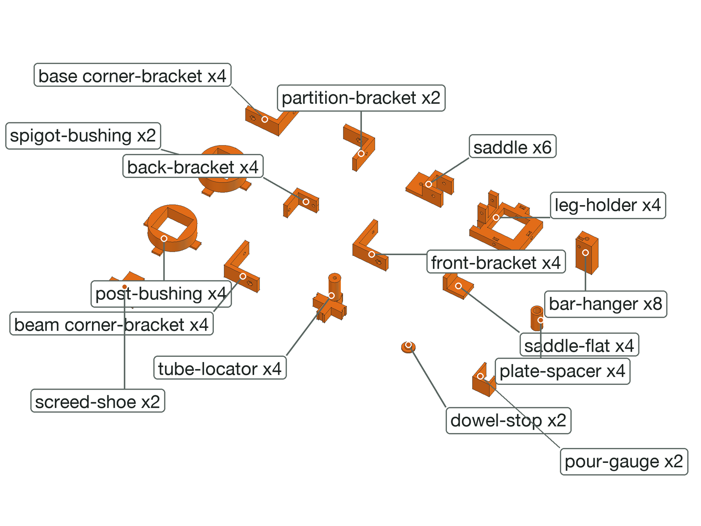

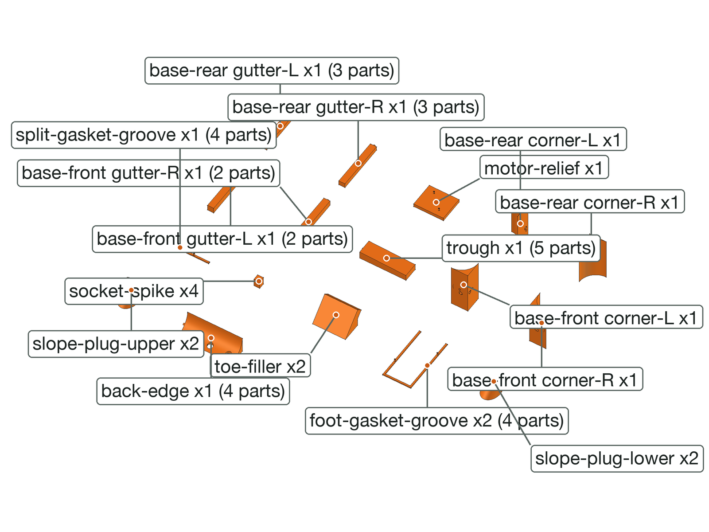

| File | Qty | g | Time each |
|---|---|---|---|
| `base-box/kit-corner-bracket.stl` | 4 | 33 | 39m 23s |
| `base-box/kit-partition-bracket.stl` | 2 | 14 | 35m 28s |
| `base-box/kit-saddle.stl` | 6 | 58 | 46m 3s |
| `base-box/kit-leg-holder.stl` | 4 | 82 | 1h 37m 1s |
| `base-box/kit-bar-hanger.stl` | 8 | 84 | 56m 45s |
| `base-rear/former-gutter-L-part1of3.stl` | 1 | 8 | 35m 5s |
| `base-rear/former-gutter-L-part2of3.stl` | 1 | 8 | 33m 40s |
| `base-rear/former-gutter-L-part3of3.stl` | 1 | 7 | 31m 15s |
| `base-rear/former-gutter-R-part1of3.stl` | 1 | 8 | 35m 6s |
| `base-rear/former-gutter-R-part2of3.stl` | 1 | 8 | 33m 40s |
| `base-rear/former-gutter-R-part3of3.stl` | 1 | 7 | 31m 15s |
| `base-rear/former-motor-relief.stl` | 1 | 12 | 40m 58s |
| `base-rear/filler-corner-L.stl` | 1 | 17 | 1h 44m 24s |
| `base-rear/filler-corner-R.stl` | 1 | 16 | 1h 42m 27s |
| `base-front/former-gutter-L-part1of2.stl` | 1 | 11 | 49m 23s |
| `base-front/former-gutter-L-part2of2.stl` | 1 | 10 | 43m 43s |
| `base-front/former-gutter-R-part1of2.stl` | 1 | 11 | 49m 24s |
| `base-front/former-gutter-R-part2of2.stl` | 1 | 10 | 43m 43s |
| `base-front/former-trough-part1of5.stl` | 1 | 20 | 1h 14m 18s |
| `base-front/former-trough-part2of5.stl` | 1 | 22 | 1h 23m 56s |
| `base-front/former-trough-part3of5.stl` | 1 | 25 | 1h 33m 33s |
| `base-front/former-trough-part4of5.stl` | 1 | 23 | 1h 24m 3s |
| `base-front/former-trough-part5of5.stl` | 1 | 21 | 1h 17m 36s |
| `base-front/filler-corner-L.stl` | 1 | 21 | 2h 0m 50s |
| `base-front/filler-corner-R.stl` | 1 | 21 | 1h 56m 31s |
| `base-rear/former-split-gasket-groove-part1of4.stl` | 1 | 2 | 9m 50s |
| `base-rear/former-split-gasket-groove-part2of4.stl` | 1 | 1 | 8m 58s |
| `base-rear/former-split-gasket-groove-part3of4.stl` | 1 | 1 | 8m 58s |
| `base-rear/former-split-gasket-groove-part4of4.stl` | 1 | 2 | 9m 53s |
| `base-front/core-center-post.stl` | 1 | 5 | 44m 56s |
| `base-rear/core-center-post.stl` | 1 | 5 | 44m 56s |
| `base-front/core-outboard-L-post.stl` | 1 | 5 | 44m 53s |
| `base-front/core-trough-band-L-post.stl` | 1 | 5 | 44m 54s |
| `base-front/core-draw-rod-L-post.stl` | 1 | 5 | 44m 53s |
| `base-front/core-foot-a-L-post.stl` | 1 | 5 | 44m 53s |
| `base-rear/core-foot-b-L-post.stl` | 1 | 5 | 44m 53s |
| `base-rear/core-knee-L-post.stl` | 1 | 5 | 44m 53s |
| `base-rear/core-outer-a-L-post.stl` | 1 | 5 | 44m 53s |
| `base-rear/core-outer-b-L-post.stl` | 1 | 5 | 44m 53s |
| `base-rear/core-rear-L-post.stl` | 1 | 5 | 44m 53s |
| `base-front/core-outboard-R-post.stl` | 1 | 5 | 44m 53s |
| `base-front/core-trough-band-R-post.stl` | 1 | 5 | 44m 54s |
| `base-front/core-draw-rod-R-post.stl` | 1 | 5 | 44m 53s |
| `base-front/core-foot-a-R-post.stl` | 1 | 5 | 44m 53s |
| `base-rear/core-foot-b-R-post.stl` | 1 | 5 | 44m 53s |
| `base-rear/core-knee-R-post.stl` | 1 | 5 | 44m 53s |
| `base-rear/core-outer-a-R-post.stl` | 1 | 5 | 44m 53s |
| `base-rear/core-outer-b-R-post.stl` | 1 | 5 | 44m 53s |
| `base-rear/core-rear-R-post.stl` | 1 | 5 | 44m 53s |
| `base-rear/plug-socket-spike.stl` | 4 | 8 | 13m 26s |
| `base-rear/kit-spigot-bushing.stl` | 2 | 34 | 1h 11m 37s |
| `upright/kit-back-bracket.stl` | 4 | 21 | 27m 33s |
| `upright/kit-front-bracket.stl` | 4 | 32 | 38m 27s |
| `upright/kit-saddle-flat.stl` | 4 | 18 | 22m 40s |
| `upright/filler-toe-filler.stl` | 2 | 54 | 1h 33m 58s |
| `upright/former-foot-gasket-groove-part1of4.stl` | 2 | 7 | 17m 8s |
| `upright/former-foot-gasket-groove-part2of4.stl` | 2 | 3 | 8m 46s |
| `upright/former-foot-gasket-groove-part3of4.stl` | 2 | 3 | 8m 46s |
| `upright/former-foot-gasket-groove-part4of4.stl` | 2 | 7 | 17m 10s |
| `upright/plug-slope-plug-lower.stl` | 2 | 29 | 1h 0m 39s |
| `upright/plug-slope-plug-upper.stl` | 2 | 29 | 1h 0m 39s |
| `upright/kit-plate-spacer.stl` | 4 | 15 | 20m 9s |
| `upright/kit-post-bushing.stl` | 4 | 67 | 1h 11m 51s |
| `beam/kit-corner-bracket.stl` | 4 | 33 | 40m 3s |
| `beam/filler-back-edge-part1of4.stl` | 1 | 19 | 1h 14m 46s |
| `beam/filler-back-edge-part2of4.stl` | 1 | 19 | 1h 14m 46s |
| `beam/filler-back-edge-part3of4.stl` | 1 | 19 | 1h 14m 46s |
| `beam/filler-back-edge-part4of4.stl` | 1 | 19 | 1h 15m 1s |
| `beam/kit-tube-locator.stl` | 4 | 43 | 58m 26s |
| `beam/kit-dowel-stop.stl` | 2 | 1 | 4m 19s |
| `tools/kit-pour-gauge.stl` | 2 | 9 | 24m 33s |
| `tools/kit-screed-shoe.stl` | 2 | 20 | 44m 42s |
| `base-front/cast-in-base-front-tube-plug-l.stl` | 2 | 15 | 39m 34s |
| `base-front/cast-in-base-front-spigot-sleeve-l.stl` | 2 | 22 | 59m 28s |
| `base-front/cast-in-leg-front-l-plug.stl` | 2 | 8 | 24m 14s |
| `base-rear/cast-in-base-rear-tube-plug-l.stl` | 2 | 15 | 39m 16s |
| `base-rear/cast-in-base-rear-spigot-sleeve-l.stl` | 2 | 22 | 59m 31s |
| `base-rear/cast-in-leg-rear-l-plug.stl` | 2 | 8 | 24m 14s |
| `upright/cast-in-post-l1-plug.stl` | 4 | 16 | 24m 37s |
| `upright/cast-in-rod-sleeve-l1a.stl` | 8 | 61 | 57m 53s |

## 4. Cut the boards

Have the store rip the strips; crosscut at home. Write each board's name on its outside face, and mark
the cast face (the melamine face the mix touches).

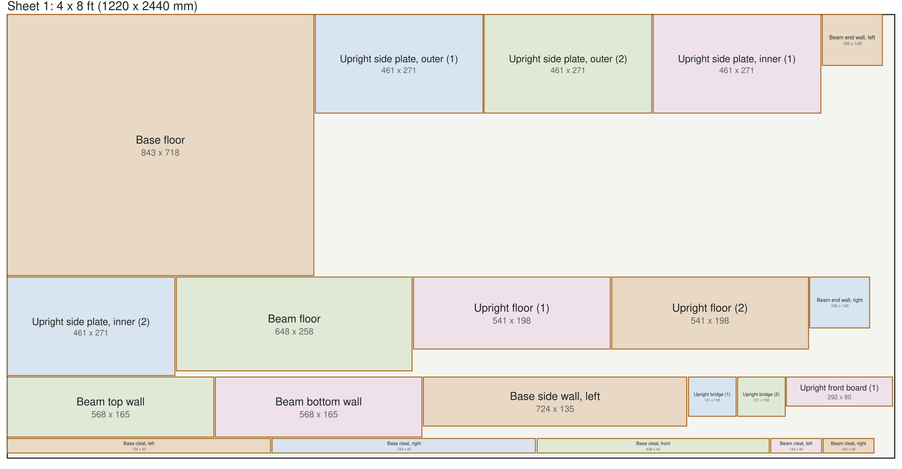

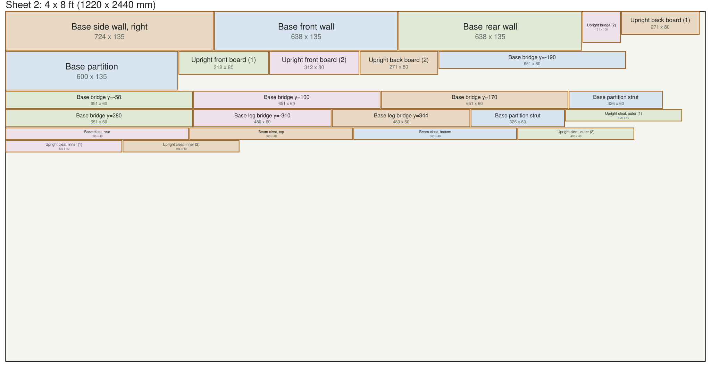

| Board | Qty | Size (mm) | Notes |
|---|---|---|---|
| Base floor | 1 | 718 x 843 | both halves are cast on it |
| Base front wall | 1 | 638 x 135 |  |
| Base rear wall | 1 | 638 x 135 |  |
| Base side wall, left | 1 | 724 x 135 |  |
| Base side wall, right | 1 | 724 x 135 |  |
| Base partition | 1 | 600 x 135 | rear half only; comes out before the front half |
| Base partition strut | 2 | 326 x 60 | offcut, stands on edge; holds the partition foot (rear half only) |
| Base cleat, front | 1 | 638 x 40 | offcut strip, flat on the floor |
| Base cleat, rear | 1 | 638 x 40 | offcut strip, flat on the floor |
| Base cleat, left | 1 | 724 x 40 | offcut strip, flat on the floor |
| Base cleat, right | 1 | 724 x 40 | offcut strip, flat on the floor |
| Base bridge y=-190 | 1 | 651 x 60 |  |
| Base bridge y=-58 | 1 | 651 x 60 |  |
| Base bridge y=100 | 1 | 651 x 60 |  |
| Base bridge y=170 | 1 | 651 x 60 |  |
| Base bridge y=280 | 1 | 651 x 60 |  |
| Base leg bridge y=-310 | 1 | 480 x 60 |  |
| Base leg bridge y=344 | 1 | 480 x 60 |  |
| Upright floor | 2 | 198 x 575 |  |
| Upright side plate, outer | 2 | 495 x 271 (profile) | cut to the profile |
| Upright side plate, inner | 2 | 495 x 271 (profile) | cut to the profile |
| Upright back board | 2 | 80 x 271 |  |
| Upright front board | 2 | 80 x 312 | ends cut square |
| Upright bridge | 2 | 131 x 108 |  |
| Upright cleat, outer | 2 | 405 x 40 | offcut strip, flat on the floor |
| Upright cleat, inner | 2 | 405 x 40 | offcut strip, flat on the floor |
| Upright cleat, back | 2 | 80 x 40 | offcut strip, flat on the floor |
| Beam floor | 1 | 648 x 258 |  |
| Beam top wall | 1 | 568 x 165 |  |
| Beam bottom wall | 1 | 568 x 165 |  |
| Beam end wall, left | 1 | 140 x 165 |  |
| Beam end wall, right | 1 | 140 x 165 |  |
| Beam cleat, top | 1 | 568 x 40 | offcut strip, flat on the floor |
| Beam cleat, bottom | 1 | 568 x 40 | offcut strip, flat on the floor |
| Beam cleat, left | 1 | 140 x 40 | offcut strip, flat on the floor |
| Beam cleat, right | 1 | 140 x 40 | offcut strip, flat on the floor |

## 5. Mark and drill

1. Print the drilling templates (`templates/base-templates.pdf`, `templates/upright-templates.pdf`, `templates/beam-templates.pdf`) at **actual size** and check the 100 mm square.
2. Tape each board's pages onto it: printed edges on the board's edges, grid lines lined up.
3. Awl through every crosshair. Pencil the dashed **pour line** on the walls.
4. Drill from the marked face, at the size the color legend gives. Pilot the big ones; the 63.5 mm
   holes are a 2-1/2 in hole saw.

The appendix has every board as a drawing and a table, if you would rather measure.

| Hole | Drill | For |
|---|---|---|
| 3.2 mm | 1/8 in | foot-gasket-groove, motor-relief, split-gasket-groove |
| 3.4 mm | 9/64 in | corner-L, corner-R, gutter-L, gutter-R |
| 4.5 mm | 11/64 in | back-edge, bar hanger, cleat, core post, corner bracket, corner-L, corner-R, gutter-L, gutter-R, leg holder, saddle, slope-plug-lower, slope-plug-upper, socket spike, toe-filler, trough, tube locator |
| 5.5 mm | 7/32 in | M5 insert screw |
| 6.5 mm | 17/64 in | M6 insert screw |
| 9.6 mm | 25/64 in | 3/8 dowel |
| 10 mm | 25/64 in | 3/8-16 bolt into the top plate |
| 13.1 mm | 33/64 in | 1/2 core rod, 1/2-13 bolt, base dowel hole |
| 13.5 mm | 17/32 in | 1/2 rod through a sleeve, 1/2-13 bolt into coupler |
| 16.3 mm | 41/64 in | 5/8 core rod |
| 63.5 mm | 2-1/2 in hole saw | hole saw |

## 6. Cut the foam

Fine saw, hot wire or a long knife. Stack and glue two layers of 2 in foam for the 90 mm cores. Wrap
each piece smooth in packing tape. Cut a snug 12 mm square hole 30 mm deep for each core's post and
glue the post in.

| Casting | Piece | Qty | Size and how |
|---|---|---|---|
| base-front | center | 1 | XPS block 100 x 185 x 90 mm, outline as the pocket (chamfered corners); taped, with its printed post glued in. |
| base-rear | center | 1 | XPS block 100 x 190 x 90 mm, outline as the pocket (chamfered corners); taped, with its printed post glued in. |
| base-front | outboard-L | 1 | XPS block 130 x 164 x 90 mm, outline as the pocket (chamfered corners); taped, with its printed post glued in. |
| base-front | trough-band-L | 1 | XPS block 101 x 55 x 40 mm, outline as the pocket (chamfered corners); taped, with its printed post glued in. |
| base-front | draw-rod-L | 1 | XPS block 20 x 255 x 40 mm, outline as the pocket (chamfered corners); taped, with its printed post glued in. |
| base-front | foot-a-L | 1 | XPS block 45 x 66 x 90 mm, outline as the pocket (chamfered corners); taped, with its printed post glued in. |
| base-rear | foot-b-L | 1 | XPS block 45 x 99 x 90 mm, outline as the pocket (chamfered corners); taped, with its printed post glued in. |
| base-rear | knee-L | 1 | XPS block 50 x 184 x 40 mm, outline as the pocket (chamfered corners); taped, with its printed post glued in. |
| base-rear | outer-a-L | 1 | XPS block 20 x 44 x 65 mm, outline as the pocket (chamfered corners); taped, with its printed post glued in. |
| base-rear | outer-b-L | 1 | XPS block 20 x 60 x 65 mm, outline as the pocket (chamfered corners); taped, with its printed post glued in. |
| base-rear | rear-L | 1 | XPS block 170 x 52 x 90 mm, outline as the pocket (chamfered corners); taped, with its printed post glued in. |
| base-front | outboard-R | 1 | XPS block 130 x 164 x 90 mm, outline as the pocket (chamfered corners); taped, with its printed post glued in. |
| base-front | trough-band-R | 1 | XPS block 101 x 55 x 40 mm, outline as the pocket (chamfered corners); taped, with its printed post glued in. |
| base-front | draw-rod-R | 1 | XPS block 20 x 255 x 40 mm, outline as the pocket (chamfered corners); taped, with its printed post glued in. |
| base-front | foot-a-R | 1 | XPS block 45 x 66 x 90 mm, outline as the pocket (chamfered corners); taped, with its printed post glued in. |
| base-rear | foot-b-R | 1 | XPS block 45 x 99 x 90 mm, outline as the pocket (chamfered corners); taped, with its printed post glued in. |
| base-rear | knee-R | 1 | XPS block 50 x 184 x 40 mm, outline as the pocket (chamfered corners); taped, with its printed post glued in. |
| base-rear | outer-a-R | 1 | XPS block 20 x 44 x 65 mm, outline as the pocket (chamfered corners); taped, with its printed post glued in. |
| base-rear | outer-b-R | 1 | XPS block 20 x 60 x 65 mm, outline as the pocket (chamfered corners); taped, with its printed post glued in. |
| base-rear | rear-R | 1 | XPS block 170 x 52 x 90 mm, outline as the pocket (chamfered corners); taped, with its printed post glued in. |
| base-rear | socket | 4 | XPS block 43 x 43 x 80 mm, taped; dig it out after curing (a little acetone dissolves the rest). |

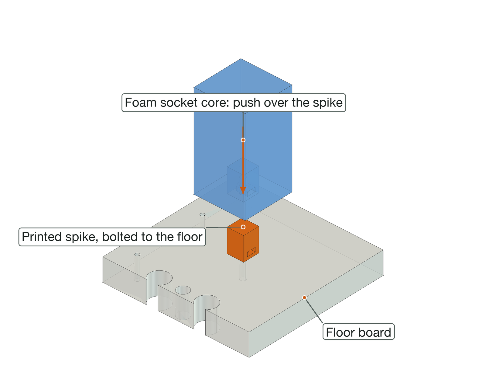

## 7. Wax

- 3-5 coats of paste wax on every face the mix touches, boards and removable printed pieces, then PVA.
  Don't wax pieces that stay in (core posts, cast-in parts): scuff and degrease them.
- Glue quarter-round into the floor-to-wall corners that make outside edges; silicone fillets elsewhere.
- Grease every screw, bolt and rod that comes out of the casting.

## 8. Assemble

### Base, rear half (first)

Cast upside down, top face on the floor; shown the right way up. New parts in color.

1. Floor on three battens. Bolt the cleats down.

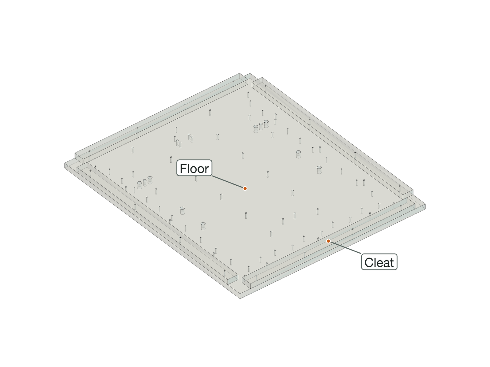

2. Walls against the cleats; corner brackets at the top. Diagonals equal within 2 mm, then tighten.

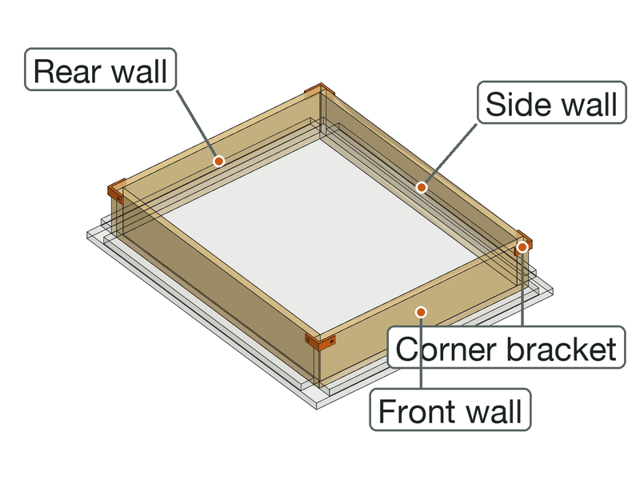

3. Partition between the side walls: two brackets, two struts to the front wall. Beads on its pins, spigot bushings in its holes.

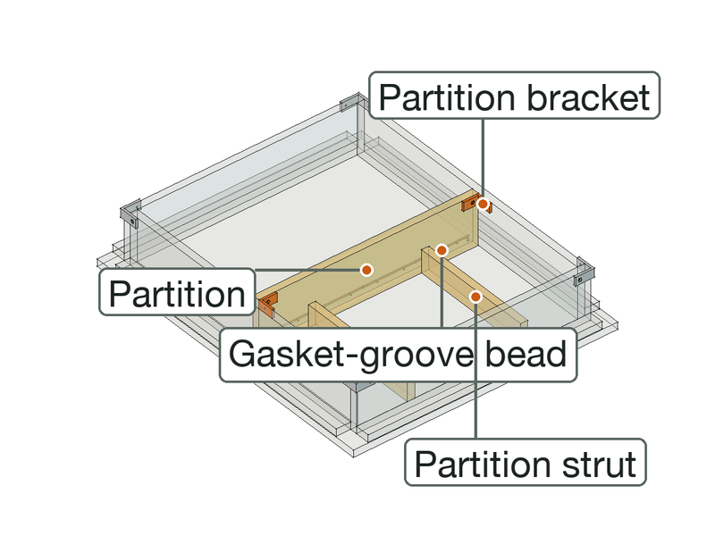

4. Gutter formers, motor relief and corner fillers on; socket spikes bolted down with a foam block on each.

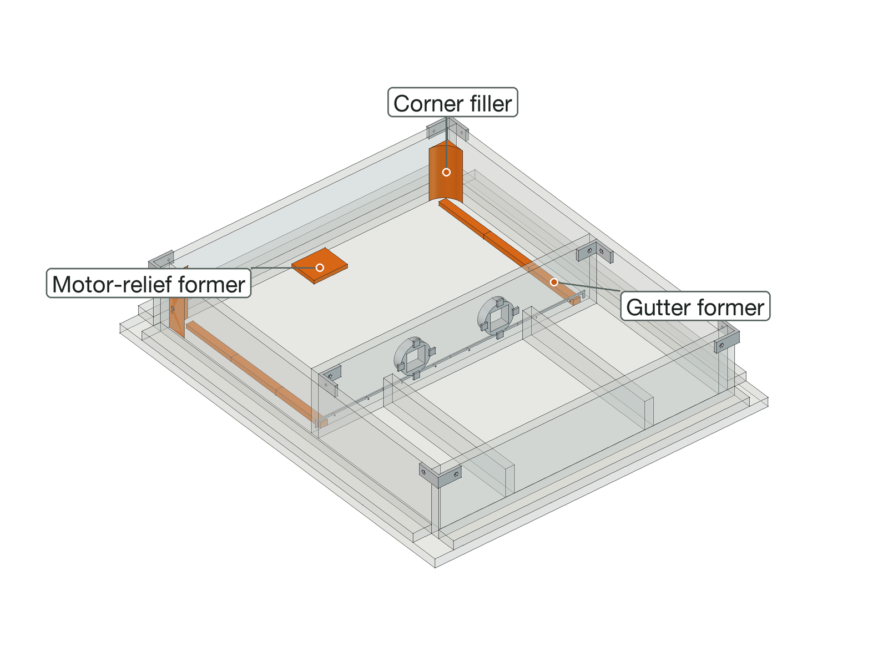

5. Inserts on their greased screws; greased 5/8 in rods up through the floor for the tie-rod holes; spigots through the bushings to their middle marks, rear tubes on them, split ends tight to the partition; leg holders in the corners, legs set to height, pinch screws tight.

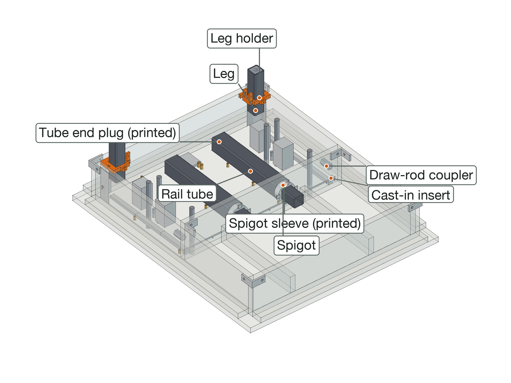

6. Pour the 20 mm skin. Foam cores on it, bridges into the saddles, each post bolted to its bridge. Fill to the pour line; the anchor bars over the rods, screwed to their hangers, flush with the line.

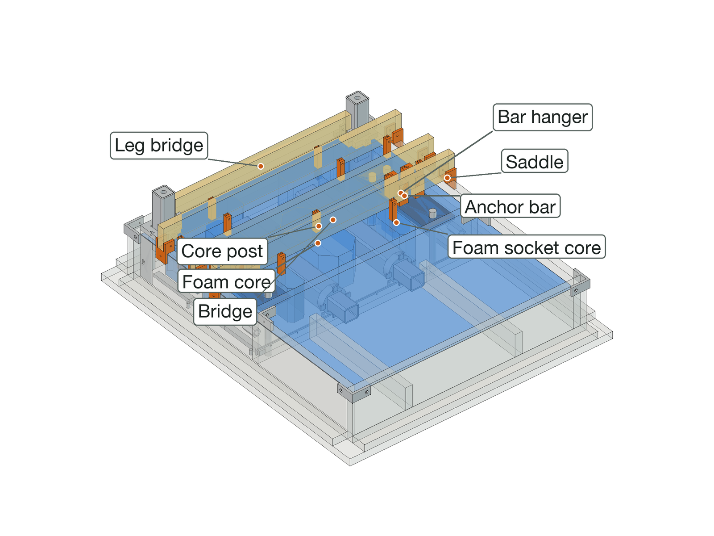

### Base, front half (against the rear half)

1. After the cure: bridges, partition and struts off. Dig out the socket foam, pull the beads, tape the groove, and wax the rear half's split face and spigots.

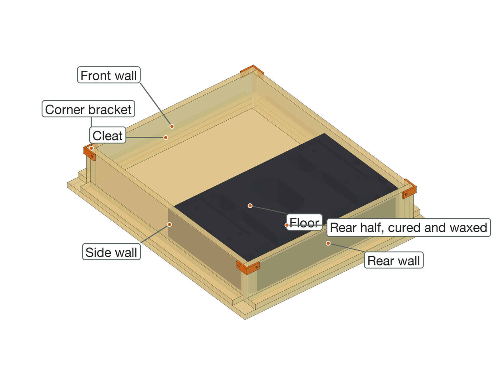

2. Trough and gutter formers and corner fillers on; front tubes onto the spigots; draw rods into the rear couplers; inserts, tie-rod core rods and legs.

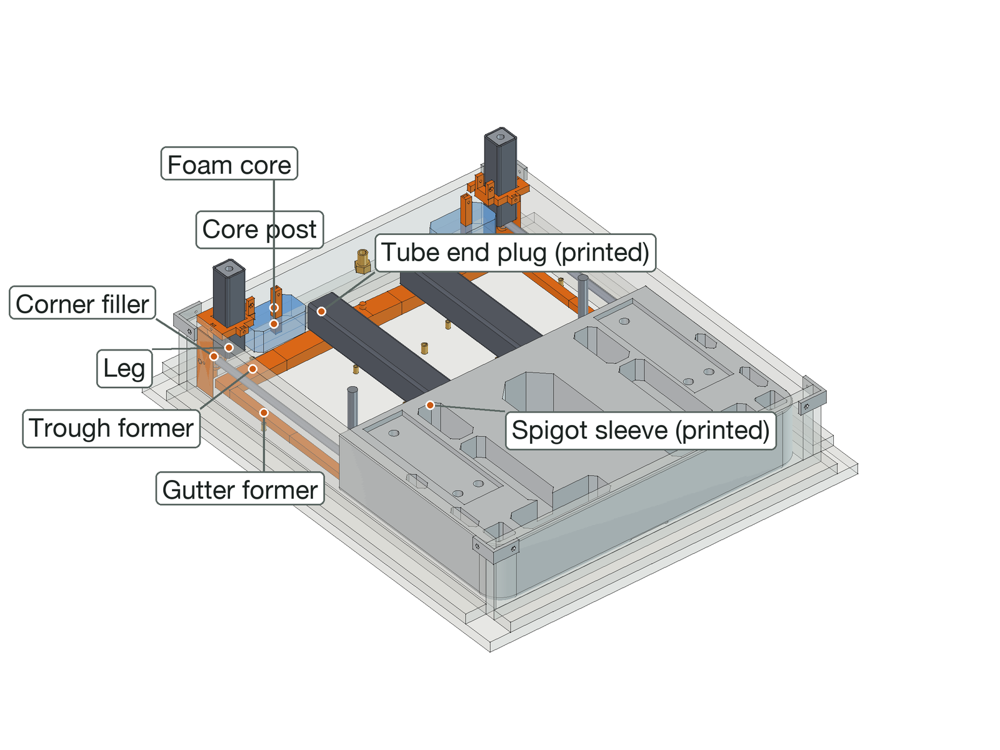

3. Skin, cores, bridges, fill; the anchor bars on their hangers. After the cure, pull the rods, take it apart and split the halves with wedges.

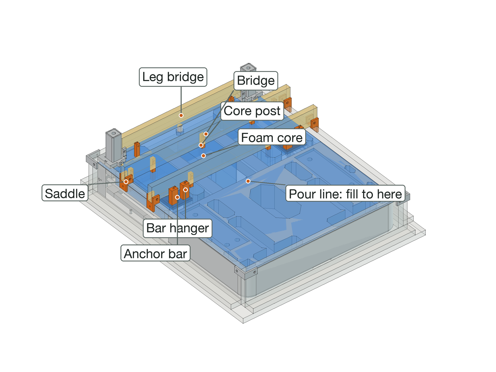

### Uprights (two molds)

Cast foot down. Build two of everything.

1. Post bushings into the floor from below; gasket bead pinned on; cleats bolted down.

2. Side plates against their cleats, back board between them, two back brackets.

3. Toe filler bolted down, the front board's foot in its lip, two front brackets at the top.

4. Mold on its four 2x4 blocks. Posts up through the bushings, standing on the bench (a long post just ends nearer the top plate: 6 mm room); greased 5/8 in rods up through the floor into the slope plugs; the two top sleeves standing over their floor holes, tops taped; dowel-hole bolt from underneath.

5. Fill to the line. Top plate (both layers) hung from the bridge, bridge onto its saddles; greased 1/2 in rods up from under the floor, through the sleeves, the plate and the bridge.

### Beam

Cast front (rail) face down, back open.

1. Cleats bolted down; support pads and riser inserts screwed to the floor.

2. Walls against the cleats; four corner brackets.

3. Tube locators bolted through the end walls. Butter the support pads with thickened epoxy (about 3 mm), then the tubes between the locators, holes over the rod holes; back-edge filler on the top wall; dowels on their stops; greased 1/2 in rods through both walls and the tubes. Fill to the line.

## 9. Pour

- Fill to the **pour line**, 25 mm below the wall tops (pencilled from the templates, or with the
  printed pour-line gauge clipped over a wall).
- Vibrate each layer until it stops bubbling; check the brackets halfway through.
- Strike the top off with a straight board in the two printed **screed shoes**: they hang it from the wall
  tops with its bottom edge on the pour line.

## 10. Take apart

1. After the full cure: bridges and saddles off, then corner brackets, then cleats; pull the walls off.
2. Screws, bolts and rods out from outside; lift the casting off the floor.
3. Unbolt and pull the formers and fillers. Dig out the socket foam (a little acetone helps).
4. Scrape and re-wax the boards; keep each mold's kit in a box. The kit is reused.

## 11. If something doesn't fit

| Problem | Fix |
|---|---|
| Nut won't slide under the hole | Clean the pocket with a nut on a bolt; warm the nut |
| Bracket or saddle loose on the board | Board thinner than set: tape shim, or set `mold_board` and reprint |
| Pin won't go in | Run the 1/8 in bit through again; trim the pin tip |
| Foam core moves | Tighten its post bolt; carpet tape under it |
| Printed part won't go on or into a steel tube | File the weld seam; sand the part. Several tight: caliper the tube, put its sizes in `frame_tube` / `post_tube`, re-run and reprint |
| Printed part loose on a tube | A wrap of tape round the part |
| Leak at a corner | Silicone fillet inside before waxing; check the brackets and diagonals |
| Former stuck after curing | Bolts out first, then a dowel and a light tap |

## Appendix: hole maps

Every board as seen from the face you mark: x from the left edge, y from the bottom edge (for a wall, the
edge on the floor). The templates carry the same holes at full size.

### Base

#### Base floor

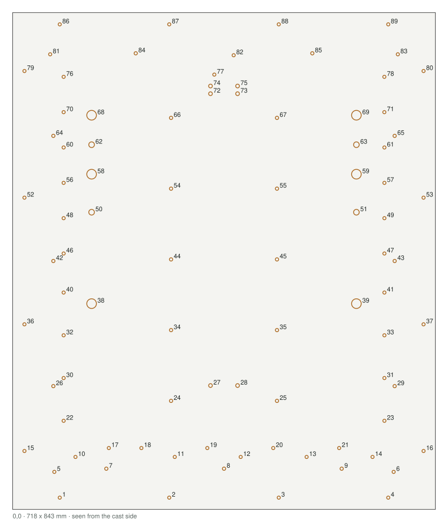

| # | x | y | Hole | For |
|---|---|---|---|---|
| 1 | 80 | 20 | 4.5 | cleat |
| 2 | 266 | 20 | 4.5 | cleat |
| 3 | 452 | 20 | 4.5 | cleat |
| 4 | 638 | 20 | 4.5 | cleat |
| 5 | 71 | 64 | 3.4 | corner-R |
| 6 | 647 | 64 | 3.4 | corner-L |
| 7 | 159 | 69 | 5.5 | M5 insert screw |
| 8 | 359 | 69 | 5.5 | M5 insert screw |
| 9 | 559 | 69 | 5.5 | M5 insert screw |
| 10 | 107 | 89 | 4.5 | trough |
| 11 | 275 | 89 | 4.5 | trough |
| 12 | 387 | 89 | 4.5 | trough |
| 13 | 499 | 89 | 4.5 | trough |
| 14 | 611 | 89 | 4.5 | trough |
| 15 | 20 | 99 | 4.5 | cleat |
| 16 | 698 | 99 | 4.5 | cleat |
| 17 | 163 | 104 | 4.5 | trough |
| 18 | 219 | 104 | 4.5 | trough |
| 19 | 331 | 104 | 4.5 | trough |
| 20 | 443 | 104 | 4.5 | trough |
| 21 | 555 | 104 | 4.5 | trough |
| 22 | 87 | 150 | 4.5 | gutter-R |
| 23 | 632 | 150 | 4.5 | gutter-L |
| 24 | 269 | 184 | 5.5 | M5 insert screw |
| 25 | 449 | 184 | 5.5 | M5 insert screw |
| 26 | 69 | 209 | 5.5 | M5 insert screw |
| 27 | 336 | 210 | 6.5 | M6 insert screw |
| 28 | 382 | 210 | 6.5 | M6 insert screw |
| 29 | 649 | 209 | 5.5 | M5 insert screw |
| 30 | 87 | 223 | 4.5 | gutter-R |
| 31 | 632 | 223 | 4.5 | gutter-L |
| 32 | 87 | 295 | 3.4 | gutter-R |
| 33 | 632 | 295 | 3.4 | gutter-L |
| 34 | 269 | 304 | 5.5 | M5 insert screw |
| 35 | 449 | 304 | 5.5 | M5 insert screw |
| 36 | 20 | 314 | 4.5 | cleat |
| 37 | 698 | 314 | 4.5 | cleat |
| 38 | 134 | 344 | 16.3 | 5/8 core rod |
| 39 | 584 | 344 | 16.3 | 5/8 core rod |
| 40 | 87 | 368 | 3.4 | gutter-R |
| 41 | 632 | 368 | 3.4 | gutter-L |
| 42 | 69 | 421 | 5.5 | M5 insert screw |
| 43 | 649 | 421 | 5.5 | M5 insert screw |
| 44 | 269 | 424 | 5.5 | M5 insert screw |
| 45 | 449 | 424 | 5.5 | M5 insert screw |
| 46 | 87 | 434 | 3.4 | gutter-R |
| 47 | 632 | 434 | 3.4 | gutter-L |
| 48 | 134 | 444 | 16.3 | 5/8 core rod |
| 49 | 584 | 444 | 16.3 | 5/8 core rod |
| 50 | 87 | 494 | 3.4 | gutter-R |
| 51 | 632 | 494 | 3.4 | gutter-L |
| 52 | 20 | 529 | 4.5 | cleat |
| 53 | 698 | 529 | 4.5 | cleat |
| 54 | 269 | 544 | 5.5 | M5 insert screw |
| 55 | 449 | 544 | 5.5 | M5 insert screw |
| 56 | 87 | 554 | 3.4 | gutter-R |
| 57 | 632 | 554 | 3.4 | gutter-L |
| 58 | 134 | 569 | 4.5 | socket spike |
| 59 | 584 | 569 | 4.5 | socket spike |
| 60 | 87 | 614 | 3.4 | gutter-R |
| 61 | 632 | 614 | 3.4 | gutter-L |
| 62 | 114 | 624 | 16.3 | 5/8 core rod |
| 63 | 134 | 624 | 9.6 | 3/8 dowel |
| 64 | 154 | 624 | 16.3 | 5/8 core rod |
| 65 | 564 | 624 | 16.3 | 5/8 core rod |
| 66 | 584 | 624 | 9.6 | 3/8 dowel |
| 67 | 604 | 624 | 16.3 | 5/8 core rod |
| 68 | 69 | 634 | 5.5 | M5 insert screw |
| 69 | 649 | 634 | 5.5 | M5 insert screw |
| 70 | 269 | 664 | 5.5 | M5 insert screw |
| 71 | 449 | 664 | 5.5 | M5 insert screw |
| 72 | 87 | 674 | 3.4 | gutter-R |
| 73 | 632 | 674 | 3.4 | gutter-L |
| 74 | 134 | 679 | 4.5 | socket spike |
| 75 | 584 | 679 | 4.5 | socket spike |
| 76 | 336 | 705 | 6.5 | M6 insert screw |
| 77 | 382 | 705 | 6.5 | M6 insert screw |
| 78 | 336 | 718 | 6.5 | M6 insert screw |
| 79 | 382 | 718 | 6.5 | M6 insert screw |
| 80 | 87 | 734 | 3.4 | gutter-R |
| 81 | 343 | 737 | 3.2 | motor-relief |
| 82 | 632 | 734 | 3.4 | gutter-L |
| 83 | 20 | 744 | 4.5 | cleat |
| 84 | 698 | 744 | 4.5 | cleat |
| 85 | 64 | 772 | 3.4 | corner-R |
| 86 | 375 | 770 | 3.2 | motor-relief |
| 87 | 654 | 772 | 3.4 | corner-L |
| 88 | 209 | 774 | 5.5 | M5 insert screw |
| 89 | 509 | 774 | 5.5 | M5 insert screw |
| 90 | 80 | 823 | 4.5 | cleat |
| 91 | 266 | 823 | 4.5 | cleat |
| 92 | 452 | 823 | 4.5 | cleat |
| 93 | 638 | 823 | 4.5 | cleat |

#### Base front wall

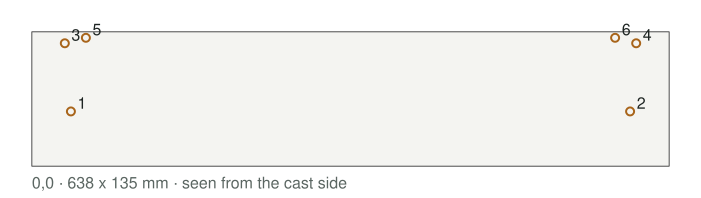

| # | x | y | Hole | For |
|---|---|---|---|---|
| 1 | 39 | 55 | 4.5 | corner-L |
| 2 | 599 | 55 | 4.5 | corner-R |
| 3 | 33 | 124 | 4.5 | corner bracket |
| 4 | 605 | 124 | 4.5 | corner bracket |
| 5 | 54 | 129 | 4.5 | leg holder |
| 6 | 584 | 129 | 4.5 | leg holder |

#### Base rear wall

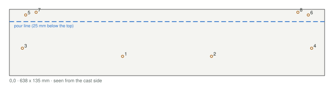

| # | x | y | Hole | For |
|---|---|---|---|---|
| 1 | 26 | 56 | 4.5 | corner-R |
| 2 | 612 | 56 | 4.5 | corner-L |
| 3 | 33 | 124 | 4.5 | corner bracket |
| 4 | 605 | 124 | 4.5 | corner bracket |
| 5 | 54 | 129 | 4.5 | leg holder |
| 6 | 584 | 129 | 4.5 | leg holder |

#### Base side wall, left

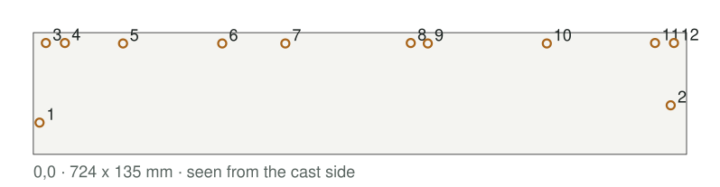

| # | x | y | Hole | For |
|---|---|---|---|---|
| 1 | 7 | 35 | 4.5 | corner-L |
| 2 | 707 | 54 | 4.5 | corner-L |
| 3 | 14 | 124 | 4.5 | corner bracket |
| 4 | 100 | 123 | 4.5 | saddle |
| 5 | 210 | 123 | 4.5 | saddle |
| 6 | 280 | 123 | 4.5 | saddle |
| 7 | 419 | 124 | 4.5 | corner bracket |
| 8 | 438 | 123 | 4.5 | saddle |
| 9 | 570 | 123 | 4.5 | saddle |
| 10 | 711 | 124 | 4.5 | corner bracket |
| 11 | 35 | 129 | 4.5 | leg holder |
| 12 | 690 | 129 | 4.5 | leg holder |

#### Base side wall, right

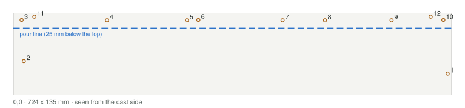

| # | x | y | Hole | For |
|---|---|---|---|---|
| 1 | 718 | 35 | 4.5 | corner-R |
| 2 | 18 | 56 | 4.5 | corner-R |
| 3 | 14 | 124 | 4.5 | corner bracket |
| 4 | 155 | 123 | 4.5 | saddle |
| 5 | 287 | 123 | 4.5 | saddle |
| 6 | 306 | 124 | 4.5 | corner bracket |
| 7 | 445 | 123 | 4.5 | saddle |
| 8 | 515 | 123 | 4.5 | saddle |
| 9 | 625 | 123 | 4.5 | saddle |
| 10 | 711 | 124 | 4.5 | corner bracket |
| 11 | 35 | 129 | 4.5 | leg holder |
| 12 | 690 | 129 | 4.5 | leg holder |

#### Base partition

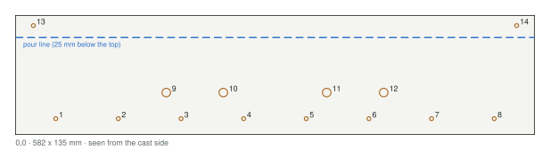

| # | x | y | Hole | For |
|---|---|---|---|---|
| 1 | 46 | 18 | 3.2 | split-gasket-groove |
| 2 | 119 | 18 | 3.2 | split-gasket-groove |
| 3 | 191 | 18 | 3.2 | split-gasket-groove |
| 4 | 264 | 18 | 3.2 | split-gasket-groove |
| 5 | 336 | 18 | 3.2 | split-gasket-groove |
| 6 | 409 | 18 | 3.2 | split-gasket-groove |
| 7 | 481 | 18 | 3.2 | split-gasket-groove |
| 8 | 554 | 18 | 3.2 | split-gasket-groove |
| 9 | 20 | 55 | 13.5 | 1/2-13 bolt into coupler |
| 10 | 580 | 55 | 13.5 | 1/2-13 bolt into coupler |
| 11 | 210 | 68 | 63.5 | hole saw |
| 12 | 390 | 68 | 63.5 | hole saw |
| 13 | 20 | 124 | 4.5 | corner bracket |
| 14 | 580 | 124 | 4.5 | corner bracket |

#### Base cleat, front

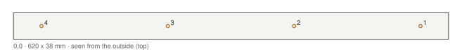

| # | x | y | Hole | For |
|---|---|---|---|---|
| 1 | 598 | 20 | 4.5 | cleat |
| 2 | 412 | 20 | 4.5 | cleat |
| 3 | 226 | 20 | 4.5 | cleat |
| 4 | 40 | 20 | 4.5 | cleat |

#### Base cleat, rear

| # | x | y | Hole | For |
|---|---|---|---|---|
| 1 | 598 | 20 | 4.5 | cleat |
| 2 | 412 | 20 | 4.5 | cleat |
| 3 | 226 | 20 | 4.5 | cleat |
| 4 | 40 | 20 | 4.5 | cleat |

#### Base cleat, left

| # | x | y | Hole | For |
|---|---|---|---|---|
| 1 | 684 | 20 | 4.5 | cleat |
| 2 | 470 | 20 | 4.5 | cleat |
| 3 | 255 | 20 | 4.5 | cleat |
| 4 | 40 | 20 | 4.5 | cleat |

#### Base cleat, right

| # | x | y | Hole | For |
|---|---|---|---|---|
| 1 | 684 | 20 | 4.5 | cleat |
| 2 | 470 | 20 | 4.5 | cleat |
| 3 | 255 | 20 | 4.5 | cleat |
| 4 | 40 | 20 | 4.5 | cleat |

#### Base bridge y=-190

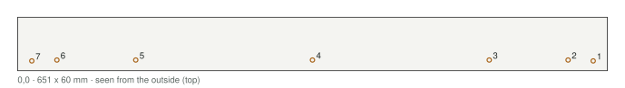

| # | x | y | Hole | For |
|---|---|---|---|---|
| 1 | 635 | 11 | 4.5 | saddle |
| 2 | 608 | 12 | 4.5 | core post |
| 3 | 520 | 12 | 4.5 | core post |
| 4 | 325 | 12 | 4.5 | core post |
| 5 | 130 | 12 | 4.5 | core post |
| 6 | 43 | 12 | 4.5 | core post |
| 7 | 16 | 11 | 4.5 | saddle |

#### Base bridge y=-58

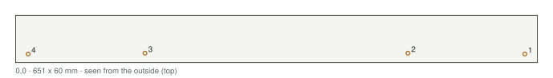

| # | x | y | Hole | For |
|---|---|---|---|---|
| 1 | 635 | 11 | 4.5 | saddle |
| 2 | 565 | 12 | 4.5 | bar hanger |
| 3 | 521 | 12 | 4.5 | bar hanger |
| 4 | 478 | 12 | 4.5 | core post |
| 5 | 173 | 12 | 4.5 | core post |
| 6 | 115 | 12 | 4.5 | bar hanger |
| 7 | 71 | 12 | 4.5 | bar hanger |
| 8 | 16 | 11 | 4.5 | saddle |

#### Base bridge y=100

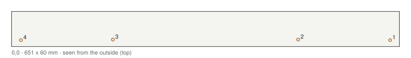

| # | x | y | Hole | For |
|---|---|---|---|---|
| 1 | 635 | 11 | 4.5 | saddle |
| 2 | 565 | 12 | 4.5 | bar hanger |
| 3 | 521 | 12 | 4.5 | bar hanger |
| 4 | 478 | 12 | 4.5 | core post |
| 5 | 173 | 12 | 4.5 | core post |
| 6 | 115 | 12 | 4.5 | bar hanger |
| 7 | 71 | 12 | 4.5 | bar hanger |
| 8 | 16 | 11 | 4.5 | saddle |

#### Base bridge y=170

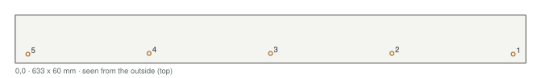

| # | x | y | Hole | For |
|---|---|---|---|---|
| 1 | 635 | 11 | 4.5 | saddle |
| 2 | 608 | 12 | 4.5 | core post |
| 3 | 565 | 12 | 4.5 | bar hanger |
| 4 | 521 | 12 | 4.5 | bar hanger |
| 5 | 325 | 12 | 4.5 | core post |
| 6 | 115 | 12 | 4.5 | bar hanger |
| 7 | 71 | 12 | 4.5 | bar hanger |
| 8 | 43 | 12 | 4.5 | core post |
| 9 | 16 | 11 | 4.5 | saddle |

#### Base bridge y=280

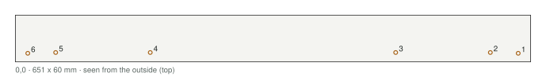

| # | x | y | Hole | For |
|---|---|---|---|---|
| 1 | 635 | 11 | 4.5 | saddle |
| 2 | 608 | 12 | 4.5 | core post |
| 3 | 480 | 12 | 4.5 | core post |
| 4 | 170 | 12 | 4.5 | core post |
| 5 | 43 | 12 | 4.5 | core post |
| 6 | 16 | 11 | 4.5 | saddle |

#### Base leg bridge y=-310

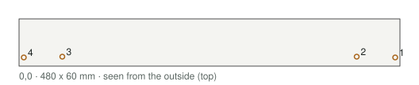

| # | x | y | Hole | For |
|---|---|---|---|---|
| 1 | 474 | 11 | 4.5 | leg holder |
| 2 | 426 | 12 | 4.5 | core post |
| 3 | 54 | 12 | 4.5 | core post |
| 4 | 6 | 11 | 4.5 | leg holder |

#### Base leg bridge y=344

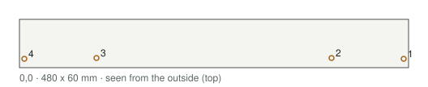

| # | x | y | Hole | For |
|---|---|---|---|---|
| 1 | 474 | 11 | 4.5 | leg holder |
| 2 | 385 | 12 | 4.5 | core post |
| 3 | 95 | 12 | 4.5 | core post |
| 4 | 6 | 11 | 4.5 | leg holder |

### Uprights

#### Upright floor (x2)

| # | x | y | Hole | For |
|---|---|---|---|---|
| 1 | 121 | 56 | 4.5 | toe-filler |
| 2 | 79 | 75 | 4.5 | toe-filler |
| 3 | 131 | 136 | 3.2 | foot-gasket-groove |
| 4 | 99 | 146 | 16.3 | 5/8 core rod |
| 5 | 20 | 170 | 4.5 | cleat |
| 6 | 178 | 170 | 4.5 | cleat |
| 7 | 67 | 197 | 3.2 | foot-gasket-groove |
| 8 | 99 | 246 | 16.3 | 5/8 core rod |
| 9 | 67 | 266 | 3.2 | foot-gasket-groove |
| 10 | 131 | 266 | 3.2 | foot-gasket-groove |
| 11 | 20 | 333 | 4.5 | cleat |
| 12 | 67 | 336 | 3.2 | foot-gasket-groove |
| 13 | 131 | 336 | 3.2 | foot-gasket-groove |
| 14 | 178 | 333 | 4.5 | cleat |
| 15 | 99 | 371 | 63.5 | hole saw |
| 16 | 131 | 414 | 3.2 | foot-gasket-groove |
| 17 | 79 | 426 | 13.5 | 1/2 rod through a sleeve |
| 18 | 99 | 426 | 13.1 | 1/2-13 bolt, base dowel hole |
| 19 | 119 | 426 | 13.5 | 1/2 rod through a sleeve |
| 20 | 67 | 461 | 3.2 | foot-gasket-groove |
| 21 | 99 | 481 | 63.5 | hole saw |
| 22 | 20 | 495 | 4.5 | cleat |
| 23 | 178 | 495 | 4.5 | cleat |
| 24 | 99 | 555 | 4.5 | cleat |

#### Upright side plate, outer (x2)

| # | x | y | Hole | For |
|---|---|---|---|---|
| 1 | 280 | 240 | 4.5 | corner bracket |
| 2 | 406 | 259 | 4.5 | saddle |
| 3 | 473 | 260 | 4.5 | corner bracket |

Outline corners (x, y): (0, 0), (495, 0), (495, 271), (264, 271)

#### Upright side plate, inner (x2)

| # | x | y | Hole | For |
|---|---|---|---|---|
| 1 | 215 | 240 | 4.5 | corner bracket |
| 2 | 22 | 260 | 4.5 | corner bracket |
| 3 | 90 | 259 | 4.5 | saddle |

Outline corners (x, y): (495, 0), (0, 0), (0, 271), (231, 271)

#### Upright back board (x2)

| # | x | y | Hole | For |
|---|---|---|---|---|
| 1 | 3 | 260 | 4.5 | corner bracket |
| 2 | 77 | 260 | 4.5 | corner bracket |

#### Upright front board (x2)

| # | x | y | Hole | For |
|---|---|---|---|---|
| 1 | 27 | 66 | 4.5 | slope-plug-lower |
| 2 | 27 | 209 | 4.5 | slope-plug-upper |
| 3 | 14 | 301 | 4.5 | corner bracket |
| 4 | 66 | 301 | 4.5 | corner bracket |

#### Upright bridge (x2)

| # | x | y | Hole | For |
|---|---|---|---|---|
| 1 | 87 | 10 | 10 | 3/8-16 bolt into the top plate |
| 2 | 85 | 34 | 13.5 | 1/2 rod through a sleeve |
| 3 | 45 | 34 | 13.5 | 1/2 rod through a sleeve |
| 4 | 43 | 100 | 10 | 3/8-16 bolt into the top plate |

#### Upright cleat, outer (x2)

| # | x | y | Hole | For |
|---|---|---|---|---|
| 1 | 365 | 20 | 4.5 | cleat |
| 2 | 203 | 20 | 4.5 | cleat |
| 3 | 40 | 20 | 4.5 | cleat |

#### Upright cleat, inner (x2)

| # | x | y | Hole | For |
|---|---|---|---|---|
| 1 | 365 | 20 | 4.5 | cleat |
| 2 | 203 | 20 | 4.5 | cleat |
| 3 | 40 | 20 | 4.5 | cleat |

#### Upright cleat, back (x2)

| # | x | y | Hole | For |
|---|---|---|---|---|
| 1 | 40 | 20 | 4.5 | cleat |

### Beam

#### Beam floor

| # | x | y | Hole | For |
|---|---|---|---|---|
| 1 | 80 | 20 | 4.5 | cleat |
| 2 | 324 | 20 | 4.5 | cleat |
| 3 | 568 | 20 | 4.5 | cleat |
| 4 | 174 | 79 | 5.5 | M5 insert screw |
| 5 | 294 | 79 | 5.5 | M5 insert screw |
| 6 | 354 | 79 | 5.5 | M5 insert screw |
| 7 | 474 | 79 | 5.5 | M5 insert screw |
| 8 | 20 | 99 | 4.5 | cleat |
| 9 | 628 | 99 | 4.5 | cleat |
| 10 | 94 | 106 | 6.5 | M6 insert screw |
| 11 | 107 | 106 | 6.5 | M6 insert screw |
| 12 | 452 | 106 | 6.5 | M6 insert screw |
| 13 | 94 | 152 | 6.5 | M6 insert screw |
| 14 | 107 | 152 | 6.5 | M6 insert screw |
| 15 | 452 | 152 | 6.5 | M6 insert screw |
| 16 | 20 | 159 | 4.5 | cleat |
| 17 | 628 | 159 | 4.5 | cleat |
| 18 | 174 | 179 | 5.5 | M5 insert screw |
| 19 | 294 | 179 | 5.5 | M5 insert screw |
| 20 | 354 | 179 | 5.5 | M5 insert screw |
| 21 | 474 | 179 | 5.5 | M5 insert screw |
| 22 | 80 | 238 | 4.5 | cleat |
| 23 | 324 | 238 | 4.5 | cleat |
| 24 | 568 | 238 | 4.5 | cleat |

#### Beam top wall

| # | x | y | Hole | For |
|---|---|---|---|---|
| 1 | 37 | 25 | 13.1 | 1/2 core rod |
| 2 | 81 | 25 | 13.1 | 1/2 core rod |
| 3 | 487 | 25 | 13.1 | 1/2 core rod |
| 4 | 531 | 25 | 13.1 | 1/2 core rod |
| 5 | 37 | 115 | 13.1 | 1/2 core rod |
| 6 | 81 | 115 | 13.1 | 1/2 core rod |
| 7 | 487 | 115 | 13.1 | 1/2 core rod |
| 8 | 531 | 115 | 13.1 | 1/2 core rod |
| 9 | 84 | 133 | 4.5 | back-edge |
| 10 | 219 | 133 | 4.5 | back-edge |
| 11 | 351 | 133 | 4.5 | back-edge |
| 12 | 484 | 133 | 4.5 | back-edge |
| 13 | 33 | 154 | 4.5 | corner bracket |
| 14 | 535 | 154 | 4.5 | corner bracket |

#### Beam bottom wall

| # | x | y | Hole | For |
|---|---|---|---|---|
| 1 | 37 | 25 | 13.1 | 1/2 core rod |
| 2 | 81 | 25 | 13.1 | 1/2 core rod |
| 3 | 487 | 25 | 13.1 | 1/2 core rod |
| 4 | 531 | 25 | 13.1 | 1/2 core rod |
| 5 | 59 | 70 | 9.6 | 3/8 dowel |
| 6 | 509 | 70 | 9.6 | 3/8 dowel |
| 7 | 37 | 115 | 13.1 | 1/2 core rod |
| 8 | 81 | 115 | 13.1 | 1/2 core rod |
| 9 | 487 | 115 | 13.1 | 1/2 core rod |
| 10 | 531 | 115 | 13.1 | 1/2 core rod |
| 11 | 33 | 154 | 4.5 | corner bracket |
| 12 | 535 | 154 | 4.5 | corner bracket |

#### Beam end wall, left

| # | x | y | Hole | For |
|---|---|---|---|---|
| 1 | 70 | 45 | 4.5 | tube locator |
| 2 | 70 | 96 | 4.5 | tube locator |
| 3 | 14 | 154 | 4.5 | corner bracket |
| 4 | 126 | 154 | 4.5 | corner bracket |

#### Beam end wall, right

| # | x | y | Hole | For |
|---|---|---|---|---|
| 1 | 70 | 45 | 4.5 | tube locator |
| 2 | 70 | 96 | 4.5 | tube locator |
| 3 | 14 | 154 | 4.5 | corner bracket |
| 4 | 126 | 154 | 4.5 | corner bracket |

#### Beam cleat, top

| # | x | y | Hole | For |
|---|---|---|---|---|
| 1 | 528 | 20 | 4.5 | cleat |
| 2 | 284 | 20 | 4.5 | cleat |
| 3 | 40 | 20 | 4.5 | cleat |

#### Beam cleat, bottom

| # | x | y | Hole | For |
|---|---|---|---|---|
| 1 | 528 | 20 | 4.5 | cleat |
| 2 | 284 | 20 | 4.5 | cleat |
| 3 | 40 | 20 | 4.5 | cleat |

#### Beam cleat, left

| # | x | y | Hole | For |
|---|---|---|---|---|
| 1 | 100 | 20 | 4.5 | cleat |
| 2 | 40 | 20 | 4.5 | cleat |

#### Beam cleat, right

| # | x | y | Hole | For |
|---|---|---|---|---|
| 1 | 100 | 20 | 4.5 | cleat |
| 2 | 40 | 20 | 4.5 | cleat |
