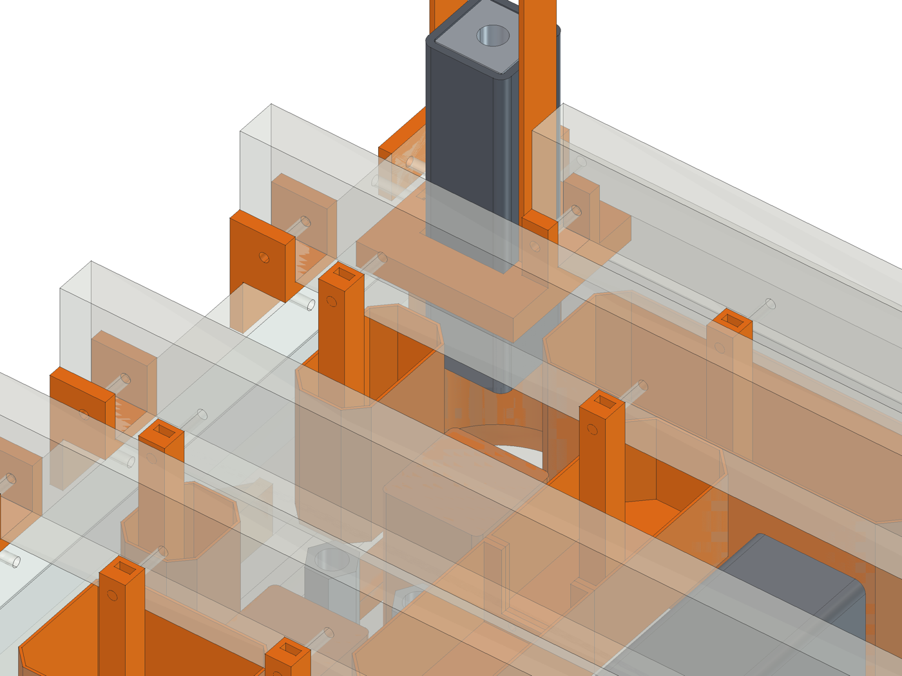
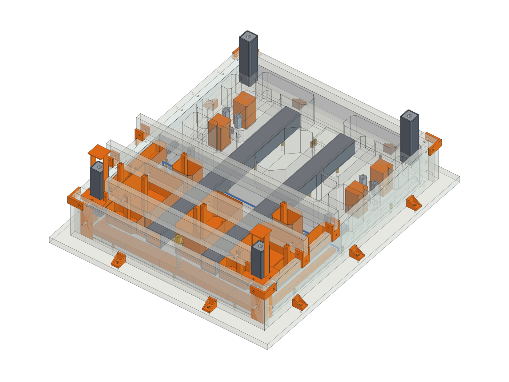
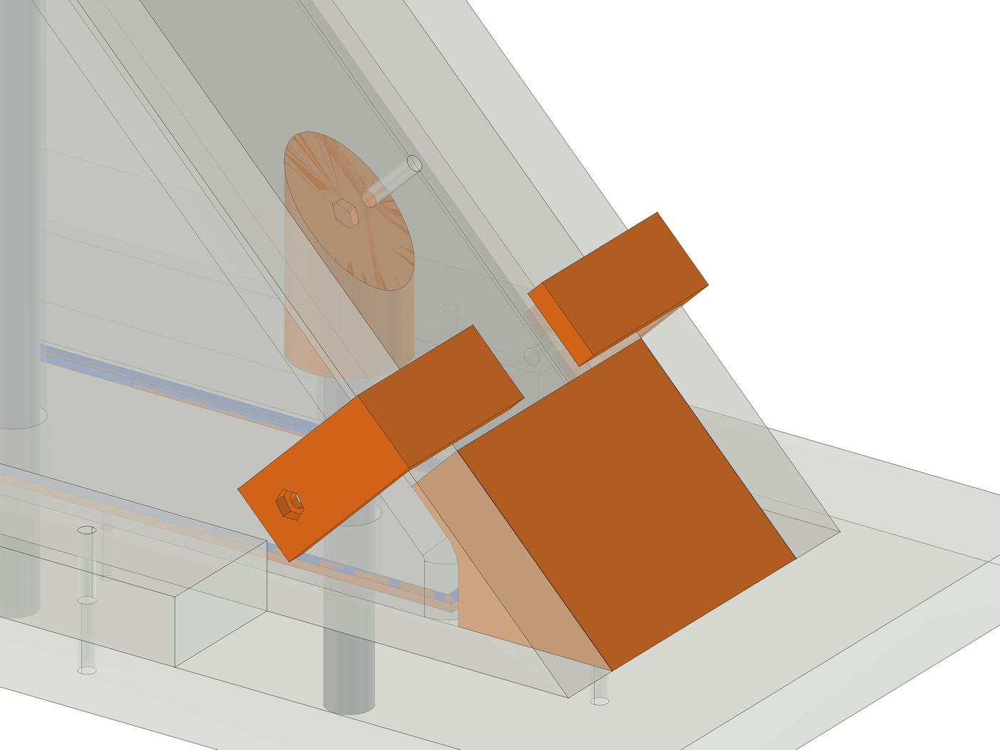

# Mould guide

The moulds are melamine boards that bolt together with printed brackets, and every printed piece
bolts or pins to its board from outside. Nothing is glued and nothing goes through a cast face,
so the moulds come apart cleanly and go back together the same way for the next casting.

## How it works

- **Walls stand 25 mm above the pour line.** The brackets, saddles and leg holders bolt through that
  band, so no bolt passes through a face that gets cast against. Fill to the line, not to the top.
- **Corner brackets** hold each outside corner square in that band. Each has its nut pressed into a hex
  pocket, and its holes are a drill guide: clamp it in place and drill through it.
- **Cleats** (strips of board offcut) lie on the floor along each wall's foot, outside, bolted down
  through the floor: the walls stand against them.
- **Printed pieces bolt on from outside.** An M4 bolt (M3 on thin pieces) goes through the board into
  a nut built into the piece. The nut drops into a pocket in the face against the board and slides
  over under the hole, so nothing opens onto a cast face. Fit the nuts before the pieces go on.
- **Thin pieces have pins.** The gasket-groove beads and the motor relief have 3 mm pins
  that push into 1/8 in holes. The casting presses them onto the board.
- **Pieces cut to fit the printer** have a peg and socket on the cut, and their own fixings.
- **Foam.** The base pocket cores and the socket cores are XPS foam board wrapped in packing tape. Each
  pocket core has a printed post glued into it that bolts to a bridge, so it sits at the right height
  and can't float; each socket block pushes over a printed spike bolted to the floor. That keeps the
  printing to about 1.5 kg of PETG.
- **Bridges** stand on edge in saddles that hook over the wall tops; each core has a post that bolts
  to the side of a bridge, which sets its height and stops it floating.
- **Fits** are 0.15 mm a side: snug, but they go together by hand. Waxed pieces come out after curing.

**Measure your board first.** The saddles, cradles and drawings are for 19.05 mm board (Home Depot's
3/4 in white melamine is a true 0.750 in; other "3/4 in" melamine can be 18 mm). If yours is different,
set `mould_board` in `model/build_cnc.py` and re-run it: the STLs, hole maps and this guide all update.

## What to buy

- **Melamine board**, 19 mm (3/4 in): about 2.9 m2 of boards in all, so 2 sheets of 4 x 8 ft with room for mistakes. Have the store rip it into strips at the widths in the cut list.
- **Hardware** (zinc-plated is fine; grease anything that touches the mix):

| Item | Qty |
|---|---|
| M3 nut | 20 |
| M3 washer | 20 |
| M3 x 25 bolt | 20 |
| M4 nut | 180 |
| M4 washer | 176 |
| M4 x 20 bolt (leg pinch screw) | 4 |
| M4 x 30 bolt | 104 |
| M4 x 35 bolt | 28 |
| M4 x 45 bolt | 40 |
| M4 x 70 bolt | 4 |
| M5 x 20 screw, greased (holds an insert) | 29 |
| M6 x 20 screw, greased (holds a pad) | 6 |
| M6 x 20 screw, greased (holds an insert) | 6 |
| 1/2 in plain steel rod, greased (forms a beam bolt hole), 198 mm | 8 |
| 1/2-13 x 1-1/2 in bolt + nut, greased (forms the dowel hole) | 2 |
| 1/2-13 x 1-1/2 in bolt, greased (holds a draw-rod coupler) | 2 |
| 1/2-13 x 2-1/2 in bolt, greased (holds a coupler) | 8 |
| 3/8-16 x 2-1/2 in bolt, greased (holds the top plate) | 4 |
| 5/8 in plain steel rod, greased (forms a tie-rod hole), cut to 140 mm, 243 mm, 377 mm, 377 mm | 2 |
| Block of 2x4, 52 mm long: four under each upright mould (the posts stand on the bench) | 8 |

Buy about 10 % spare of the small bolts, nuts and washers.

- **Foam**: one 2 in x 2 ft x 8 ft XPS board (Foamular or similar) for the 26 foam
  pieces (stack two layers, glued with foam-safe adhesive, for the 90 mm cores); packing tape;
  double-sided carpet tape.

## Foam pieces

Cut with a fine saw, a hot wire or a sharp knife and a sanding block; wrap in packing tape (no wax
needed on the tape). Sizes are x by y by depth, as the piece sits in the casting.

| Casting | Piece | Qty | How |
|---|---|---|---|
| base-front | centre | 1 | XPS block 100 x 185 x 90 mm, outline as the pocket (chamfered corners); taped, with its printed post glued in. |
| base-rear | centre | 1 | XPS block 100 x 190 x 90 mm, outline as the pocket (chamfered corners); taped, with its printed post glued in. |
| base-front | outboard-L | 1 | XPS block 130 x 164 x 90 mm, outline as the pocket (chamfered corners); taped, with its printed post glued in. |
| base-front | trough-band-L | 1 | XPS block 101 x 55 x 40 mm, outline as the pocket (chamfered corners); taped, with its printed post glued in. |
| base-front | draw-rod-L | 1 | XPS block 37 x 255 x 40 mm, outline as the pocket (chamfered corners); taped, with its printed post glued in. |
| base-front | foot-a-L | 1 | XPS block 68 x 66 x 90 mm, outline as the pocket (chamfered corners); taped, with its printed post glued in. |
| base-rear | foot-b-L | 1 | XPS block 68 x 100 x 90 mm, outline as the pocket (chamfered corners); taped, with its printed post glued in. |
| base-rear | foot-c-L | 1 | XPS block 80 x 63 x 90 mm, outline as the pocket (chamfered corners); taped, with its printed post glued in. |
| base-rear | knee-L | 1 | XPS block 50 x 183 x 40 mm, outline as the pocket (chamfered corners); taped, with its printed post glued in. |
| base-rear | outer-a-L | 1 | XPS block 35 x 43 x 65 mm, outline as the pocket (chamfered corners); taped, with its printed post glued in. |
| base-rear | outer-b-L | 1 | XPS block 35 x 60 x 65 mm, outline as the pocket (chamfered corners); taped, with its printed post glued in. |
| base-rear | rear-L | 1 | XPS block 170 x 52 x 90 mm, outline as the pocket (chamfered corners); taped, with its printed post glued in. |
| base-front | outboard-R | 1 | XPS block 130 x 164 x 90 mm, outline as the pocket (chamfered corners); taped, with its printed post glued in. |
| base-front | trough-band-R | 1 | XPS block 101 x 55 x 40 mm, outline as the pocket (chamfered corners); taped, with its printed post glued in. |
| base-front | draw-rod-R | 1 | XPS block 37 x 255 x 40 mm, outline as the pocket (chamfered corners); taped, with its printed post glued in. |
| base-front | foot-a-R | 1 | XPS block 68 x 66 x 90 mm, outline as the pocket (chamfered corners); taped, with its printed post glued in. |
| base-rear | foot-b-R | 1 | XPS block 68 x 100 x 90 mm, outline as the pocket (chamfered corners); taped, with its printed post glued in. |
| base-rear | foot-c-R | 1 | XPS block 80 x 63 x 90 mm, outline as the pocket (chamfered corners); taped, with its printed post glued in. |
| base-rear | knee-R | 1 | XPS block 50 x 183 x 40 mm, outline as the pocket (chamfered corners); taped, with its printed post glued in. |
| base-rear | outer-a-R | 1 | XPS block 35 x 43 x 65 mm, outline as the pocket (chamfered corners); taped, with its printed post glued in. |
| base-rear | outer-b-R | 1 | XPS block 35 x 60 x 65 mm, outline as the pocket (chamfered corners); taped, with its printed post glued in. |
| base-rear | rear-R | 1 | XPS block 170 x 52 x 90 mm, outline as the pocket (chamfered corners); taped, with its printed post glued in. |
| base-rear | socket | 4 | XPS block 41 x 41 x 80 mm, taped; dig it out after curing (a little acetone dissolves the rest). |

## Cut list

Sizes are length x height (or width) of the face, in mm. Boards marked "profile" are cut to the outline in
their drawing.

| Mould | Board | Qty | Size (mm) | Notes |
|---|---|---|---|---|
| Base | Base floor | 1 | 718 x 843 | both halves are cast on it |
| Base | Base front wall | 1 | 638 x 135 |  |
| Base | Base rear wall | 1 | 638 x 135 |  |
| Base | Base side wall, left | 1 | 724 x 135 |  |
| Base | Base side wall, right | 1 | 724 x 135 |  |
| Base | Base partition | 1 | 600 x 135 | rear half only; comes out before the front half |
| Base | Base partition strut | 2 | 326 x 60 | offcut, stands on edge; holds the partition foot (rear half only) |
| Base | Base cleat, front | 1 | 638 x 40 | offcut strip, flat on the floor |
| Base | Base cleat, rear | 1 | 638 x 40 | offcut strip, flat on the floor |
| Base | Base cleat, left | 1 | 724 x 40 | offcut strip, flat on the floor |
| Base | Base cleat, right | 1 | 724 x 40 | offcut strip, flat on the floor |
| Base | Base bridge y=-190 | 1 | 651 x 60 |  |
| Base | Base bridge y=-58 | 1 | 651 x 60 |  |
| Base | Base bridge y=100 | 1 | 651 x 60 |  |
| Base | Base bridge y=170 | 1 | 651 x 60 |  |
| Base | Base bridge y=280 | 1 | 651 x 60 |  |
| Base | Base leg bridge y=-310 | 1 | 480 x 60 |  |
| Base | Base leg bridge y=344 | 1 | 480 x 60 |  |
| Uprights | Upright floor | 2 | 198 x 575 |  |
| Uprights | Upright side plate, outer | 2 | 495 x 271 (profile) | cut to the profile |
| Uprights | Upright side plate, inner | 2 | 495 x 271 (profile) | cut to the profile |
| Uprights | Upright back board | 2 | 80 x 271 |  |
| Uprights | Upright front board | 2 | 80 x 312 | ends cut square |
| Uprights | Upright bridge | 2 | 131 x 108 |  |
| Uprights | Upright cleat, outer | 2 | 405 x 40 | offcut strip, flat on the floor |
| Uprights | Upright cleat, inner | 2 | 405 x 40 | offcut strip, flat on the floor |
| Uprights | Upright cleat, back | 2 | 80 x 40 | offcut strip, flat on the floor |
| Beam | Beam floor | 1 | 648 x 258 |  |
| Beam | Beam top wall | 1 | 568 x 165 |  |
| Beam | Beam bottom wall | 1 | 568 x 165 |  |
| Beam | Beam end wall, left | 1 | 140 x 165 |  |
| Beam | Beam end wall, right | 1 | 140 x 165 |  |
| Beam | Beam cleat, top | 1 | 568 x 40 | offcut strip, flat on the floor |
| Beam | Beam cleat, bottom | 1 | 568 x 40 | offcut strip, flat on the floor |
| Beam | Beam cleat, left | 1 | 140 x 40 | offcut strip, flat on the floor |
| Beam | Beam cleat, right | 1 | 140 x 40 | offcut strip, flat on the floor |

## Drilling

- Drill every hole from the **cast side** (the face the mix touches), so any tear-out is on the outside.
  The drawings and tables are seen from that side: x from the left edge, y from the bottom edge. For a
  wall the bottom edge sits on the floor; for a floor, the bottom of the drawing is toward the front
  wall (or the beam's bottom wall). Left and right are as you look at the cast face, so a floor seen
  from above is mirrored compared with the machine.
- Bridges are drawn from the top (outside).
- Use the printed brackets as drill guides where they sit; the tables give every hole anyway.

| Hole | Drill | For |
|---|---|---|
| 3.2 mm | 1/8 in | foot-gasket-groove, motor-relief, split-gasket-groove |
| 3.4 mm | 9/64 in | corner-L, corner-R, gutter-L, gutter-R |
| 4.5 mm | 11/64 in | back-edge-1, cleat, core post, corner bracket, corner-L, corner-R, gutter-L, gutter-R, leg holder, saddle, slope-pocket--60, slope-pocket-40, socket spike, toe-filler, trough, tube locator |
| 5.5 mm | 7/32 in | M5 insert screw |
| 6.5 mm | 17/64 in | M6 insert screw |
| 9.6 mm | 25/64 in | 3/8 dowel |
| 10 mm | 25/64 in | 3/8-16 bolt into the top plate |
| 13.1 mm | 33/64 in | 1/2 core rod, 1/2-13 bolt, base dowel hole |
| 13.5 mm | 17/32 in | 1/2-13 bolt into coupler |
| 16.3 mm | 41/64 in | 5/8 core rod |
| 63.5 mm | 2-1/2 in hole saw | hole saw |

## Base: hole maps

### Base floor

| # | x | y | Hole | For |
|---|---|---|---|---|
| 1 | 80 | 20 | 4.5 | cleat |
| 2 | 266 | 20 | 4.5 | cleat |
| 3 | 452 | 20 | 4.5 | cleat |
| 4 | 638 | 20 | 4.5 | cleat |
| 5 | 71 | 64 | 3.4 | corner-R |
| 6 | 647 | 64 | 3.4 | corner-L |
| 7 | 159 | 69 | 5.5 | M5 insert screw |
| 8 | 359 | 69 | 5.5 | M5 insert screw |
| 9 | 559 | 69 | 5.5 | M5 insert screw |
| 10 | 107 | 89 | 4.5 | trough |
| 11 | 275 | 89 | 4.5 | trough |
| 12 | 387 | 89 | 4.5 | trough |
| 13 | 499 | 89 | 4.5 | trough |
| 14 | 611 | 89 | 4.5 | trough |
| 15 | 20 | 99 | 4.5 | cleat |
| 16 | 698 | 99 | 4.5 | cleat |
| 17 | 163 | 104 | 4.5 | trough |
| 18 | 219 | 104 | 4.5 | trough |
| 19 | 331 | 104 | 4.5 | trough |
| 20 | 443 | 104 | 4.5 | trough |
| 21 | 555 | 104 | 4.5 | trough |
| 22 | 87 | 150 | 4.5 | gutter-R |
| 23 | 632 | 150 | 4.5 | gutter-L |
| 24 | 269 | 184 | 5.5 | M5 insert screw |
| 25 | 449 | 184 | 5.5 | M5 insert screw |
| 26 | 69 | 209 | 5.5 | M5 insert screw |
| 27 | 336 | 210 | 6.5 | M6 insert screw |
| 28 | 382 | 210 | 6.5 | M6 insert screw |
| 29 | 649 | 209 | 5.5 | M5 insert screw |
| 30 | 87 | 223 | 4.5 | gutter-R |
| 31 | 632 | 223 | 4.5 | gutter-L |
| 32 | 87 | 295 | 3.4 | gutter-R |
| 33 | 632 | 295 | 3.4 | gutter-L |
| 34 | 269 | 304 | 5.5 | M5 insert screw |
| 35 | 449 | 304 | 5.5 | M5 insert screw |
| 36 | 20 | 314 | 4.5 | cleat |
| 37 | 698 | 314 | 4.5 | cleat |
| 38 | 134 | 344 | 13.5 | 1/2-13 bolt into coupler |
| 39 | 584 | 344 | 13.5 | 1/2-13 bolt into coupler |
| 40 | 87 | 368 | 3.4 | gutter-R |
| 41 | 632 | 368 | 3.4 | gutter-L |
| 42 | 69 | 421 | 5.5 | M5 insert screw |
| 43 | 649 | 421 | 5.5 | M5 insert screw |
| 44 | 269 | 424 | 5.5 | M5 insert screw |
| 45 | 449 | 424 | 5.5 | M5 insert screw |
| 46 | 87 | 434 | 3.4 | gutter-R |
| 47 | 632 | 434 | 3.4 | gutter-L |
| 48 | 134 | 444 | 13.5 | 1/2-13 bolt into coupler |
| 49 | 584 | 444 | 13.5 | 1/2-13 bolt into coupler |
| 50 | 87 | 494 | 3.4 | gutter-R |
| 51 | 632 | 494 | 3.4 | gutter-L |
| 52 | 20 | 529 | 4.5 | cleat |
| 53 | 698 | 529 | 4.5 | cleat |
| 54 | 269 | 544 | 5.5 | M5 insert screw |
| 55 | 449 | 544 | 5.5 | M5 insert screw |
| 56 | 87 | 554 | 3.4 | gutter-R |
| 57 | 632 | 554 | 3.4 | gutter-L |
| 58 | 134 | 569 | 4.5 | socket spike |
| 59 | 584 | 569 | 4.5 | socket spike |
| 60 | 87 | 614 | 3.4 | gutter-R |
| 61 | 632 | 614 | 3.4 | gutter-L |
| 62 | 114 | 624 | 13.5 | 1/2-13 bolt into coupler |
| 63 | 134 | 624 | 9.6 | 3/8 dowel |
| 64 | 154 | 624 | 13.5 | 1/2-13 bolt into coupler |
| 65 | 564 | 624 | 13.5 | 1/2-13 bolt into coupler |
| 66 | 584 | 624 | 9.6 | 3/8 dowel |
| 67 | 604 | 624 | 13.5 | 1/2-13 bolt into coupler |
| 68 | 69 | 634 | 5.5 | M5 insert screw |
| 69 | 649 | 634 | 5.5 | M5 insert screw |
| 70 | 269 | 664 | 5.5 | M5 insert screw |
| 71 | 449 | 664 | 5.5 | M5 insert screw |
| 72 | 87 | 674 | 3.4 | gutter-R |
| 73 | 632 | 674 | 3.4 | gutter-L |
| 74 | 134 | 679 | 4.5 | socket spike |
| 75 | 584 | 679 | 4.5 | socket spike |
| 76 | 336 | 705 | 6.5 | M6 insert screw |
| 77 | 382 | 705 | 6.5 | M6 insert screw |
| 78 | 336 | 718 | 6.5 | M6 insert screw |
| 79 | 382 | 718 | 6.5 | M6 insert screw |
| 80 | 87 | 734 | 3.4 | gutter-R |
| 81 | 343 | 737 | 3.2 | motor-relief |
| 82 | 632 | 734 | 3.4 | gutter-L |
| 83 | 20 | 744 | 4.5 | cleat |
| 84 | 698 | 744 | 4.5 | cleat |
| 85 | 64 | 772 | 3.4 | corner-R |
| 86 | 375 | 770 | 3.2 | motor-relief |
| 87 | 654 | 772 | 3.4 | corner-L |
| 88 | 209 | 774 | 5.5 | M5 insert screw |
| 89 | 509 | 774 | 5.5 | M5 insert screw |
| 90 | 80 | 823 | 4.5 | cleat |
| 91 | 266 | 823 | 4.5 | cleat |
| 92 | 452 | 823 | 4.5 | cleat |
| 93 | 638 | 823 | 4.5 | cleat |

### Base front wall

| # | x | y | Hole | For |
|---|---|---|---|---|
| 1 | 39 | 55 | 4.5 | corner-L |
| 2 | 599 | 55 | 4.5 | corner-R |
| 3 | 33 | 124 | 4.5 | corner bracket |
| 4 | 605 | 124 | 4.5 | corner bracket |
| 5 | 54 | 129 | 4.5 | leg holder |
| 6 | 584 | 129 | 4.5 | leg holder |

### Base rear wall

| # | x | y | Hole | For |
|---|---|---|---|---|
| 1 | 26 | 56 | 4.5 | corner-R |
| 2 | 612 | 56 | 4.5 | corner-L |
| 3 | 33 | 124 | 4.5 | corner bracket |
| 4 | 605 | 124 | 4.5 | corner bracket |
| 5 | 54 | 129 | 4.5 | leg holder |
| 6 | 584 | 129 | 4.5 | leg holder |

### Base side wall, left

| # | x | y | Hole | For |
|---|---|---|---|---|
| 1 | 7 | 35 | 4.5 | corner-L |
| 2 | 707 | 54 | 4.5 | corner-L |
| 3 | 14 | 124 | 4.5 | corner bracket |
| 4 | 100 | 123 | 4.5 | saddle |
| 5 | 210 | 123 | 4.5 | saddle |
| 6 | 280 | 123 | 4.5 | saddle |
| 7 | 419 | 124 | 4.5 | corner bracket |
| 8 | 438 | 123 | 4.5 | saddle |
| 9 | 570 | 123 | 4.5 | saddle |
| 10 | 711 | 124 | 4.5 | corner bracket |
| 11 | 35 | 129 | 4.5 | leg holder |
| 12 | 690 | 129 | 4.5 | leg holder |

### Base side wall, right

| # | x | y | Hole | For |
|---|---|---|---|---|
| 1 | 718 | 35 | 4.5 | corner-R |
| 2 | 18 | 56 | 4.5 | corner-R |
| 3 | 14 | 124 | 4.5 | corner bracket |
| 4 | 155 | 123 | 4.5 | saddle |
| 5 | 287 | 123 | 4.5 | saddle |
| 6 | 306 | 124 | 4.5 | corner bracket |
| 7 | 445 | 123 | 4.5 | saddle |
| 8 | 515 | 123 | 4.5 | saddle |
| 9 | 625 | 123 | 4.5 | saddle |
| 10 | 711 | 124 | 4.5 | corner bracket |
| 11 | 35 | 129 | 4.5 | leg holder |
| 12 | 690 | 129 | 4.5 | leg holder |

### Base partition

| # | x | y | Hole | For |
|---|---|---|---|---|
| 1 | 46 | 18 | 3.2 | split-gasket-groove |
| 2 | 119 | 18 | 3.2 | split-gasket-groove |
| 3 | 191 | 18 | 3.2 | split-gasket-groove |
| 4 | 264 | 18 | 3.2 | split-gasket-groove |
| 5 | 336 | 18 | 3.2 | split-gasket-groove |
| 6 | 409 | 18 | 3.2 | split-gasket-groove |
| 7 | 481 | 18 | 3.2 | split-gasket-groove |
| 8 | 554 | 18 | 3.2 | split-gasket-groove |
| 9 | 20 | 55 | 13.5 | 1/2-13 bolt into coupler |
| 10 | 580 | 55 | 13.5 | 1/2-13 bolt into coupler |
| 11 | 210 | 68 | 63.5 | hole saw |
| 12 | 390 | 68 | 63.5 | hole saw |
| 13 | 20 | 124 | 4.5 | corner bracket |
| 14 | 580 | 124 | 4.5 | corner bracket |

### Base cleat, front

| # | x | y | Hole | For |
|---|---|---|---|---|
| 1 | 598 | 20 | 4.5 | cleat |
| 2 | 412 | 20 | 4.5 | cleat |
| 3 | 226 | 20 | 4.5 | cleat |
| 4 | 40 | 20 | 4.5 | cleat |

### Base cleat, rear

| # | x | y | Hole | For |
|---|---|---|---|---|
| 1 | 598 | 20 | 4.5 | cleat |
| 2 | 412 | 20 | 4.5 | cleat |
| 3 | 226 | 20 | 4.5 | cleat |
| 4 | 40 | 20 | 4.5 | cleat |

### Base cleat, left

| # | x | y | Hole | For |
|---|---|---|---|---|
| 1 | 684 | 20 | 4.5 | cleat |
| 2 | 470 | 20 | 4.5 | cleat |
| 3 | 255 | 20 | 4.5 | cleat |
| 4 | 40 | 20 | 4.5 | cleat |

### Base cleat, right

| # | x | y | Hole | For |
|---|---|---|---|---|
| 1 | 684 | 20 | 4.5 | cleat |
| 2 | 470 | 20 | 4.5 | cleat |
| 3 | 255 | 20 | 4.5 | cleat |
| 4 | 40 | 20 | 4.5 | cleat |

### Base bridge y=-190

| # | x | y | Hole | For |
|---|---|---|---|---|
| 1 | 635 | 11 | 4.5 | saddle |
| 2 | 599 | 12 | 4.5 | core post |
| 3 | 520 | 12 | 4.5 | core post |
| 4 | 325 | 12 | 4.5 | core post |
| 5 | 130 | 12 | 4.5 | core post |
| 6 | 52 | 12 | 4.5 | core post |
| 7 | 16 | 11 | 4.5 | saddle |

### Base bridge y=-58

| # | x | y | Hole | For |
|---|---|---|---|---|
| 1 | 635 | 11 | 4.5 | saddle |
| 2 | 489 | 12 | 4.5 | core post |
| 3 | 161 | 12 | 4.5 | core post |
| 4 | 16 | 11 | 4.5 | saddle |

### Base bridge y=100

| # | x | y | Hole | For |
|---|---|---|---|---|
| 1 | 635 | 11 | 4.5 | saddle |
| 2 | 565 | 12 | 4.5 | core post |
| 3 | 489 | 12 | 4.5 | core post |
| 4 | 161 | 12 | 4.5 | core post |
| 5 | 85 | 12 | 4.5 | core post |
| 6 | 16 | 11 | 4.5 | saddle |

### Base bridge y=170

| # | x | y | Hole | For |
|---|---|---|---|---|
| 1 | 635 | 11 | 4.5 | saddle |
| 2 | 600 | 12 | 4.5 | core post |
| 3 | 325 | 12 | 4.5 | core post |
| 4 | 51 | 12 | 4.5 | core post |
| 5 | 16 | 11 | 4.5 | saddle |

### Base bridge y=280

| # | x | y | Hole | For |
|---|---|---|---|---|
| 1 | 635 | 11 | 4.5 | saddle |
| 2 | 600 | 12 | 4.5 | core post |
| 3 | 480 | 12 | 4.5 | core post |
| 4 | 170 | 12 | 4.5 | core post |
| 5 | 51 | 12 | 4.5 | core post |
| 6 | 16 | 11 | 4.5 | saddle |

### Base leg bridge y=-310

| # | x | y | Hole | For |
|---|---|---|---|---|
| 1 | 474 | 11 | 4.5 | leg holder |
| 2 | 426 | 12 | 4.5 | core post |
| 3 | 54 | 12 | 4.5 | core post |
| 4 | 6 | 11 | 4.5 | leg holder |

### Base leg bridge y=344

| # | x | y | Hole | For |
|---|---|---|---|---|
| 1 | 474 | 11 | 4.5 | leg holder |
| 2 | 385 | 12 | 4.5 | core post |
| 3 | 95 | 12 | 4.5 | core post |
| 4 | 6 | 11 | 4.5 | leg holder |

## Uprights: hole maps

### Upright floor (x2)

| # | x | y | Hole | For |
|---|---|---|---|---|
| 1 | 121 | 56 | 4.5 | toe-filler |
| 2 | 79 | 75 | 4.5 | toe-filler |
| 3 | 131 | 136 | 3.2 | foot-gasket-groove |
| 4 | 99 | 146 | 16.3 | 5/8 core rod |
| 5 | 20 | 170 | 4.5 | cleat |
| 6 | 178 | 170 | 4.5 | cleat |
| 7 | 67 | 197 | 3.2 | foot-gasket-groove |
| 8 | 99 | 246 | 16.3 | 5/8 core rod |
| 9 | 67 | 266 | 3.2 | foot-gasket-groove |
| 10 | 131 | 266 | 3.2 | foot-gasket-groove |
| 11 | 20 | 333 | 4.5 | cleat |
| 12 | 67 | 336 | 3.2 | foot-gasket-groove |
| 13 | 131 | 336 | 3.2 | foot-gasket-groove |
| 14 | 178 | 333 | 4.5 | cleat |
| 15 | 99 | 371 | 63.5 | hole saw |
| 16 | 131 | 414 | 3.2 | foot-gasket-groove |
| 17 | 79 | 426 | 16.3 | 5/8 core rod |
| 18 | 99 | 426 | 13.1 | 1/2-13 bolt, base dowel hole |
| 19 | 119 | 426 | 16.3 | 5/8 core rod |
| 20 | 67 | 461 | 3.2 | foot-gasket-groove |
| 21 | 99 | 481 | 63.5 | hole saw |
| 22 | 20 | 495 | 4.5 | cleat |
| 23 | 178 | 495 | 4.5 | cleat |
| 24 | 99 | 555 | 4.5 | cleat |

### Upright side plate, outer (x2)

| # | x | y | Hole | For |
|---|---|---|---|---|
| 1 | 280 | 240 | 4.5 | corner bracket |
| 2 | 406 | 259 | 4.5 | saddle |
| 3 | 473 | 260 | 4.5 | corner bracket |

Outline corners (x, y): (0, 0), (495, 0), (495, 271), (264, 271)

### Upright side plate, inner (x2)

| # | x | y | Hole | For |
|---|---|---|---|---|
| 1 | 215 | 240 | 4.5 | corner bracket |
| 2 | 22 | 260 | 4.5 | corner bracket |
| 3 | 90 | 259 | 4.5 | saddle |

Outline corners (x, y): (495, 0), (0, 0), (0, 271), (231, 271)

### Upright back board (x2)

| # | x | y | Hole | For |
|---|---|---|---|---|
| 1 | 3 | 260 | 4.5 | corner bracket |
| 2 | 77 | 260 | 4.5 | corner bracket |

### Upright front board (x2)

| # | x | y | Hole | For |
|---|---|---|---|---|
| 1 | 32 | 66 | 4.5 | slope-pocket--60 |
| 2 | 32 | 209 | 4.5 | slope-pocket-40 |
| 3 | 14 | 301 | 4.5 | corner bracket |
| 4 | 66 | 301 | 4.5 | corner bracket |

### Upright bridge (x2)

| # | x | y | Hole | For |
|---|---|---|---|---|
| 1 | 87 | 10 | 10 | 3/8-16 bolt into the top plate |
| 2 | 85 | 34 | 16.3 | 5/8 core rod |
| 3 | 45 | 34 | 16.3 | 5/8 core rod |
| 4 | 43 | 100 | 10 | 3/8-16 bolt into the top plate |

### Upright cleat, outer (x2)

| # | x | y | Hole | For |
|---|---|---|---|---|
| 1 | 365 | 20 | 4.5 | cleat |
| 2 | 203 | 20 | 4.5 | cleat |
| 3 | 40 | 20 | 4.5 | cleat |

### Upright cleat, inner (x2)

| # | x | y | Hole | For |
|---|---|---|---|---|
| 1 | 365 | 20 | 4.5 | cleat |
| 2 | 203 | 20 | 4.5 | cleat |
| 3 | 40 | 20 | 4.5 | cleat |

### Upright cleat, back (x2)

| # | x | y | Hole | For |
|---|---|---|---|---|
| 1 | 40 | 20 | 4.5 | cleat |

## Beam: hole maps

### Beam floor

| # | x | y | Hole | For |
|---|---|---|---|---|
| 1 | 80 | 20 | 4.5 | cleat |
| 2 | 324 | 20 | 4.5 | cleat |
| 3 | 568 | 20 | 4.5 | cleat |
| 4 | 174 | 79 | 5.5 | M5 insert screw |
| 5 | 294 | 79 | 5.5 | M5 insert screw |
| 6 | 354 | 79 | 5.5 | M5 insert screw |
| 7 | 474 | 79 | 5.5 | M5 insert screw |
| 8 | 20 | 99 | 4.5 | cleat |
| 9 | 628 | 99 | 4.5 | cleat |
| 10 | 94 | 106 | 6.5 | M6 insert screw |
| 11 | 107 | 106 | 6.5 | M6 insert screw |
| 12 | 452 | 106 | 6.5 | M6 insert screw |
| 13 | 94 | 152 | 6.5 | M6 insert screw |
| 14 | 107 | 152 | 6.5 | M6 insert screw |
| 15 | 452 | 152 | 6.5 | M6 insert screw |
| 16 | 20 | 159 | 4.5 | cleat |
| 17 | 628 | 159 | 4.5 | cleat |
| 18 | 174 | 179 | 5.5 | M5 insert screw |
| 19 | 294 | 179 | 5.5 | M5 insert screw |
| 20 | 354 | 179 | 5.5 | M5 insert screw |
| 21 | 474 | 179 | 5.5 | M5 insert screw |
| 22 | 80 | 238 | 4.5 | cleat |
| 23 | 324 | 238 | 4.5 | cleat |
| 24 | 568 | 238 | 4.5 | cleat |

### Beam top wall

| # | x | y | Hole | For |
|---|---|---|---|---|
| 1 | 37 | 25 | 13.1 | 1/2 core rod |
| 2 | 81 | 25 | 13.1 | 1/2 core rod |
| 3 | 487 | 25 | 13.1 | 1/2 core rod |
| 4 | 531 | 25 | 13.1 | 1/2 core rod |
| 5 | 37 | 115 | 13.1 | 1/2 core rod |
| 6 | 81 | 115 | 13.1 | 1/2 core rod |
| 7 | 487 | 115 | 13.1 | 1/2 core rod |
| 8 | 531 | 115 | 13.1 | 1/2 core rod |
| 9 | 84 | 133 | 4.5 | back-edge-1 |
| 10 | 219 | 133 | 4.5 | back-edge-1 |
| 11 | 351 | 133 | 4.5 | back-edge-1 |
| 12 | 484 | 133 | 4.5 | back-edge-1 |
| 13 | 33 | 154 | 4.5 | corner bracket |
| 14 | 535 | 154 | 4.5 | corner bracket |

### Beam bottom wall

| # | x | y | Hole | For |
|---|---|---|---|---|
| 1 | 37 | 25 | 13.1 | 1/2 core rod |
| 2 | 81 | 25 | 13.1 | 1/2 core rod |
| 3 | 487 | 25 | 13.1 | 1/2 core rod |
| 4 | 531 | 25 | 13.1 | 1/2 core rod |
| 5 | 59 | 70 | 9.6 | 3/8 dowel |
| 6 | 509 | 70 | 9.6 | 3/8 dowel |
| 7 | 37 | 115 | 13.1 | 1/2 core rod |
| 8 | 81 | 115 | 13.1 | 1/2 core rod |
| 9 | 487 | 115 | 13.1 | 1/2 core rod |
| 10 | 531 | 115 | 13.1 | 1/2 core rod |
| 11 | 33 | 154 | 4.5 | corner bracket |
| 12 | 535 | 154 | 4.5 | corner bracket |

### Beam end wall, left

| # | x | y | Hole | For |
|---|---|---|---|---|
| 1 | 70 | 44 | 4.5 | tube locator |
| 2 | 70 | 96 | 4.5 | tube locator |
| 3 | 14 | 154 | 4.5 | corner bracket |
| 4 | 126 | 154 | 4.5 | corner bracket |

### Beam end wall, right

| # | x | y | Hole | For |
|---|---|---|---|---|
| 1 | 70 | 44 | 4.5 | tube locator |
| 2 | 70 | 96 | 4.5 | tube locator |
| 3 | 14 | 154 | 4.5 | corner bracket |
| 4 | 126 | 154 | 4.5 | corner bracket |

### Beam cleat, top

| # | x | y | Hole | For |
|---|---|---|---|---|
| 1 | 528 | 20 | 4.5 | cleat |
| 2 | 284 | 20 | 4.5 | cleat |
| 3 | 40 | 20 | 4.5 | cleat |

### Beam cleat, bottom

| # | x | y | Hole | For |
|---|---|---|---|---|
| 1 | 528 | 20 | 4.5 | cleat |
| 2 | 284 | 20 | 4.5 | cleat |
| 3 | 40 | 20 | 4.5 | cleat |

### Beam cleat, left

| # | x | y | Hole | For |
|---|---|---|---|---|
| 1 | 100 | 20 | 4.5 | cleat |
| 2 | 40 | 20 | 4.5 | cleat |

### Beam cleat, right

| # | x | y | Hole | For |
|---|---|---|---|---|
| 1 | 100 | 20 | 4.5 | cleat |
| 2 | 40 | 20 | 4.5 | cleat |

## Putting the moulds together

### Base: both halves on one floor

The rear half is cast first, against a partition at the split. Then the partition comes out and the
front half is cast against the rear half's waxed split face, on the same floor. The two top faces come out
flush, the split faces match, and the front tubes slide straight onto the rear half's spigots.

1. Drill the floor, walls, partition and bridges. Wax and PVA every face that the mix touches.
2. Stand the floor on two or three battens (the insert screws and floor bolts come up from underneath).
3. Bolt the cleats to the floor and stand the walls on the floor against them. Fit the four corner
   brackets at the top corners. Square the box with a tape across the diagonals before tightening.
4. Fit the partition between the side walls with its two brackets on the front side, and the two struts
   from the front wall to its foot. Push the gasket-groove beads onto its pins; push the spigot bushings
   into its hole-saw holes from the front.
5. Put the rear-half pieces in: the gutter formers and the motor relief on the floor, the corner fillers
   bolted to the floor and walls, the socket spikes bolted to the floor with a taped foam block pushed over
   each, the inserts and the tie-rod couplers on their greased screws and bolts, the base dowels.
6. Hold the draw-rod couplers on greased 1/2-13 bolts through the partition. Slide the spigots through
   the bushings and put the rear tubes on them, with their sleeves and end plugs.
7. Bolt the leg holders into the rear corners, drop the legs through them, set each at its height (the
   holder note in the print guide) and tighten its pinch screw.
8. Cast the 20 mm skin, set the foam cores on it, drop the bridges into the saddles and bolt each core's
   post to its bridge. Fill to the line.
9. After the cure: unbolt the bridges, partition and struts, leave the rest. Dig the foam out of the four
   sockets (a little acetone dissolves what sticks). Pull the gasket-groove beads,
   cover the groove with packing tape, and wax and PVA the rear half's split face and the spigots.
10. Front half the same way: trough and gutter formers (the drain liner on the trough's spigot), corner
    fillers, couplers and inserts; front tubes onto the
    spigots; draw rods screwed into the rear half's couplers with their ends in the corner fillers; legs;
    skin, cores, bridges, fill.
11. After the cure, unbolt everything and split the halves (a few wedges at the split, gently).

### Uprights (two moulds, cast together)

1. Drill the boards; wax and PVA. Push the post bushings into the floor from below.
2. Bolt the cleats to the floor. Stand each side plate on the floor against its cleat, the back board
   between them against its cleat, and fit the two back brackets at the top.
3. Bolt the toe filler to the floor between the side plates, set the front board's foot in its lip and
   fit the two front brackets at the top.
4. Pin the gasket-groove bead to the floor. Stand the mould on its four 2x4 blocks.
5. Posts up through the bushings onto the bench; greased 5/8 in rods up through the floor: the two
   short ones into the slope plugs (bolted to the front board), the two long ones on through the top.
   The dowel-hole bolt with its nut from underneath.
6. Fill to the line and vibrate. Then slide the top pocket plugs down the long rods, set the top plate
   (greased 3/8 bolts through the bridge and the spacers into it), drop the bridge into its saddles.

### Beam

1. Drill the boards; wax and PVA. Cleats bolted to the floor, walls against them, corner brackets at the top.
2. Screw the support pads and riser inserts to the floor on greased screws. Push the dowels into the
   bottom wall onto their printed stops.
3. Bolt the tube locators through the end walls (M4 x 70 into the nut in each square end) and hang the
   tubes between them. Bolt the back-edge fillers to the top wall.
4. Greased 1/2 in rods through the top and bottom walls for the eight bolt holes. Fill to the line.
5. The locators leave a 16 mm hole in each beam end; plug it with a dark printed cap or leave it.
