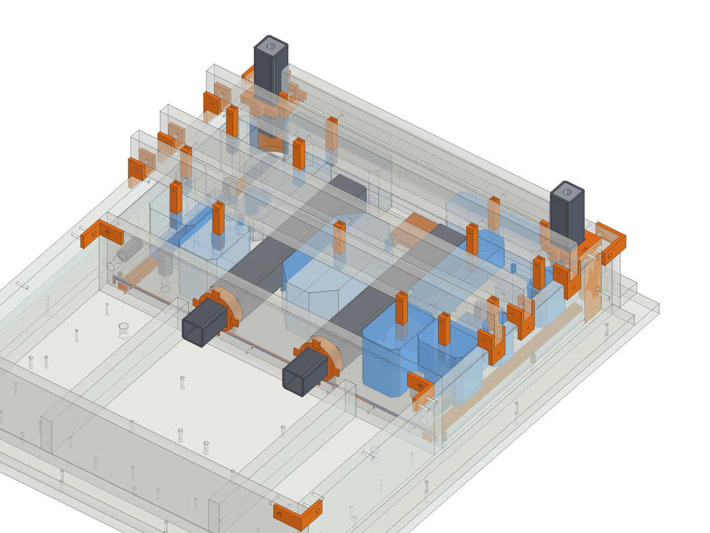

# Print guide

Every printed part for the moulds, the castings and the machine, cut to fit a Bambu A1 mini
(180 mm cube; no piece is over 170 mm). The STL files are in `print/`, one folder per
casting, with the list in `print/manifest.csv`. They are written by `model/build_cnc.py` on every run.
How the moulds go together is in the mould guide.

**About 186 prints, roughly 4.6 kg of PETG.** The filament figures are rough estimates.

## Settings

- **PETG for everything.** Thick sections of curing epoxy get warm, and PLA softens at about 55 °C.
- 0.4 mm nozzle, 0.2 mm layers. Every file is already turned the way it prints best, without supports.
- **Cores** (`core-*`): thin shells, 1.6 mm walls, so they print solid with any infill setting.
- **Fillers, formers, plugs** (`filler-*`, `former-*`, `plug-*`): 3 walls, 15 % infill.
- **Mould kit** (`kit-*`: brackets, saddles, holders, bushings): 4 walls, 25 % infill. Print one,
  check it over a 19 mm offcut of your board, then the rest.
- **Liners and cast-in parts** (`liner-*`, `cast-in-*`): 4 walls, 40 % infill.
- **Fits.** Slip fits are 0.15 mm a side, nut pockets 0.15 mm over the nut, pins 3.0 mm into a 1/8 in
  hole. If your printer runs tight, print a bracket and a former first and adjust the
  horizontal expansion (XY compensation) rather than the files.

## Joining the pieces

- **Nuts.** Every piece that bolts to a board has its nut built in. On cast faces the nut drops into a
  pocket in the face against the board and slides sideways under the bolt hole; on brackets it
  presses into a hex pocket. Fit the nuts before the piece goes on the board.
- **Parts cut to fit the bed** (`-partNofM`) have a peg on one cut face and a socket on the other:
  push them together, no glue. Each part has its own bolts or pins to the board.
- **Cores** cut in two have a bulkhead on each side of the cut with two M3 x 10 bolts through them.
- **Pins.** Thin formers (gasket-groove beads, the shallow end of a gutter) have 3 mm pins that push into
  1/8 in holes. Nothing else holds them; the casting presses them onto the board.
- **Removable pieces** (formers, fillers, plugs, kit): 3-5 coats of paste wax and PVA like the boards.
  **Pieces that stay in** (cores, liners, cast-in parts): no wax; scuff and degrease them so the
  epoxy grips. Fill the cores with dry sand before the bridge goes on.

## Foam cores instead of printed ones

The pocket cores are about 2.0 kg of the PETG. The rectangular ones are quick to cut from XPS foam board on a table saw or with a hot wire;
wrap them in packing tape and wax them. The corners are chamfered 8-10 mm (30 mm on the rear
centre core). A foam core needs its own post to the bridge: glue a printed `core` post cut off
a misprint, or a strip of plywood, into it. Sizes (outline x depth from the underside):

| Casting | Core | Outline (mm) | Depth (mm) |
|---|---|---|---|
| base-front | centre | 100 x 185 | 90 |
| base-rear | centre | 100 x 190 | 90 |
| base-front | outboard-L | 130 x 164 | 90 |
| base-front | trough-band-L | 101 x 55 | 40 |
| base-front | draw-rod-L | 37 x 255 | 40 |
| base-front | foot-a-L | 68 x 66 | 90 |
| base-rear | foot-b-L | 68 x 99 | 90 |
| base-rear | foot-c-L | 80 x 62 | 90 |
| base-rear | knee-L | 50 x 184 | 40 |
| base-rear | outer-a-L | 35 x 44 | 65 |
| base-rear | outer-b-L | 35 x 60 | 65 |
| base-rear | rear-L | 170 x 52 | 90 |
| base-front | outboard-R | 130 x 164 | 90 |
| base-front | trough-band-R | 101 x 55 | 40 |
| base-front | draw-rod-R | 37 x 255 | 40 |
| base-front | foot-a-R | 68 x 66 | 90 |
| base-rear | foot-b-R | 68 x 99 | 90 |
| base-rear | foot-c-R | 80 x 62 | 90 |
| base-rear | knee-R | 50 x 184 | 40 |
| base-rear | outer-a-R | 35 x 44 | 65 |
| base-rear | outer-b-R | 35 x 60 | 65 |
| base-rear | rear-R | 170 x 52 | 90 |

## Base mould kit (both halves)

Folder `print/base-box/`, about 425 g.

| File | What | Qty | Size (mm) | Notes |
|---|---|---|---|---|
| `kit-corner-bracket.stl` | Mould kit (reused) | 4 | 50 x 50 x 23 |  |
| `kit-floor-bracket.stl` | Mould kit (reused) | 10 | 24 x 32 x 25 |  |
| `kit-partition-bracket.stl` | Mould kit (reused) | 2 | 44 x 44 x 23 |  |
| `kit-saddle.stl` | Mould kit (reused) | 2 | 53 x 31 x 25 | The rear half needs six; four move over for the front half. |
| `kit-leg-holder.stl` | Mould kit (reused) | 4 | 72 x 72 x 51 |  |
| `kit-leg-hanger.stl` | Mould kit (reused) | 4 | 43 x 43 x 145 | Drops over the leg end and rests on the holder: the leg hangs at its cast-in depth. |

## Base, rear half (cast first)

Folder `print/base-rear/`, about 1651 g.

| File | What | Qty | Size (mm) | Notes |
|---|---|---|---|---|
| `former-gutter-L-part1of3.stl` | Former (removable) | 1 | 15 x 124 x 12 | Bolts to the floor from underneath (the base is cast top face down). |
| `former-gutter-L-part2of3.stl` | Former (removable) | 1 | 15 x 124 x 10 |  |
| `former-gutter-L-part3of3.stl` | Former (removable) | 1 | 15 x 120 x 9 |  |
| `former-gutter-R-part1of3.stl` | Former (removable) | 1 | 15 x 124 x 12 | Bolts to the floor from underneath (the base is cast top face down). |
| `former-gutter-R-part2of3.stl` | Former (removable) | 1 | 15 x 124 x 10 |  |
| `former-gutter-R-part3of3.stl` | Former (removable) | 1 | 15 x 120 x 9 |  |
| `former-motor-relief.stl` | Former (removable) | 1 | 72 x 60 x 14 | Bolts to the floor from underneath (the base is cast top face down). |
| `filler-corner-L.stl` | Filler (removable) | 1 | 40 x 40 x 110 | Rounded corner; bolts to the floor and both walls. |
| `filler-corner-R.stl` | Filler (removable) | 1 | 40 x 40 x 110 | Rounded corner; bolts to the floor and both walls. |
| `former-split-gasket-groove-part1of4.stl` | Former (removable) | 1 | 145 x 14 x 8 | Pins into the partition. |
| `former-split-gasket-groove-part2of4.stl` | Former (removable) | 1 | 145 x 4 x 8 |  |
| `former-split-gasket-groove-part3of4.stl` | Former (removable) | 1 | 145 x 4 x 8 |  |
| `former-split-gasket-groove-part4of4.stl` | Former (removable) | 1 | 145 x 14 x 8 |  |
| `core-centre-part1of2.stl` | Pocket core (shell, stays in) | 1 | 100 x 86 x 90 | Shell core, stays in. Bolts to the bridge by its post. |
| `core-centre-part2of2.stl` | Pocket core (shell, stays in) | 1 | 100 x 104 x 141 |  |
| `core-foot-b-L.stl` | Pocket core (shell, stays in) | 1 | 68 x 99 x 141 | Shell core, stays in. Bolts to the bridge by its post. |
| `core-foot-c-L.stl` | Pocket core (shell, stays in) | 1 | 80 x 62 x 141 | Shell core, stays in. Bolts to the bridge by its post. |
| `core-knee-L-part1of2.stl` | Pocket core (shell, stays in) | 1 | 50 x 92 x 40 | Shell core, stays in. Bolts to the bridge by its post. |
| `core-knee-L-part2of2.stl` | Pocket core (shell, stays in) | 1 | 50 x 92 x 91 |  |
| `core-outer-a-L.stl` | Pocket core (shell, stays in) | 1 | 35 x 44 x 116 | Shell core, stays in. Bolts to the bridge by its post. |
| `core-outer-b-L.stl` | Pocket core (shell, stays in) | 1 | 35 x 60 x 116 | Shell core, stays in. Bolts to the bridge by its post. |
| `core-rear-L.stl` | Pocket core (shell, stays in) | 1 | 170 x 52 x 141 | Shell core, stays in. Bolts to the bridge by its post. |
| `core-foot-b-R.stl` | Pocket core (shell, stays in) | 1 | 68 x 99 x 141 | Shell core, stays in. Bolts to the bridge by its post. |
| `core-foot-c-R.stl` | Pocket core (shell, stays in) | 1 | 80 x 62 x 141 | Shell core, stays in. Bolts to the bridge by its post. |
| `core-knee-R-part1of2.stl` | Pocket core (shell, stays in) | 1 | 50 x 92 x 40 | Shell core, stays in. Bolts to the bridge by its post. |
| `core-knee-R-part2of2.stl` | Pocket core (shell, stays in) | 1 | 50 x 92 x 91 |  |
| `core-outer-a-R.stl` | Pocket core (shell, stays in) | 1 | 35 x 44 x 116 | Shell core, stays in. Bolts to the bridge by its post. |
| `core-outer-b-R.stl` | Pocket core (shell, stays in) | 1 | 35 x 60 x 116 | Shell core, stays in. Bolts to the bridge by its post. |
| `core-rear-R.stl` | Pocket core (shell, stays in) | 1 | 170 x 52 x 141 | Shell core, stays in. Bolts to the bridge by its post. |
| `plug-socket-plug.stl` | Plug (removable) | 4 | 41 x 41 x 15 | Fills the open end of a socket liner; bolts to the floor. |
| `kit-spigot-bushing.stl` | Mould kit (reused) | 2 | 79 x 79 x 22 | Push fit in a 2-1/2 in hole-saw hole; flange on the far side. |
| `cast-in-base-rear-tube-plug-l.stl` | Cast-in part (stays in) | 2 | 42 x 10 x 42 | Cast in, stays. |
| `cast-in-base-rear-spigot-sleeve-l.stl` | Cast-in part (stays in) | 2 | 44 x 69 x 44 | Cast in, stays. |
| `cast-in-leg-rear-l-plug.stl` | Cast-in part (stays in) | 2 | 30 x 30 x 10 | Cast in, stays. |
| `cast-in-socket-liner-l1.stl` | Cast-in part (stays in) | 4 | 47 x 47 x 80 | Cast in, stays. |

## Base, front half

Folder `print/base-front/`, about 1353 g.

| File | What | Qty | Size (mm) | Notes |
|---|---|---|---|---|
| `former-gutter-L-part1of2.stl` | Former (removable) | 1 | 15 x 149 x 15 | Bolts to the floor from underneath (the base is cast top face down). |
| `former-gutter-L-part2of2.stl` | Former (removable) | 1 | 15 x 145 x 13 |  |
| `former-gutter-R-part1of2.stl` | Former (removable) | 1 | 15 x 149 x 15 | Bolts to the floor from underneath (the base is cast top face down). |
| `former-gutter-R-part2of2.stl` | Former (removable) | 1 | 15 x 145 x 13 |  |
| `former-trough-part1of5.stl` | Former (removable) | 1 | 116 x 35 x 19 | Bolts to the floor from underneath (the base is cast top face down). |
| `former-trough-part2of5.stl` | Former (removable) | 1 | 116 x 35 x 23 |  |
| `former-trough-part3of5.stl` | Former (removable) | 1 | 116 x 35 x 33 |  |
| `former-trough-part4of5.stl` | Former (removable) | 1 | 116 x 35 x 24 |  |
| `former-trough-part5of5.stl` | Former (removable) | 1 | 112 x 35 x 21 |  |
| `filler-corner-L.stl` | Filler (removable) | 1 | 40 x 40 x 110 | Rounded corner, and the plug that forms the draw-rod nut pocket; bolts to the floor and both walls. |
| `filler-corner-R.stl` | Filler (removable) | 1 | 40 x 40 x 110 | Rounded corner, and the plug that forms the draw-rod nut pocket; bolts to the floor and both walls. |
| `core-centre-part1of2.stl` | Pocket core (shell, stays in) | 1 | 100 x 92 x 141 | Shell core, stays in. Bolts to the bridge by its post. |
| `core-centre-part2of2.stl` | Pocket core (shell, stays in) | 1 | 100 x 93 x 90 |  |
| `core-outboard-L.stl` | Pocket core (shell, stays in) | 1 | 130 x 164 x 141 | Shell core, stays in. Bolts to the bridge by its post. |
| `core-trough-band-L.stl` | Pocket core (shell, stays in) | 1 | 101 x 55 x 91 | Shell core, stays in. Bolts to the bridge by its post. |
| `core-draw-rod-L-part1of2.stl` | Pocket core (shell, stays in) | 1 | 36 x 128 x 91 | Shell core, stays in. Bolts to the bridge by its post. |
| `core-draw-rod-L-part2of2.stl` | Pocket core (shell, stays in) | 1 | 37 x 128 x 40 |  |
| `core-foot-a-L.stl` | Pocket core (shell, stays in) | 1 | 68 x 66 x 141 | Shell core, stays in. Bolts to the bridge by its post. |
| `core-outboard-R.stl` | Pocket core (shell, stays in) | 1 | 130 x 164 x 141 | Shell core, stays in. Bolts to the bridge by its post. |
| `core-trough-band-R.stl` | Pocket core (shell, stays in) | 1 | 101 x 55 x 91 | Shell core, stays in. Bolts to the bridge by its post. |
| `core-draw-rod-R-part1of2.stl` | Pocket core (shell, stays in) | 1 | 36 x 128 x 91 | Shell core, stays in. Bolts to the bridge by its post. |
| `core-draw-rod-R-part2of2.stl` | Pocket core (shell, stays in) | 1 | 37 x 128 x 40 |  |
| `core-foot-a-R.stl` | Pocket core (shell, stays in) | 1 | 68 x 66 x 141 | Shell core, stays in. Bolts to the bridge by its post. |
| `cast-in-base-front-tube-plug-l.stl` | Cast-in part (stays in) | 2 | 42 x 10 x 42 | Cast in, stays. |
| `cast-in-base-front-spigot-sleeve-l.stl` | Cast-in part (stays in) | 2 | 44 x 69 x 44 | Cast in, stays. |
| `cast-in-leg-front-l-plug.stl` | Cast-in part (stays in) | 2 | 30 x 30 x 10 | Cast in, stays. |

## Uprights (two moulds: print quantities are for both)

Folder `print/upright/`, about 654 g.

| File | What | Qty | Size (mm) | Notes |
|---|---|---|---|---|
| `kit-back-bracket.stl` | Mould kit (reused) | 4 | 33 x 33 x 23 |  |
| `kit-front-bracket.stl` | Mould kit (reused) | 8 | 50 x 50 x 22 | Two at the top of the front board and two at its foot (only the side-plate bolt there). |
| `kit-floor-bracket.stl` | Mould kit (reused) | 10 | 32 x 24 x 25 |  |
| `kit-saddle-flat.stl` | Mould kit (reused) | 4 | 41 x 121 x 25 | The bridge rests between the cheeks. |
| `filler-toe-filler.stl` | Filler (removable) | 2 | 80 x 60 x 48 | Rounds the nose into the slope; the front board stands on it. Bolts to the floor. |
| `former-foot-gasket-groove-part1of4.stl` | Former (removable) | 2 | 68 x 139 x 8 | Pins into the floor. |
| `former-foot-gasket-groove-part2of4.stl` | Former (removable) | 2 | 4 x 139 x 8 |  |
| `former-foot-gasket-groove-part3of4.stl` | Former (removable) | 2 | 4 x 139 x 8 |  |
| `former-foot-gasket-groove-part4of4.stl` | Former (removable) | 2 | 68 x 139 x 8 |  |
| `plug-slope-pocket--60.stl` | Plug (removable) | 2 | 32 x 32 x 54 | Forms a nut pocket in the slope; bolts to the front board; its rod stops inside it. |
| `plug-slope-pocket-40.stl` | Plug (removable) | 2 | 32 x 32 x 54 | Forms a nut pocket in the slope; bolts to the front board; its rod stops inside it. |
| `plug-tie-rod-pocket.stl` | Plug (removable) | 4 | 32 x 32 x 49 | Forms a top nut pocket: slides down its rod; the bridge holds it down. |
| `kit-plate-spacer.stl` | Mould kit (reused) | 4 | 16 x 16 x 31 | Between the bridge and the top plate, on its greased 3/8 bolt. |
| `kit-post-bushing.stl` | Mould kit (reused) | 4 | 79 x 79 x 22 | Push fit in a 2-1/2 in hole-saw hole in the floor, flange underneath. |
| `cast-in-post-l1-plug.stl` | Cast-in part (stays in) | 4 | 30 x 30 x 10 | Cast in, stays. |

## Beam

Folder `print/beam/`, about 297 g.

| File | What | Qty | Size (mm) | Notes |
|---|---|---|---|---|
| `kit-corner-bracket.stl` | Mould kit (reused) | 4 | 50 x 50 x 23 |  |
| `kit-floor-bracket.stl` | Mould kit (reused) | 6 | 24 x 32 x 25 |  |
| `filler-back-edge-1-part1of4.stl` | Filler (removable) | 1 | 136 x 40 x 40 | Rounded back edge; bolts to the top wall. |
| `filler-back-edge-1-part2of4.stl` | Filler (removable) | 1 | 136 x 40 x 40 |  |
| `filler-back-edge-1-part3of4.stl` | Filler (removable) | 1 | 136 x 40 x 40 |  |
| `filler-back-edge-1-part4of4.stl` | Filler (removable) | 1 | 132 x 40 x 40 |  |
| `kit-tube-locator.stl` | Mould kit (reused) | 4 | 44 x 44 x 51 | Square end into the tube, stem to the end wall, M4 x 70 through the wall into a nut slid in from inside the tube. Leaves a 16 mm hole in each beam end. |
| `kit-dowel-stop.stl` | Mould kit (reused) | 2 | 18 x 18 x 11 | Pushes into the dowel hole from outside so the dowel stands 10 mm proud. |

## Machine parts

Folder `print/machine/`, about 200 g.

| File | What | Qty | Size (mm) | Notes |
|---|---|---|---|---|
| `part-pocket-cap-l3.stl` | Machine part | 4 | 32 x 32 x 42 |  |
| `part-chain-mount-fixed.stl` | Machine part | 1 | 25 x 38 x 21 |  |
| `part-chain-mount-moving.stl` | Machine part | 1 | 37 x 123 x 45 |  |
| `part-sump-baffle-part1of2.stl` | Machine part | 1 | 148 x 4 x 73 |  |
| `part-sump-baffle-part2of2.stl` | Machine part | 1 | 148 x 4 x 73 |  |
| `part-sump-filter-frame-part1of2.stl` | Machine part | 1 | 148 x 6 x 92 |  |
| `part-sump-filter-frame-part2of2.stl` | Machine part | 1 | 148 x 6 x 92 |  |
