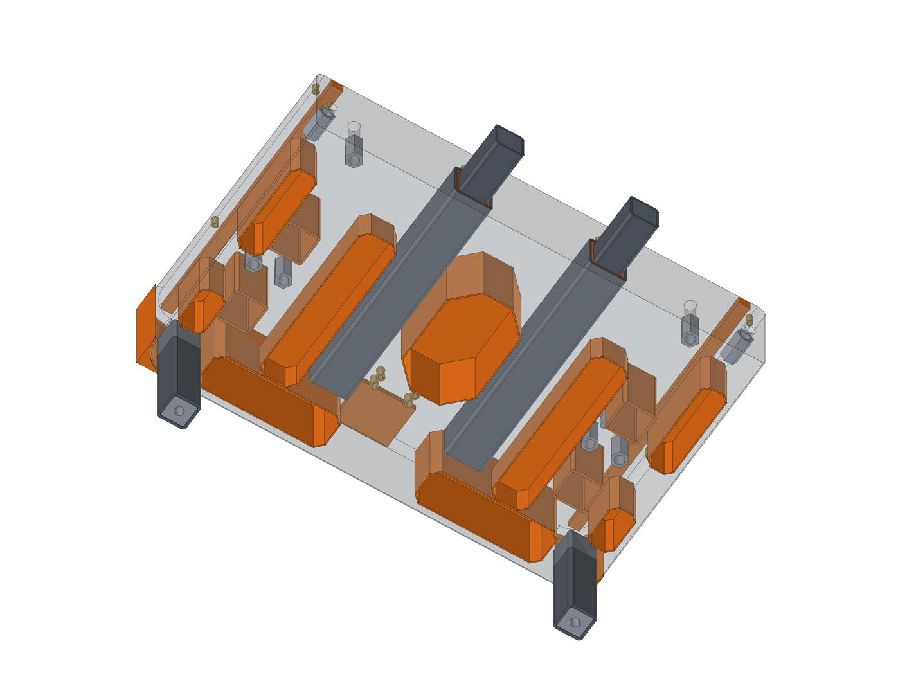

# Print guide

Every printed part for the castings and the machine, cut to fit a Bambu A1 mini
(180 mm cube; no piece is over 170 mm). The STL files are in `print/`, one folder per
casting, with the list in `print/manifest.csv`. They are written by `model/build_cnc.py` on every run.

**About 98 prints, roughly 3.6 kg of PETG.** The filament figures are rough estimates.

## Settings

- **PETG for everything.** Thick sections of curing epoxy get warm, and PLA softens at about 55 °C.
- 0.4 mm nozzle, 0.2 mm layers.
- **Cores** (`core-*`): thin shells, 1.6 mm walls, so they print solid with any infill setting. They are already turned with the closed face on the bed.
- **Fillers, formers, plugs** (`filler-*`, `former-*`, `plug-*`): 3 walls, 15 % infill.
- **Liners and cast-in parts** (`liner-*`, `cast-in-*`): 4 walls, 40 % infill.
- Anything named `-partNofM` was cut to fit the bed. Glue the parts edge to edge with CA or epoxy
  and tape over the seam. Check the joined piece against the drawing before casting.

## How the pieces are used

- The mould boxes are 18 mm melamine board, not printed: the flat board is what the important
  faces are cast against. Box sizes (inside) and casting orientation are in the table below.
- **Removable pieces** (formers, fillers, plugs): screw or hot-glue them to the board, then 3-5 coats
  of paste wax and PVA like the rest of the mould. Reuse the fillers for the second upright.
- **Pieces that stay in** (cores, liners, cast-in parts): no wax; scuff and degrease them so the
  epoxy grips. Cores float: fill them with dry sand and hold them down with a bridge across the mould.

| Casting | Mould box inside (mm) | Cast with |
|---|---|---|
| Base, front half | 600 x 345 x 110 | top face down |
| Base, rear half | 600 x 380 x 110 | top face down |
| Uprights (both the same: print quantities are for two) | 80 x 285 x 246 | foot down |
| Beam | 530 x 140 x 140 | front (rail) face down |

## Foam cores instead of printed ones

The pocket cores are about 1.5 kg of the PETG. The rectangular ones are quick to cut from XPS foam board on a table saw or with a hot wire;
wrap them in packing tape and wax them. The corners are chamfered 8-10 mm (30 mm on the rear
centre core), and the triangles are right triangles. Glue foam cores to the bridge so they
cannot float. Sizes (outline x depth from the underside):

| Casting | Core | Outline (mm) | Depth (mm) |
|---|---|---|---|
| base-front | centre | 100 x 260 | 85 |
| base-front | outboard-L | 130 x 260 | 85 |
| base-front | trough-band-L | 101 x 55 | 40 |
| base-front | draw-rod-L | 37 x 255 | 40 |
| base-front | outboard-R | 130 x 260 | 85 |
| base-front | trough-band-R | 101 x 55 | 40 |
| base-front | draw-rod-R | 37 x 255 | 40 |
| base-rear | centre | 100 x 185 | 85 |
| base-rear | triangle-L | 115 x 80 | 85 |
| base-rear | knee-L | 50 x 258 | 40 |
| base-rear | outer-a-L | 35 x 128 | 65 |
| base-rear | outer-b-L | 35 x 60 | 65 |
| base-rear | rear-L | 170 x 52 | 85 |
| base-rear | triangle-R | 115 x 80 | 85 |
| base-rear | knee-R | 50 x 258 | 40 |
| base-rear | outer-a-R | 35 x 128 | 65 |
| base-rear | outer-b-R | 35 x 60 | 65 |
| base-rear | rear-R | 170 x 52 | 85 |

## Base, front half

Folder `print/base-front/`, about 1245 g.

| File | What | Qty | Size (mm) | Notes |
|---|---|---|---|---|
| `core-centre-part1of2.stl` | Pocket core (shell, stays in) | 1 | 100 x 130 x 85 | Shell core, stays in the casting. Fill with dry sand while casting so it cannot float. |
| `core-centre-part2of2.stl` | Pocket core (shell, stays in) | 1 | 100 x 130 x 85 |  |
| `core-outboard-L-part1of2.stl` | Pocket core (shell, stays in) | 1 | 130 x 130 x 85 | Shell core, stays in the casting. Fill with dry sand while casting so it cannot float. |
| `core-outboard-L-part2of2.stl` | Pocket core (shell, stays in) | 1 | 130 x 130 x 85 |  |
| `core-trough-band-L.stl` | Pocket core (shell, stays in) | 1 | 101 x 55 x 40 | Shell core, stays in the casting. Fill with dry sand while casting so it cannot float. |
| `core-draw-rod-L-part1of2.stl` | Pocket core (shell, stays in) | 1 | 37 x 128 x 40 | Shell core, stays in the casting. Fill with dry sand while casting so it cannot float. |
| `core-draw-rod-L-part2of2.stl` | Pocket core (shell, stays in) | 1 | 37 x 128 x 40 |  |
| `core-outboard-R-part1of2.stl` | Pocket core (shell, stays in) | 1 | 130 x 130 x 85 | Shell core, stays in the casting. Fill with dry sand while casting so it cannot float. |
| `core-outboard-R-part2of2.stl` | Pocket core (shell, stays in) | 1 | 130 x 130 x 85 |  |
| `core-trough-band-R.stl` | Pocket core (shell, stays in) | 1 | 101 x 55 x 40 | Shell core, stays in the casting. Fill with dry sand while casting so it cannot float. |
| `core-draw-rod-R-part1of2.stl` | Pocket core (shell, stays in) | 1 | 37 x 128 x 40 | Shell core, stays in the casting. Fill with dry sand while casting so it cannot float. |
| `core-draw-rod-R-part2of2.stl` | Pocket core (shell, stays in) | 1 | 37 x 128 x 40 |  |
| `former-gutter-L-part1of2.stl` | Former (removable) | 1 | 15 x 162 x 15 | Stick to the mould floor (the base is cast top-down), wax. |
| `former-gutter-L-part2of2.stl` | Former (removable) | 1 | 15 x 162 x 13 |  |
| `former-gutter-R-part1of2.stl` | Former (removable) | 1 | 15 x 162 x 15 | Stick to the mould floor (the base is cast top-down), wax. |
| `former-gutter-R-part2of2.stl` | Former (removable) | 1 | 15 x 162 x 13 |  |
| `former-trough-part1of4.stl` | Former (removable) | 1 | 140 x 35 x 20 | Stick to the mould floor (the base is cast top-down), wax. |
| `former-trough-part2of4.stl` | Former (removable) | 1 | 140 x 35 x 25 |  |
| `former-trough-part3of4.stl` | Former (removable) | 1 | 140 x 35 x 25 |  |
| `former-trough-part4of4.stl` | Former (removable) | 1 | 140 x 35 x 22 |  |
| `filler-corner-1.stl` | Corner filler (removable) | 1 | 40 x 40 x 110 | Rounded corner of the mould box; wax. |
| `filler-corner-2.stl` | Corner filler (removable) | 1 | 40 x 40 x 110 | Rounded corner of the mould box; wax. |
| `liner-drain.stl` | Liner (stays in) | 1 | 14 x 14 x 73 | Drain liner; sits on the nipple and stays in. |
| `former-split-gasket-groove-part1of4.stl` | Former (removable) | 1 | 145 x 2 x 14 | Stick to the split-face mould wall, wax. |
| `former-split-gasket-groove-part2of4.stl` | Former (removable) | 1 | 145 x 2 x 4 |  |
| `former-split-gasket-groove-part3of4.stl` | Former (removable) | 1 | 145 x 2 x 4 |  |
| `former-split-gasket-groove-part4of4.stl` | Former (removable) | 1 | 145 x 2 x 14 |  |
| `cast-in-base-front-tube-plug-l.stl` | Cast-in part (stays in) | 2 | 42 x 10 x 42 | Cast in, stays. |
| `cast-in-base-front-spigot-sleeve-l.stl` | Cast-in part (stays in) | 2 | 44 x 69 x 44 | Cast in, stays. |
| `cast-in-leg-front-l-plug.stl` | Cast-in part (stays in) | 2 | 30 x 30 x 10 | Cast in, stays. |

## Base, rear half

Folder `print/base-rear/`, about 1222 g.

| File | What | Qty | Size (mm) | Notes |
|---|---|---|---|---|
| `core-centre-part1of2.stl` | Pocket core (shell, stays in) | 1 | 100 x 92 x 85 | Shell core, stays in the casting. Fill with dry sand while casting so it cannot float. |
| `core-centre-part2of2.stl` | Pocket core (shell, stays in) | 1 | 100 x 92 x 85 |  |
| `core-triangle-L.stl` | Pocket core (shell, stays in) | 1 | 115 x 80 x 85 | Shell core, stays in the casting. Fill with dry sand while casting so it cannot float. |
| `core-knee-L-part1of2.stl` | Pocket core (shell, stays in) | 1 | 50 x 129 x 40 | Shell core, stays in the casting. Fill with dry sand while casting so it cannot float. |
| `core-knee-L-part2of2.stl` | Pocket core (shell, stays in) | 1 | 50 x 129 x 40 |  |
| `core-outer-a-L.stl` | Pocket core (shell, stays in) | 1 | 35 x 128 x 65 | Shell core, stays in the casting. Fill with dry sand while casting so it cannot float. |
| `core-outer-b-L.stl` | Pocket core (shell, stays in) | 1 | 35 x 60 x 65 | Shell core, stays in the casting. Fill with dry sand while casting so it cannot float. |
| `core-rear-L.stl` | Pocket core (shell, stays in) | 1 | 170 x 52 x 85 | Shell core, stays in the casting. Fill with dry sand while casting so it cannot float. |
| `core-triangle-R.stl` | Pocket core (shell, stays in) | 1 | 115 x 80 x 85 | Shell core, stays in the casting. Fill with dry sand while casting so it cannot float. |
| `core-knee-R-part1of2.stl` | Pocket core (shell, stays in) | 1 | 50 x 129 x 40 | Shell core, stays in the casting. Fill with dry sand while casting so it cannot float. |
| `core-knee-R-part2of2.stl` | Pocket core (shell, stays in) | 1 | 50 x 129 x 40 |  |
| `core-outer-a-R.stl` | Pocket core (shell, stays in) | 1 | 35 x 128 x 65 | Shell core, stays in the casting. Fill with dry sand while casting so it cannot float. |
| `core-outer-b-R.stl` | Pocket core (shell, stays in) | 1 | 35 x 60 x 65 | Shell core, stays in the casting. Fill with dry sand while casting so it cannot float. |
| `core-rear-R.stl` | Pocket core (shell, stays in) | 1 | 170 x 52 x 85 | Shell core, stays in the casting. Fill with dry sand while casting so it cannot float. |
| `former-gutter-L-part1of3.stl` | Former (removable) | 1 | 15 x 120 x 12 | Stick to the mould floor (the base is cast top-down), wax. |
| `former-gutter-L-part2of3.stl` | Former (removable) | 1 | 15 x 120 x 10 |  |
| `former-gutter-L-part3of3.stl` | Former (removable) | 1 | 15 x 120 x 9 |  |
| `former-gutter-R-part1of3.stl` | Former (removable) | 1 | 15 x 120 x 12 | Stick to the mould floor (the base is cast top-down), wax. |
| `former-gutter-R-part2of3.stl` | Former (removable) | 1 | 15 x 120 x 10 |  |
| `former-gutter-R-part3of3.stl` | Former (removable) | 1 | 15 x 120 x 9 |  |
| `former-motor-relief.stl` | Former (removable) | 1 | 72 x 60 x 8 | Stick to the mould floor (the base is cast top-down), wax. |
| `filler-corner-1.stl` | Corner filler (removable) | 1 | 40 x 40 x 110 | Rounded corner of the mould box; wax. |
| `filler-corner-2.stl` | Corner filler (removable) | 1 | 40 x 40 x 110 | Rounded corner of the mould box; wax. |
| `cast-in-base-rear-tube-plug-l.stl` | Cast-in part (stays in) | 2 | 42 x 10 x 42 | Cast in, stays. |
| `cast-in-base-rear-spigot-sleeve-l.stl` | Cast-in part (stays in) | 2 | 44 x 69 x 44 | Cast in, stays. |
| `cast-in-leg-rear-l-plug.stl` | Cast-in part (stays in) | 2 | 30 x 30 x 10 | Cast in, stays. |
| `cast-in-socket-liner-l1.stl` | Cast-in part (stays in) | 4 | 44 x 44 x 80 | Cast in, stays. |

## Uprights (both the same: print quantities are for two)

Folder `print/upright/`, about 592 g.

| File | What | Qty | Size (mm) | Notes |
|---|---|---|---|---|
| `filler-front-flare.stl` | Corner filler (removable) | 2 | 80 x 70 x 70 | Forms the curved flare at the front of the foot; wax. Above it, fill the box corner with a 70 x 168 x 80 mm wood block. |
| `filler-back-slope-part1of2.stl` | Corner filler (removable) | 2 | 80 x 18 x 123 | Forms the sloped back. Optional: a melamine board set at the same angle does the same job. |
| `filler-back-slope-part2of2.stl` | Corner filler (removable) | 2 | 80 x 35 x 123 |  |
| `former-foot-gasket-groove-part1of2.stl` | Former (removable) | 2 | 68 x 136 x 2 | Stick to the mould floor (the upright is cast foot-down), wax. |
| `former-foot-gasket-groove-part2of2.stl` | Former (removable) | 2 | 68 x 136 x 2 |  |
| `plug-tie-rod-pocket.stl` | Pocket plug (removable) | 4 | 32 x 32 x 18 | Forms the nut pocket; slides down the greased tie-rod core rod. Wax; pull after curing. |
| `cast-in-post-l1-plug.stl` | Cast-in part (stays in) | 4 | 30 x 30 x 10 | Cast in, stays. |

## Beam

Folder `print/beam/`, about 308 g.

| File | What | Qty | Size (mm) | Notes |
|---|---|---|---|---|
| `filler-back-edge-1-part1of4.stl` | Corner filler (removable) | 1 | 132 x 40 x 40 | Rounded back edge of the beam mould; wax. |
| `filler-back-edge-1-part2of4.stl` | Corner filler (removable) | 1 | 132 x 40 x 40 |  |
| `filler-back-edge-1-part3of4.stl` | Corner filler (removable) | 1 | 132 x 40 x 40 |  |
| `filler-back-edge-1-part4of4.stl` | Corner filler (removable) | 1 | 132 x 40 x 40 |  |
| `filler-back-edge-2-part1of4.stl` | Corner filler (removable) | 1 | 132 x 40 x 40 | Rounded back edge of the beam mould; wax. |
| `filler-back-edge-2-part2of4.stl` | Corner filler (removable) | 1 | 132 x 40 x 40 |  |
| `filler-back-edge-2-part3of4.stl` | Corner filler (removable) | 1 | 132 x 40 x 40 |  |
| `filler-back-edge-2-part4of4.stl` | Corner filler (removable) | 1 | 132 x 40 x 40 |  |

## Machine parts

Folder `print/machine/`, about 184 g.

| File | What | Qty | Size (mm) | Notes |
|---|---|---|---|---|
| `part-chain-mount-fixed.stl` | Machine part | 1 | 25 x 38 x 21 |  |
| `part-chain-mount-moving.stl` | Machine part | 1 | 37 x 123 x 45 |  |
| `part-sump-baffle-part1of2.stl` | Machine part | 1 | 148 x 4 x 73 |  |
| `part-sump-baffle-part2of2.stl` | Machine part | 1 | 148 x 4 x 73 |  |
| `part-sump-filter-frame-part1of2.stl` | Machine part | 1 | 148 x 6 x 92 |  |
| `part-sump-filter-frame-part2of2.stl` | Machine part | 1 | 148 x 6 x 92 |  |
