# Upright molds

How to make the upright molds. Drilling templates: `templates/upright-templates.pdf`. The sheet layout for the boards is
`docs/src/boards/sheet-1.svg`; `docs/src/make_pdfs.py` also makes `molds-complete.pdf`, all the molds in one
(not kept in the repo).

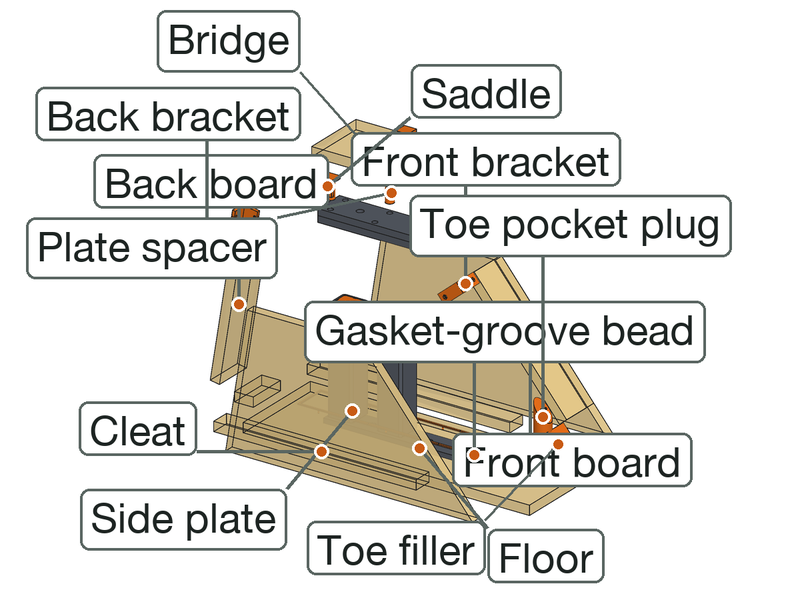

**In short:** melamine boards bolt together with printed brackets. Every printed piece bolts or pins to
its board from outside. The walls stand 25 mm above the pour line, so no bolt goes through a face the
mix touches. Nothing is glued, and it all comes apart for the next casting.

**Order of work:** print &rarr; cut the boards &rarr; mark them with the templates and drill &rarr; wax &rarr; assemble &rarr; pour &rarr; take apart.

## 1. How it works

- **Walls** stand on the floor against bolted-down **cleats**; **corner brackets** square the tops. All the
  bolts go through the top 25 mm, above the pour line.

- **Printed pieces** have a nut built in: it goes into a pocket on the board side and slides under the
  hole; an M4 bolt comes through the board from outside.

- **Thin pieces** (gasket-groove beads) have 3 mm pins that push into 1/8 in holes.

- **Long pieces** are printed in parts that peg together; each part bolts down on its own.

- **Fits** are 0.15 mm a side, and drawn for 19.05 mm board (Home Depot's 3/4 in melamine is a true
  0.750 in). Measure yours; if it differs, set `mold_board` in `model/build_cnc.py` and re-run it.

## 2. What you need

| Material | Amount | Notes |
|---|---|---|
| Melamine board, 3/4 in | about 0.4 m2 | all the molds come out of 1 sheet, 4 x 8 ft |
| 1x2 lumber (furring strip is fine) | 1 x 8 ft 1x2 (0.9 m) | the cleats: they lie on the floor outside the walls |
| PETG | 0.26 kg | sliced; everything printed for the machine fits in two 1 kg rolls |
| Paste wax and PVA | 1 each | release |
| 3/8 in quarter-round PVC molding | a few meters | the rounded outside edges |
| 2x4 offcut | 4 blocks per upright mold, about 50 mm | feet |

| Hardware | Qty |
|---|---|
| M4 nut | 20 |
| M4 washer | 20 |
| M4 x 30 bolt | 11 |
| M4 x 35 bolt | 2 |
| M4 x 45 bolt | 7 |
| 1/2-13 x 1-1/2 in bolt + nut, greased (forms a dowel hole) | 2 |
| 3/8-16 x 3 in bolt, greased (holds the top plate, both layers) | 2 |
| the two column tie rods themselves, greased: up through the floor and the columns into the top plate, to center the columns while the casting goes off | 2 |

Add about 10 % spare small bolts, nuts and washers. **Tools:** drill and brad-point bits (sizes in section 5), a 2-1/2 in hole saw, a jigsaw for the side plates' slope, a square, clamps, a 7 mm nut driver, a 3 mm hex key, an awl.

## 3. Print

32 prints, 0.26 kg, about 19 hours (sliced; settings in the print guide). Print one corner bracket and one saddle first
and check them on a board offcut. Press or slide the nuts in before the pieces go on the boards.

| File | Qty | g | Time each |
|---|---|---|---|
| `upright/kit-back-bracket.stl` | 4 | 21 | 27m 30s |
| `upright/kit-front-bracket.stl` | 4 | 32 | 38m 26s |
| `upright/kit-saddle-flat.stl` | 4 | 18 | 22m 38s |
| `upright/filler-toe-filler.stl` | 1 | 26 | 1h 30m 52s |
| `upright/former-foot-gasket-groove-part1of4.stl` | 1 | 3 | 17m 28s |
| `upright/former-foot-gasket-groove-part2of4.stl` | 1 | 1 | 8m 54s |
| `upright/former-foot-gasket-groove-part3of4.stl` | 1 | 1 | 8m 54s |
| `upright/former-foot-gasket-groove-part4of4.stl` | 1 | 3 | 17m 27s |
| `upright/plug-toe-plug.stl` | 1 | 13 | 1h 3m 44s |
| `upright/kit-plate-spacer.stl` | 2 | 8 | 20m 11s |
| `tools/kit-pour-gauge.stl` | 2 | 9 | 24m 41s |
| `tools/kit-screed-shoe.stl` | 2 | 20 | 47m 40s |
| `upright/cast-in-column-ring-l1a.stl` | 8 | 109 | 49m 49s |

## 4. Cut the boards

Have the store rip the strips; crosscut at home. Write each board's name on its outside face, and mark
the cast face (the melamine face the mix touches). The cleats are cut from 1x2 lumber, not the sheet;
the bridges and struts come out of the sheet's offcuts.

| Board | Qty | Size (mm) | Notes |
|---|---|---|---|
| Upright floor | 1 | 198 x 581 |  |
| Upright side plate, outer | 1 | 501 x 271 (profile) | cut to the profile |
| Upright side plate, inner | 1 | 501 x 271 (profile) | cut to the profile |
| Upright back board | 1 | 80 x 272 | ends cut square |
| Upright front board | 1 | 80 x 292 | ends cut square |
| Upright bridge | 1 | 131 x 138 |  |
| Upright cleat, outer | 1 | 411 x 38 | 1x2 lumber; flat on the floor |
| Upright cleat, inner | 1 | 411 x 38 | 1x2 lumber; flat on the floor |
| Upright cleat, back | 1 | 80 x 38 | 1x2 lumber; flat on the floor |

## 5. Mark and drill

1. Print the drilling templates (`templates/upright-templates.pdf`) at **actual size** and check the 100 mm square.
2. Tape each board's pages onto it: printed edges on the board's edges, grid lines lined up.
3. Awl through every crosshair. Pencil the dashed **pour line** on the walls.
4. Drill from the marked face, at the size the color legend gives. Pilot the big ones; the 63.5 mm
   holes are a 2-1/2 in hole saw.

The appendix has every board as a drawing and a table, if you would rather measure.

| Hole | Drill | For |
|---|---|---|
| 3.2 mm | 1/8 in | foot-gasket-groove |
| 4.5 mm | 11/64 in | cleat, corner bracket, saddle, toe-filler, toe-plug |
| 10 mm | 25/64 in | 3/8-16 bolt into the top plate |
| 13.1 mm | 33/64 in | 1/2-13 bolt, base dowel hole |
| 13.5 mm | 17/32 in | column tie rod, from below |

## 6. Wax

- 3-5 coats of paste wax on every face the mix touches, boards and removable printed pieces, then PVA.
  Don't wax pieces that stay in (core posts, cast-in parts): scuff and degrease them.
- Glue quarter-round into the floor-to-wall corners that make outside edges; silicone fillets elsewhere.
- Grease every screw, bolt and rod that comes out of the casting.

## 7. Assemble

### Uprights (one mold, cast twice)

Cast foot down. The two uprights are the same part: cast one, take the mold apart after the cure, scrape and re-wax it and cast the other. The skeleton: the foot bar, two columns and the top plate (two flat bars), clamped later by the column tie rods.

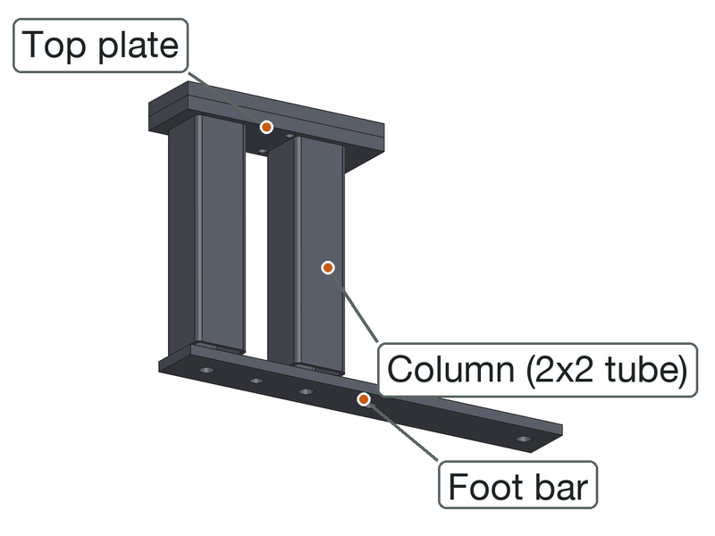

1. Gasket bead pinned on; cleats bolted down.

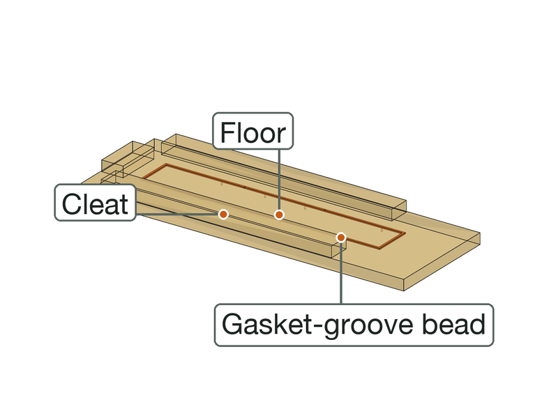

2. Side plates against their cleats, back board between them (it leans in, like the front board), two back brackets.

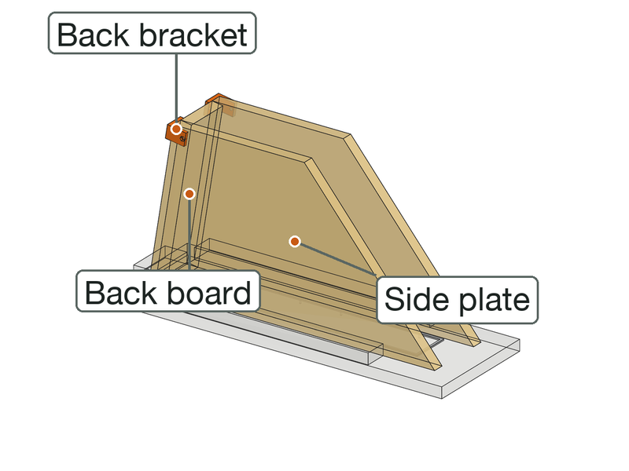

3. Toe filler bolted down, the front board's foot in its lip, two front brackets at the top.

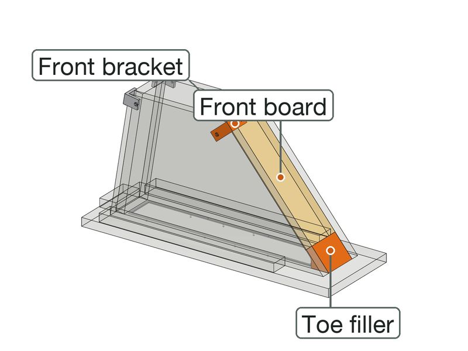

4. Mold on its four 2x4 blocks. The foot bar on the floor; the two columns on beds of thickened epoxy on it, the top plate and bridge set on them while it goes off, then lifted away; the toe pocket plug on the foot bar; the two dowel-hole bolts from underneath.

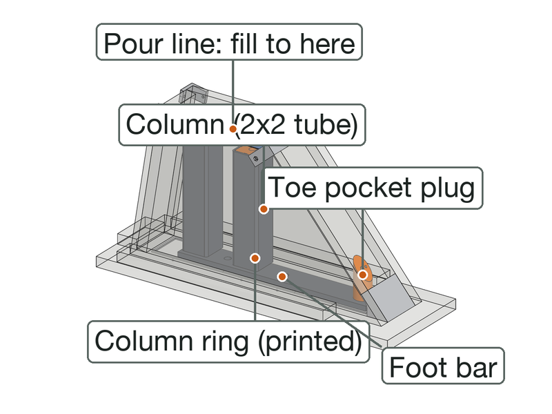

5. Fill to the line. Top plate (both bars) back on, hung from the bridge; bridge onto its saddles. Then the two column tie rods, greased, up from under the floor through the foot bar and the columns into the top plate: they center the columns while it cures.

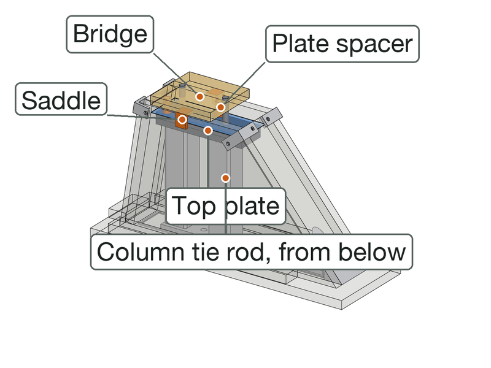

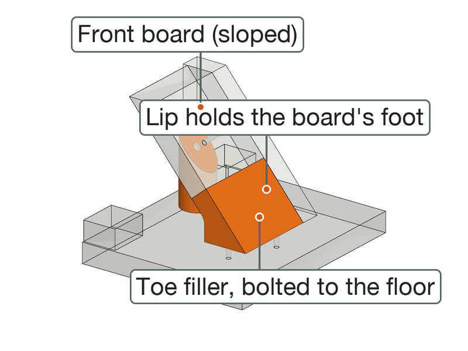

## 8. Pour

- Fill to the **pour line**, 25 mm below the wall tops (pencilled from the templates, or with the
  printed pour-line gauge clipped over a wall).
- Vibrate each layer until it stops bubbling; check the brackets halfway through.
- Strike the top off with a straight board in the two printed **screed shoes**: they hang it from the wall
  tops with its bottom edge on the pour line.

## 9. Take apart

1. After the full cure: bridges and saddles off, then corner brackets, then cleats; pull the walls off.
2. Screws, bolts and rods out from outside; lift the casting off the floor.
3. Unbolt and pull the formers and fillers.
4. Scrape and re-wax the boards; keep each mold's kit in a box. The kit is reused.

## 10. If something doesn't fit

| Problem | Fix |
|---|---|
| Nut won't slide under the hole | Clean the pocket with a nut on a bolt; warm the nut |
| Bracket or saddle loose on the board | Board thinner than set: tape shim, or set `mold_board` and reprint |
| Pin won't go in | Run the 1/8 in bit through again; trim the pin tip |
| Foam core moves | Tighten its post bolt; carpet tape under it |
| Printed part won't go on or into a steel tube | File the weld seam; sand the part. Several tight: caliper the tube, put its sizes in `frame_tube` / `post_tube`, re-run and reprint |
| Printed part loose on a tube | A wrap of tape round the part |
| Leak at a corner | Silicone fillet inside before waxing; check the brackets and diagonals |
| Former stuck after curing | Bolts out first, then a dowel and a light tap |

## Appendix: hole maps

Every board as seen from the face you mark: x from the left edge, y from the bottom edge (for a wall, the
edge on the floor). The templates carry the same holes at full size.

#### Upright floor

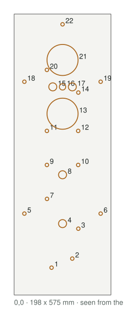

| # | x | y | Hole | For |
|---|---|---|---|---|
| 1 | 121 | 54 | 4.5 | toe-filler |
| 2 | 80 | 72 | 4.5 | toe-filler |
| 3 | 131 | 129 | 3.2 | foot-gasket-groove |
| 4 | 21 | 170 | 4.5 | cleat |
| 5 | 177 | 170 | 4.5 | cleat |
| 6 | 67 | 189 | 3.2 | foot-gasket-groove |
| 7 | 67 | 266 | 3.2 | foot-gasket-groove |
| 8 | 131 | 266 | 3.2 | foot-gasket-groove |
| 9 | 99 | 272 | 13.1 | 1/2-13 bolt, base dowel hole |
| 10 | 21 | 335 | 4.5 | cleat |
| 11 | 67 | 337 | 3.2 | foot-gasket-groove |
| 12 | 99 | 337 | 13.5 | column tie rod, from below |
| 13 | 131 | 337 | 3.2 | foot-gasket-groove |
| 14 | 177 | 335 | 4.5 | cleat |
| 15 | 99 | 387 | 13.1 | 1/2-13 bolt, base dowel hole |
| 16 | 131 | 414 | 3.2 | foot-gasket-groove |
| 17 | 99 | 437 | 13.5 | column tie rod, from below |
| 18 | 67 | 474 | 3.2 | foot-gasket-groove |
| 19 | 21 | 501 | 4.5 | cleat |
| 20 | 177 | 501 | 4.5 | cleat |
| 21 | 99 | 560 | 4.5 | cleat |

#### Upright side plate, outer

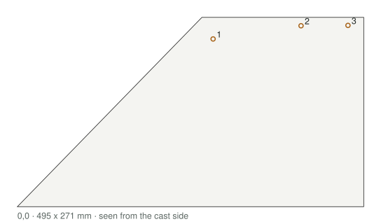

| # | x | y | Hole | For |
|---|---|---|---|---|
| 1 | 246 | 241 | 4.5 | corner bracket |
| 2 | 437 | 256 | 4.5 | corner bracket |
| 3 | 356 | 259 | 4.5 | saddle |

Outline corners (x, y): (0, 0), (501, 0), (457, 271), (228, 271)

#### Upright side plate, inner

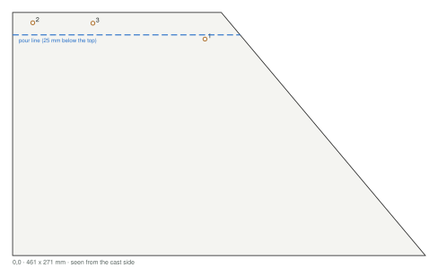

| # | x | y | Hole | For |
|---|---|---|---|---|
| 1 | 255 | 241 | 4.5 | corner bracket |
| 2 | 64 | 256 | 4.5 | corner bracket |
| 3 | 145 | 259 | 4.5 | saddle |

Outline corners (x, y): (501, 0), (0, 0), (44, 271), (273, 271)

#### Upright back board

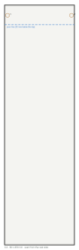

| # | x | y | Hole | For |
|---|---|---|---|---|
| 1 | 3 | 260 | 4.5 | corner bracket |
| 2 | 77 | 260 | 4.5 | corner bracket |

#### Upright front board

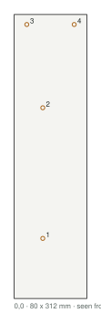

| # | x | y | Hole | For |
|---|---|---|---|---|
| 1 | 32 | 35 | 4.5 | toe-plug |
| 2 | 14 | 281 | 4.5 | corner bracket |
| 3 | 66 | 281 | 4.5 | corner bracket |

#### Upright bridge

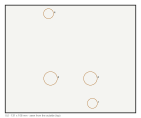

| # | x | y | Hole | For |
|---|---|---|---|---|
| 1 | 87 | 40 | 10 | 3/8-16 bolt into the top plate |
| 2 | 43 | 130 | 10 | 3/8-16 bolt into the top plate |

#### Upright cleat, outer

| # | x | y | Hole | For |
|---|---|---|---|---|
| 1 | 371 | 19 | 4.5 | cleat |
| 2 | 205 | 19 | 4.5 | cleat |
| 3 | 40 | 19 | 4.5 | cleat |

#### Upright cleat, inner

| # | x | y | Hole | For |
|---|---|---|---|---|
| 1 | 371 | 19 | 4.5 | cleat |
| 2 | 205 | 19 | 4.5 | cleat |
| 3 | 40 | 19 | 4.5 | cleat |

#### Upright cleat, back

| # | x | y | Hole | For |
|---|---|---|---|---|
| 1 | 40 | 19 | 4.5 | cleat |
